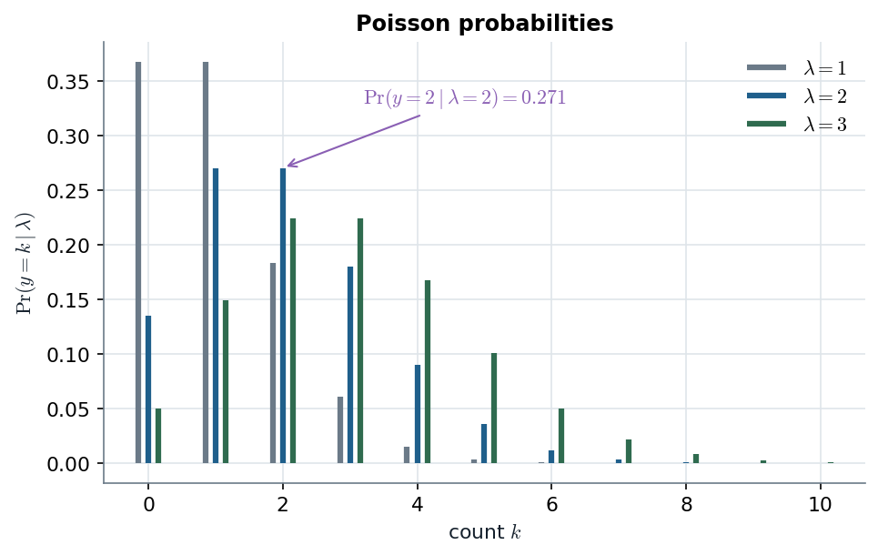
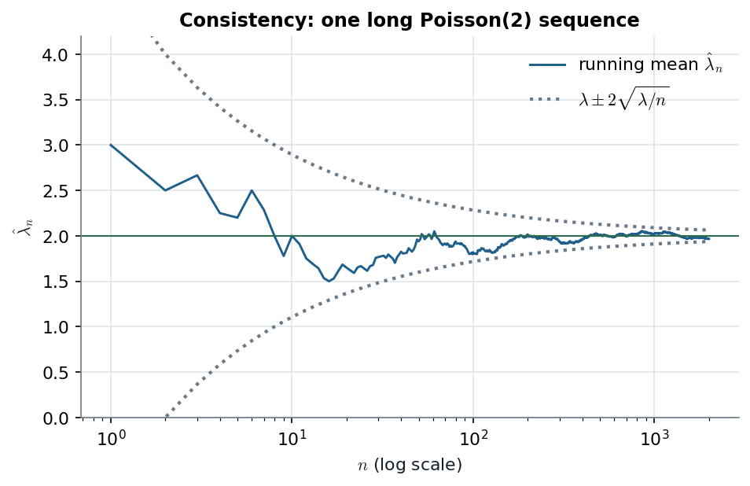

# Poisson MLE · $\hat\lambda=\bar y$ is sufficient-based, unbiased, consistent and efficient

> **Claim.** For iid Poisson counts the likelihood depends on the data only through
> $s_n=\sum y_i$, and its maximiser is the **sample mean**. The sample mean passes all four classical tests:
> **sufficiency** (B Ex. 2.2.3), **unbiasedness**, **consistency** ($V=\lambda/n\to0$) and
> **efficiency** ($V$ equals the Cramér–Rao bound $\lambda/n$). The sample variance $s^2$ is also
> unbiased for $\lambda$, but its variance is $\lambda/n+2\lambda^2/(n-1)$, so it is only
> $1/(1+2\lambda)=\mathbf{20\%}$ efficient at $\lambda=2$. In practice it **needs five times the data**.
> Prev: [[L01-01-likelihood-sampling-rules]] · Next: [[L01-03-coal-mining-change-point]] · Map: [[L01-00-map]]

**Notation.**

| Symbol | Meaning | Range |
|---|---|---|
| $y_i$ | count in period $i$ (coal-mining disasters in year $i$) | $\{0,1,2,\dots\}$ |
| $n$ | number of periods | $1,2,\dots$ |
| $\lambda$ | occurrence rate, $E(y_i)=V(y_i)=\lambda$ | $(0,\infty)$ |
| $s_n=\sum_{i=1}^ny_i$ | total count | $\{0,1,\dots\}$ |
| $\bar y_n=s_n/n$ | sample mean | $[0,\infty)$ |
| $s^2=\frac1{n-1}\sum_i(y_i-\bar y)^2$ | sample variance | $[0,\infty)$ |
| $\ell(\lambda)$, $I(\lambda)$ | log-likelihood; expected Fisher information of the whole sample | — |
| $N$ | Monte Carlo replications | 1000 |

---

## 1 · C — the Poisson model (slide 2; B §1.1.4, pp. 2–3)

$$y_1,\dots,y_n\mid\lambda\ \stackrel{iid}\sim\ \text{Poisson}(\lambda),\qquad \Pr(y_i\mid\lambda)=\frac{\lambda^{y_i}e^{-\lambda}}{y_i!},\quad\lambda>0.\tag{1}$$

**Mean and variance, derived.** Drop the $k=0$ term, cancel $k$ against $k!$, and use
$\sum_{j\ge0}\lambda^j/j!=e^\lambda$:

$$E(y)=\sum_{k\ge1}k\frac{\lambda^ke^{-\lambda}}{k!}=\lambda e^{-\lambda}\sum_{k\ge1}\frac{\lambda^{k-1}}{(k-1)!}=\lambda e^{-\lambda}e^{\lambda}=\lambda.\tag{2}$$

The factorial moment works the same way:

$$E[y(y-1)]=\lambda^2e^{-\lambda}\sum_{k\ge2}\frac{\lambda^{k-2}}{(k-2)!}=\lambda^2.$$

So $E(y^2)=\lambda^2+\lambda$. Substitute into $V(y)=E(y^2)-[E(y)]^2$:

$$V(y)=(\lambda^2+\lambda)-\lambda^2=\lambda.\tag{3}$$

> **Equidispersion, $E=V=\lambda$, is the model's testable fingerprint.** It is what the
> dispersion test of [[L01-03-coal-mining-change-point]] §3 checks, and what fails on the full
> coal series.

## 2 · Worked — the probabilities on slide 3 (class1-poisson.pdf p. 1; class1-poisson.html)

| $k$ | $\lambda=1$: $e^{-1}/k!$ | value | $\lambda=2$: $2^ke^{-2}/k!$ | value |
|---|---|---|---|---|
| 0 | $0.36788/1$ | 0.368 | $1\times0.13534$ | 0.135 |
| 1 | $0.36788/1$ | 0.368 | $2\times0.13534$ | 0.271 |
| 2 | $0.36788/2$ | 0.184 | $(4/2)\times0.13534$ | 0.271 |
| 3 | $0.36788/6$ | 0.061 | $(8/6)\times0.13534$ | 0.180 |
| Sum | | **0.981** | | **0.857** |

So $\Pr(y=2\mid\lambda=2)=0.271$ and $\Pr(y\le3\mid\lambda=2)=0.857$, as on the html page. (The
handwritten table rounds the last entry to 0.181; the exact value is 0.18045.)

*Poisson pmf (1) for $\lambda=1,2,3$; $\Pr(y=2\mid\lambda=2)=0.271$ is marked. Source: slide 3; `class1-poisson.html` §1.2.*

For integer $\lambda$ the two bars at $k=\lambda-1$ and $k=\lambda$ are always equal, because
$\Pr(k)/\Pr(k-1)=\lambda/k$. As $\lambda$ grows the mass moves right **and spreads**, which is
$V=\lambda$ seen directly.

---

## 3 · C — likelihood and sufficiency (slide 4; class1-poisson.pdf p. 2; B §2.2)

Multiply (1) over $i$ and collect exponents:

$$p(y_1,\dots,y_n\mid\lambda)=\prod_{i=1}^n\frac{\lambda^{y_i}e^{-\lambda}}{y_i!}=\frac{\lambda^{s_n}e^{-n\lambda}}{\prod_{i=1}^ny_i!}.\tag{4}$$

As a function of $\lambda$:

$$L(\lambda\mid y_1,\dots,y_n)=c\,\lambda^{s_n}e^{-n\lambda},\qquad c^{-1}=\prod_{i=1}^ny_i!\ \ \text{(constant)}.\tag{5}$$

> **The likelihood depends on the data only through $(s_n,n)$, so $s_n$ is a sufficient statistic
> for $\lambda$** (slide 4). (5) has exactly the form of the Neyman factorisation criterion,
> B Thm 2.2.1 (2.2.2), p. 22: $h(y)=c$ and $g_\lambda(T)=\lambda^Te^{-n\lambda}$ with $T=s_n$. This
> is B Ex. 2.2.4.

**By the definition** (B Def. 2.2.1, p. 20: the conditional distribution of the sample given $T$
must not depend on $\lambda$). This is B Ex. 2.2.3, p. 21. A sum of independent Poissons is Poisson, so
$T=s_n\sim$ Poisson$(n\lambda)$. For $\sum_iy_i=t$, divide (4) by $\Pr(T=t)$:

$$P(Y=y\mid T=t)=\frac{\lambda^{t}e^{-n\lambda}/\prod_iy_i!}{(n\lambda)^te^{-n\lambda}/t!}=\frac{t!}{\prod_iy_i!}\cdot\frac{\lambda^t}{n^t\lambda^t}=\frac{t!}{y_1!\cdots y_n!}\Big(\frac1n\Big)^{t}.\tag{6}$$

(6) is free of $\lambda$. It is the multinomial$(t;\,1/n,\dots,1/n)$: given the total, the counts are
spread over the $n$ years like balls dropped uniformly into $n$ boxes, **which tells nothing about
the rate.**

---

## 4 · C — the MLE is the sample mean (slide 5; class1-poisson.pdf p. 3)

Take logs of (5):

$$\ell(\lambda)\equiv\log L(\lambda\mid y)=\log c+s_n\log\lambda-n\lambda.\tag{7}$$

Differentiate (the score):

$$\ell'(\lambda)=\frac{s_n}{\lambda}-n.\tag{8}$$

Set (8) to zero (B (3.1.3), p. 36):

$$\frac{s_n}{\hat\lambda}=n\quad\Longrightarrow\quad\boxed{\hat\lambda_{MLE}=\frac{s_n}{n}=\bar y_n}\tag{9}$$

**Is it a maximum?** (B (3.1.4)) Differentiate (8) again:

$$\ell''(\lambda)=-\frac{s_n}{\lambda^2}<0\quad(s_n>0),\tag{10}$$

so (9) is a maximum, and indeed the global one, since $\ell$ is strictly concave.

> **Edge case (not on the slides).** If $s_n=0$, (7) becomes $\log c-n\lambda$, which increases as $\lambda\downarrow0$.
> On the open space $\lambda>0$ the MLE **does not exist**; it would sit on the boundary. This
> happens with probability $e^{-n\lambda}$, negligible for the coal data but not for small $n\lambda$.

---

## 5 · C — unbiasedness and consistency (slides 5–6; class1-poisson.pdf pp. 3–4; B §3.7)

**Unbiased.** Take the expectation of (9) and use (2):

$$E(\hat\lambda\mid\lambda)=\frac1n\sum_{i=1}^nE(y_i\mid\lambda)=\frac1n\cdot n\lambda=\lambda.\tag{11}$$

**Variance.** By independence and (3):

$$V(\hat\lambda\mid\lambda)=\frac1{n^2}\sum_{i=1}^nV(y_i\mid\lambda)=\frac{n\lambda}{n^2}=\frac\lambda n\ \xrightarrow[n\to\infty]{}\ 0.\tag{12}$$

Unbiased with vanishing variance means $\text{MSE}=V+\text{bias}^2=\lambda/n+0\to0$. So
$\hat\lambda\to\lambda$ in probability, i.e. **$\hat\lambda$ is consistent**.

In Bolfarine's form (Def. 3.7.1, p. 52, $\lim_n P(|\hat\theta-\theta|>\epsilon)=0$),
**Chebyshev** (Ex. 3.7.1) with (11)–(12) gives

$$P(|\hat\lambda-\lambda|>\epsilon)\le\frac{V(\hat\lambda)}{\epsilon^2}=\frac{\lambda}{n\epsilon^2}\ \xrightarrow[n\to\infty]{}\ 0.\tag{13}$$

**CLT** (slide 6; B (3.2.3), p. 44):

$$\hat\lambda_{MLE}\ \stackrel a\sim\ N(\lambda,\lambda/n),\qquad \text{SE}(\hat\lambda_{MLE})=\sqrt{\hat\lambda_{MLE}/n}.\tag{14}$$

> **Interactive companion.** [The Change-Point Dial](companions/companion-poisson-change-point.html):
> each segment's rate is drawn with its Wald band $\hat\lambda_j\pm z\sqrt{\hat\lambda_j/n_j}$ from
> (14). Move the **confidence** slider to change $z$. Move the **cut year** or the **sample window**
> to change $n_j$, and the bands widen or narrow like the $\sqrt{1/n}$ in (12).

---

## 6 · C — efficiency: the Cramér–Rao bound (slide 7; class1-poisson.pdf pp. 4–5; B §2.1)

An unbiased estimator is **efficient** if its variance equals the Cramér–Rao lower bound
(B Def. 2.1.1, p. 15: $e(\hat\theta)=LI(\theta)/\text{Var}[\hat\theta]$):

$$\text{CRLB}=\frac1{I(\lambda)},\qquad I(\lambda)=n\,E_{y\mid\lambda}\Big[\Big(\frac{\partial\log p(y\mid\lambda)}{\partial\lambda}\Big)^2\Big].\tag{15}$$

Here $I(\lambda)$ is the expected Fisher information of the sample: $n$ times the information
of one observation, B (2.1.6), p. 17. The bound itself is B Thm 2.1.1, p. 18,
$\text{Var}[\hat\theta]\ge1/(nI_F(\theta))$.

For one Poisson observation, $\log p(y\mid\lambda)=y\log\lambda-\lambda-\log y!$, so

$$\frac{\partial\log p(y\mid\lambda)}{\partial\lambda}=\frac y\lambda-1.\tag{16}$$

Substitute (16) into (15) and expand the square:

$$I(\lambda)=n\,E\Big[\Big(\frac y\lambda-1\Big)^2\Big]=n\,E\Big[\frac{y^2}{\lambda^2}-\frac{2y}\lambda+1\Big]=n\Big[\frac1{\lambda^2}E(y^2)-\frac2\lambda E(y)+1\Big].$$

Substitute $E(y^2)=V(y)+[E(y)]^2=\lambda+\lambda^2=\lambda(\lambda+1)$ (from (2)–(3)) and $E(y)=\lambda$:

$$I(\lambda)=n\Big[\frac{\lambda(\lambda+1)}{\lambda^2}-\frac{2\lambda}{\lambda}+1\Big]=n\Big[\frac{\lambda+1}{\lambda}-1\Big]=\frac n\lambda.\tag{17}$$

Compare with (12):

$$\boxed{I(\lambda)=\frac n\lambda=\frac{1}{V(\hat\lambda_{MLE}\mid\lambda)}}\quad\Longrightarrow\quad e(\hat\lambda_{MLE})=\frac{\{I(\lambda)\}^{-1}}{V(\hat\lambda_{MLE}\mid\lambda)}=\frac{\lambda/n}{\lambda/n}=1.\tag{18}$$

**$\hat\lambda_{MLE}$ is efficient.** Bolfarine's route (Ex. 2.1.2, p. 19) uses the second
derivative instead. Differentiate (16): $\partial^2\log p/\partial\lambda^2=-y/\lambda^2$, so
$E[-y/\lambda^2]=-\lambda/\lambda^2=-1/\lambda$, and $LI(\lambda)=\lambda/n$. Same bound.

> **The bound checks efficiency; it does not build estimators.** In Bolfarine's words (p. 19), "a
> desigualdade da informação … não é um método de construção de estimadores". The MLE is the
> construction, and (18) is the certificate.

---

## 7 · C — a competitor: the sample variance (slide 8)

By (3), $V(y_i)=\lambda$ too, so $s^2$ is **also unbiased for $\lambda$**, since $E(s^2)=\sigma^2=\lambda$ for any iid
sample. Its variance (slide 8) is

$$V(s^2\mid\lambda)=\frac\lambda n+\frac{2\lambda^2}{n-1}\ >\ \frac\lambda n=\text{CRLB}.\tag{19}$$

**Where (19) comes from (G, not on the slide).** For any iid sample,
$V(s^2)=\mu_4/n-\sigma^4(n-3)/[n(n-1)]$, with $\mu_4$ the fourth central moment. Every cumulant of a
Poisson equals $\lambda$, and $\mu_4=\kappa_4+3\kappa_2^2$, so $\mu_4=\lambda+3\lambda^2$. Substitute
this and $\sigma^4=\lambda^2$:

$$V(s^2)=\frac{\lambda+3\lambda^2}{n}-\frac{\lambda^2(n-3)}{n(n-1)}=\frac\lambda n+\lambda^2\,\frac{3(n-1)-(n-3)}{n(n-1)}=\frac\lambda n+\lambda^2\frac{2n}{n(n-1)}=\frac\lambda n+\frac{2\lambda^2}{n-1}.$$

**Efficiency of $s^2$.** Divide the CRLB by (19):

$$e(s^2)=\frac{\lambda/n}{\lambda/n+2\lambda^2/(n-1)}.\tag{20}$$

Multiply the numerator and the denominator by $n/\lambda$:

$$e(s^2)=\frac{1}{1+2\lambda\,n/(n-1)}\ \xrightarrow[n\to\infty]{}\ \boxed{\frac{1}{1+2\lambda}}\tag{21}$$

At $\lambda=2$, (21) gives $1/(1+4)=\mathbf{0.2}$. At $n=10$, (20) gives
$0.2/(0.2+8/9)=0.2/1.0889=0.184$.

> **Reading (21).** The bigger the rate, the worse $s^2$ does. It spends the data estimating
> spread, which carries information about $\lambda$ only through the model's $V=E$ restriction, and
> that information is much noisier than the mean's.

---

## 8 · Worked — the Monte Carlo exercise (slides 8–12)

**Design (slide 8).** $\lambda=2$, $N=1000$ replications, $n\in\{10,50,200\}$. For each $n$:
draw $y^{(j)}_1,\dots,y^{(j)}_n$ iid Poisson(2), $j=1,\dots,N$, and record
$\hat\lambda^{(j)}_{MLE}=\bar y^{(j)}$ and $s^{2(j)}$. (The deck's R uses
`matrix(rpois(N*n, lambda), N, n)`, `rowMeans`, `apply(y, 1, var)`; the Python port is in [[L01-11-python]].)

**Slide 10, the deck's table.** The "theoretical" rows come from (12), (19) and (20); the "MC"
rows are the deck's simulation:

| | $\bar y$, $n=10$ | 50 | 200 | $s^2$, $n=10$ | 50 | 200 |
|---|---|---|---|---|---|---|
| MC mean | 2.003 | 1.994 | 1.998 | 2.036 | 1.990 | 1.994 |
| MC variance | 0.193 | 0.038 | 0.011 | 1.245 | 0.187 | 0.051 |
| Theoretical var. | **0.200** | **0.040** | **0.010** | **1.089** | **0.203** | **0.050** |
| Efficiency (MC) | 1 | 1 | 1 | 0.161 | 0.214 | 0.197 |
| Efficiency (theory) | 1 | 1 | 1 | **0.184** | **0.197** | **0.199** |

**Theoretical rows, arithmetic.** For $\bar y$, (12) gives $2/10=0.200$, $2/50=0.040$ and $2/200=0.010$.
For $s^2$, (19) gives:

$$n=10:\ 0.2+\tfrac{8}{9}=0.2+0.8889=1.089;\qquad n=50:\ 0.04+\tfrac{8}{49}=0.04+0.1633=0.203;\qquad n=200:\ 0.01+\tfrac{8}{199}=0.01+0.0402=0.050.$$

Efficiency (theory) then follows from (20): $0.2/1.089=0.184$, $0.04/0.203=0.197$, $0.01/0.050=0.199$.

**MC efficiency** is the CRLB over the MC variance of $s^2$: $0.2/1.245=0.161$, $0.04/0.187=0.214$,
$0.01/0.051=0.196$. That is 0.197 on the slide, where the unrounded variance was used.

*Sampling distribution of $\hat\lambda_{MLE}$ (1000 replications, seeded) against the CLT density (14). Source: slide 9; theory (12), (14).*

The support is the grid $\{0,1/n,2/n,\dots\}$, so the $n=10$ histogram is lumpy. It is already
centred at 2 with the predicted spread. By $n=200$ the normal curve and the histogram are
indistinguishable, and the spread has shrunk by $\sqrt{200/10}=4.5$. (This figure's own seed gives
MC variances 0.182, 0.041 and 0.011; the deck's run gave 0.193, 0.038 and 0.011. Both scatter
around $\lambda/n$, as Monte Carlo should.)

**Slide 12, one long sequence and the coverage of a ±0.25 window.** The deck's MC reports
$\Pr(|\hat\lambda-\lambda|<0.25)\approx0.420,\ 0.799,\ 0.984$ for $n=10,50,200$. They can be checked
exactly, because $n\hat\lambda=s_n\sim$ Poisson$(n\lambda)$, and approximately with (14):

| $n$ | deck MC | exact Poisson$(2n)$ | normal (14): $2\Phi(0.25/\sqrt{2/n})-1$ | Chebyshev (13) lower bound $1-\frac{2}{n(0.25)^2}$ |
|---|---|---|---|---|
| 10 | 0.420 | 0.424 | $2\Phi(0.559)-1=0.424$ | $1-3.2=-2.2$ (empty) |
| 50 | 0.799 | 0.789 | $2\Phi(1.250)-1=0.789$ | $1-0.64=0.36$ |
| 200 | 0.984 | 0.987 | $2\Phi(2.500)-1=0.988$ | $1-0.16=0.84$ |

> **Chebyshev proves consistency but is far too crude to quantify it.** At $n=10$ its bound is
> vacuous, while the true probability is 0.42. Use (14) for numbers, and (13) only for the limit.

*Running mean $\hat\lambda_n$ along one sequence of 2000 Poisson(2) draws, with $\lambda\pm2\sqrt{\lambda/n}$ from (12). Source: slide 12.*

One path, not a distribution. Early on the running mean jumps with every draw. Later it stays
inside the funnel, whose width falls like $1/\sqrt n$. This is consistency seen pathwise.

> **Slide 10's verdict.** Both estimators are unbiased; the MLE attains the CRLB $\lambda/n$;
> **$s^2$ has efficiency $\approx1/(1+2\lambda)=0.2$, so it needs about 5 times more data to match
> $\bar y$.**

---

## 9 · G — beyond the slides (named, not examinable here)

- **Invariance.** The MLE of $g(\lambda)$ is $g(\hat\lambda)$: e.g. $e^{-\bar y}$ for
  $\Pr(y=0)=e^{-\lambda}$, with $\sqrt n(e^{-\bar y}-e^{-\lambda})\stackrel a\to N(0,\lambda e^{-2\lambda})$
  by (3.2.4) (B Ex. 3.2.5, p. 45).
- **UMVUE.** $\bar y$ is the unique minimum-variance unbiased estimator of $\lambda$
  (Lehmann–Scheffé, B §2.5, pp. 29–32). Rao–Blackwellising $1\{y_1=0\}$ gives
  $((n-1)/n)^{s_n}$ for $e^{-\lambda}$, an unbiased competitor to $e^{-\bar y}$.
- **Poisson regression.** Let $\lambda$ depend on covariates through $\log\lambda_i=x_i'\beta$.
  The score (8) becomes $\sum_ix_i(y_i-\lambda_i)$, and the coefficients read as rate ratios:
  [[../L02/L02-06-gaussian-vs-poisson-regression|L02 §6]].

---

## Links

- Prev: the same checklist for the Bernoulli, [[L01-01-likelihood-sampling-rules]]. Next: the
  model fails on the full coal series, [[L01-03-coal-mining-change-point]]. Then the first prior on
  $\lambda$, [[L01-04-first-bayesian-poisson]]; MSE when unbiasedness is not on offer,
  [[L01-05-comparing-estimators-mse-bootstrap]]. Formulas: [[L01-09-formulas]]; pitfalls:
  [[L01-10-pitfalls]]; code with asserts: [[L01-11-python]].
- Class 2: the Poisson GLM and the mean–variance check, [[../L02/L02-06-gaussian-vs-poisson-regression|L02 §6]].
- Rules: [[../../rules/08_monte_carlo_mcmc|rules/08]] (Monte Carlo integration); scope
  [[../../rules/09_course_program|rules/09]].
- Companion: [The Change-Point Dial](companions/companion-poisson-change-point.html) (CI bands
  from (14)).
- Reading: B §1.1.4 (pp. 2–3), §2.1 (pp. 15–19, Ex. 2.1.2), §2.2 (pp. 20–23, Ex. 2.2.3–2.2.4),
  §3.1 (pp. 35–42), §3.2 (pp. 42–45, Ex. 3.2.5), §3.7 (p. 52).
- Practice (statements in the books; see [[../../Map/exercises-index]]): **B 2.4** (p. 32,
  sufficiency by the definition, Poisson), **B 2.2** (p. 32, CRLB and efficiency), **B 3.13**
  (p. 54, invariance and the delta method), **B 3.17** (p. 55, consistency), **B 1.4** (p. 13, two
  unbiased-or-not variance estimators compared by MSE).
