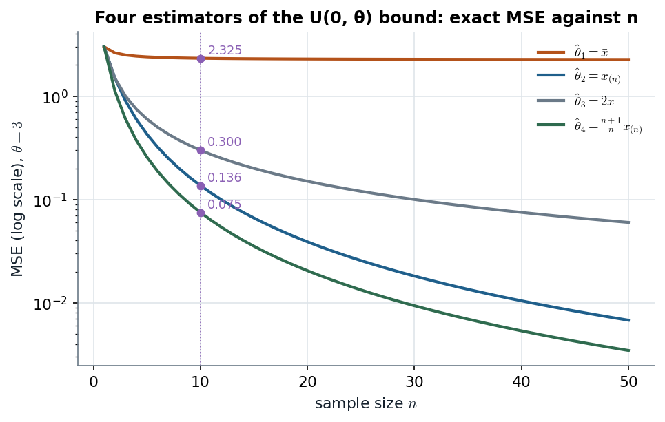

# MSE, Monte Carlo and the bootstrap · four estimators of a uniform bound, and where resampling breaks

> **Claim.** **Mean squared error is variance plus squared bias**, so unbiasedness is one ingredient of a good estimator, not the criterion. For $x_i\sim U(0,\theta)$ the exact MSEs rank the four candidates $\hat\theta_4<\hat\theta_2<\hat\theta_3<\hat\theta_1$ for every $n\ge3$, and the two built on the maximum $x_{(n)}$ (the sufficient statistic and the MLE) converge at rate $1/n^2$ in MSE against $1/n$ for the two built on $\bar x$. **The nonparametric bootstrap reproduces the observed maximum with probability $1-(1-1/n)^n\to0.632$**, a point mass the true continuous law does not have: it is inconsistent for $x_{(n)}$, and resampling from the fitted model (the parametric bootstrap) repairs it.
> Prev: [[L01-04-first-bayesian-poisson]] · Next: [[L01-06-gaussian-linear-regression]] · Map: [[L01-00-map]]

**Notation.**

| Symbol | Meaning | Range |
|---|---|---|
| $x_1,\dots,x_n$ | iid draws from $U(0,\theta)$ | $0<x_i<\theta$ |
| $\theta$ | upper bound of the support (the parameter) | $\theta>0$ |
| $n$ | sample size | $n\ge1$ |
| $\bar x=\frac1n\sum_i x_i$ | sample mean | |
| $x_{(1)}\le\dots\le x_{(n)}$ | order statistics; $x_{(n)}=\max_i x_i$ | |
| $\hat\theta_1,\dots,\hat\theta_4$ | $\bar x$, $x_{(n)}$, $2\bar x$, $\frac{n+1}{n}x_{(n)}$ | |
| $E(\cdot),V(\cdot)$ | mean and variance over repeated samples, $\theta$ fixed | |
| $B(\hat\theta)=E(\hat\theta)-\theta$ | bias | |
| $\mathrm{MSE}(\hat\theta)=E[(\hat\theta-\theta)^2]$ | mean squared error (B: *EQM*, "erro quadrático médio") | $\ge0$ |
| $N$ | Monte Carlo replications (deck: 1000) | |
| $B$ | bootstrap resamples (deck: 1000) | |
| $x^*_1,\dots,x^*_n$ | a bootstrap sample; $x^*_{(n)}$ its maximum | |
| $c$ | scale in the family $c\,x_{(n)}$ (§8 only) | $c>0$ |

---

## 1 · U — why a criterion is needed at all

Four reasonable-looking numbers can be computed from one uniform sample, and they disagree. To choose, we need a loss that does not reward a property for its own sake. The deck's opening question, "Is $\hat\theta_1=\bar x$ a 'natural choice'?" (slide 7), has a blunt answer:

> **Not quite. Every $x_i$ is at most $\theta$, so $\bar x$ estimates $E(x)=\theta/2$, not $\theta$.** Doubling it removes the bias but doubles the standard deviation. **A better route is to look at the likelihood** — which points to the maximum.

The rest of the note makes "better" precise (MSE), proves the ranking, checks it by simulation, and then asks what happens when only one sample is available (the bootstrap).

---

## 2 · C — mean squared error = variance + bias² (B Def. 1.3.7, (1.3.2), p. 6)

$$\mathrm{MSE}(\hat\theta)=E\big[(\hat\theta-\theta)^2\big]\tag{1}$$

Add and subtract $E(\hat\theta)$ inside the square:

$$\mathrm{MSE}(\hat\theta)=E\Big[\big(\{\hat\theta-E(\hat\theta)\}+\{E(\hat\theta)-\theta\}\big)^2\Big]$$

Expand the square:

$$=E\big[\{\hat\theta-E(\hat\theta)\}^2\big]+2\{E(\hat\theta)-\theta\}\,E\big[\hat\theta-E(\hat\theta)\big]+\{E(\hat\theta)-\theta\}^2$$

The middle expectation is $E(\hat\theta)-E(\hat\theta)=0$, so

$$\boxed{\;\mathrm{MSE}(\hat\theta)=V(\hat\theta)+B(\hat\theta)^2\;}\tag{2}$$

and for an unbiased estimator ($B=0$)

$$\mathrm{MSE}(\hat\theta)=V(\hat\theta).\tag{3}$$

> **The sentence to keep: an unbiased estimator can lose to a biased one if the bias buys enough variance.** Section 8 shows a biased multiple of $x_{(n)}$ beating the unbiased one.

*(The handwritten note writes the definition as $E\{(\hat\theta-E(\theta))^2\}$ on p. 2 — a slip; (1) is the definition, and its second line, $V+\text{Bias}^2$, is correct.)*

---

## 3 · C — the four estimators and their first two moments (slides 2–3)

### 3.1 · One uniform draw (B §1.1.5, p. 3)

The density is $f(x\mid\theta)=\frac1\theta I_{(0,\theta)}(x)$ — **its support depends on $\theta$**, which is what makes this model unusual (B, p. 3: "o suporte da variável X … depende do parâmetro θ").

$$E(x)=\int_0^\theta x\,\frac1\theta\,dx=\frac1\theta\cdot\frac{\theta^2}{2}=\frac\theta2\tag{4}$$

$$E(x^2)=\int_0^\theta x^2\,\frac1\theta\,dx=\frac1\theta\cdot\frac{\theta^3}{3}=\frac{\theta^2}{3}\tag{5}$$

$$V(x)=E(x^2)-E(x)^2=\frac{\theta^2}{3}-\frac{\theta^2}{4}=\frac{\theta^2}{12}\tag{6}$$

### 3.2 · The sample mean

By linearity and (4):

$$E(\bar x)=\frac1n\sum_{i=1}^n E(x_i)=\frac1n\cdot n\cdot\frac\theta2=\frac\theta2\tag{7}$$

By independence and (6):

$$V(\bar x)=\frac1{n^2}\sum_{i=1}^n V(x_i)=\frac1{n^2}\cdot n\cdot\frac{\theta^2}{12}=\frac{\theta^2}{12n}\tag{8}$$

### 3.3 · The maximum: $x_{(n)}/\theta\sim\mathrm{Beta}(n,1)$ (slide 3's "useful fact"; B (1.3.14), p. 11)

The maximum is below $t$ exactly when every draw is:

$$P(x_{(n)}\le t)=\prod_{i=1}^n P(x_i\le t)=\Big(\frac t\theta\Big)^n,\qquad 0\le t\le\theta\tag{9}$$

Differentiating (9) in $t$ gives the density

$$p(x_{(n)}\mid\theta)=\frac{n\,x_{(n)}^{\,n-1}}{\theta^n},\qquad 0\le x_{(n)}\le\theta,\tag{10}$$

so $u=x_{(n)}/\theta$ has density $n u^{n-1}$ on $[0,1]$ — the $\mathrm{Beta}(n,1)$ law. Its moments come from one integral:

$$E(u^k)=\int_0^1 u^k\,n u^{n-1}\,du=\frac{n}{n+k}\tag{11}$$

With $k=1$ and $k=2$ in (11):

$$E(u)=\frac{n}{n+1},\qquad E(u^2)=\frac{n}{n+2}\tag{12}$$

$$V(u)=\frac{n}{n+2}-\Big(\frac{n}{n+1}\Big)^2=\frac{n(n+1)^2-n^2(n+2)}{(n+1)^2(n+2)}=\frac{n\,[\,n^2+2n+1-n^2-2n\,]}{(n+1)^2(n+2)}=\frac{n}{(n+1)^2(n+2)}\tag{13}$$

Scaling back by $\theta$ (B (1.3.15), p. 11):

$$E(x_{(n)})=\frac{n}{n+1}\theta,\qquad V(x_{(n)})=\frac{n\,\theta^2}{(n+1)^2(n+2)}\tag{14}$$

### 3.4 · The unbiased versions

$\hat\theta_3=2\bar x$: from (7) and (8), $E=2\cdot\frac\theta2=\theta$ and $V=4\cdot\frac{\theta^2}{12n}=\frac{\theta^2}{3n}$.

$\hat\theta_4=\frac{n+1}{n}x_{(n)}$: from (14), $E=\frac{n+1}{n}\cdot\frac{n}{n+1}\theta=\theta$ and

$$V(\hat\theta_4)=\Big(\frac{n+1}{n}\Big)^2\cdot\frac{n\theta^2}{(n+1)^2(n+2)}=\frac{\theta^2}{n(n+2)}\tag{15}$$

**Slide 3's table, now derived:**

| | $\hat\theta_1=\bar x$ | $\hat\theta_2=x_{(n)}$ | $\hat\theta_3=2\bar x$ | $\hat\theta_4=\frac{n+1}{n}x_{(n)}$ |
|---|---|---|---|---|
| $E(\hat\theta)$ | $\theta/2$ | $\frac{n}{n+1}\theta$ | $\theta$ | $\theta$ |
| $V(\hat\theta)$ | $\frac{\theta^2}{12n}$ | $\frac{n\theta^2}{(n+1)^2(n+2)}$ | $\frac{\theta^2}{3n}$ | $\frac{\theta^2}{n(n+2)}$ |
| Source | (7), (8) | (14) | §3.4 | (15) |

---

## 4 · C — the four MSEs (slide 4; B Example 1.3.8, p. 11)

**$\hat\theta_1$.** Substituting (7) and (8) into (2):

$$\mathrm{MSE}(\hat\theta_1)=\frac{\theta^2}{12n}+\Big(\frac\theta2-\theta\Big)^2=\frac{\theta^2}{12n}+\frac{\theta^2}{4}=\frac{\theta^2+3n\theta^2}{12n}=\frac{1+3n}{12n}\,\theta^2\tag{16}$$

**$\hat\theta_2$.** Substituting (14) into (2); the bias is $\frac{n}{n+1}\theta-\theta=-\frac{\theta}{n+1}$:

$$\mathrm{MSE}(\hat\theta_2)=\frac{n\theta^2}{(n+1)^2(n+2)}+\Big(-\frac{\theta}{n+1}\Big)^2=\frac{n\theta^2+(n+2)\theta^2}{(n+1)^2(n+2)}=\frac{2(n+1)\theta^2}{(n+1)^2(n+2)}=\frac{2\theta^2}{(n+1)(n+2)}\tag{17}$$

**$\hat\theta_3,\hat\theta_4$.** Unbiased, so by (3):

$$\mathrm{MSE}(\hat\theta_3)=\frac{\theta^2}{3n},\qquad \mathrm{MSE}(\hat\theta_4)=\frac{\theta^2}{n(n+2)}\tag{18}$$

> **Two rates, visible in the formulas.** (17) and (18, right) fall like $1/n^2$; (18, left) falls like $1/n$; and (16) does not go to zero at all — it tends to $\theta^2/4$, the squared bias $(\theta/2)^2$ that no amount of data removes (B, p. 12: "quando $n\to\infty$, $EQM[\hat\theta_1]\to\theta^2/4$").

---

## 5 · C — the ranking, proved (slide 5)

All four MSEs are $\theta^2$ times a function of $n$, so **the ranking does not depend on $\theta$**. Compare them in pairs, dividing out $\theta^2$.

**(a) $\hat\theta_4$ vs $\hat\theta_2$.** From (18) and (17):

$$\frac{1}{n(n+2)}<\frac{2}{(n+1)(n+2)}\iff (n+1)<2n\iff n>1\tag{19}$$

(multiply both sides by $n(n+1)(n+2)>0$).

**(b) $\hat\theta_2$ vs $\hat\theta_3$.** From (17) and (18):

$$\frac{2}{(n+1)(n+2)}<\frac{1}{3n}\iff 6n<(n+1)(n+2)=n^2+3n+2\iff n^2-3n+2>0\iff (n-1)(n-2)>0\tag{20}$$

For integer $n\ge1$ this holds exactly when $n>2$; at $n=1$ and $n=2$ the product is zero, so the two MSEs tie.

**(c) $\hat\theta_3$ vs $\hat\theta_1$.** From (18) and (16):

$$\frac{1}{3n}<\frac{1+3n}{12n}\iff 4<1+3n\iff n>1\tag{21}$$

Chaining (19), (20) and (21):

$$\boxed{\;n\ge3:\quad \mathrm{MSE}(\hat\theta_4)<\mathrm{MSE}(\hat\theta_2)<\mathrm{MSE}(\hat\theta_3)<\mathrm{MSE}(\hat\theta_1)\;}\tag{22}$$

**The small-$n$ cases, in units of $\theta^2$** (each entry is (16)–(18) evaluated):

| $n$ | $\mathrm{MSE}_1$ | $\mathrm{MSE}_2$ | $\mathrm{MSE}_3$ | $\mathrm{MSE}_4$ | Ordering |
|---|---|---|---|---|---|
| 1 | $4/12=0.3333$ | $2/6=0.3333$ | $1/3=0.3333$ | $1/3=0.3333$ | all equal ($\hat\theta_1=\hat\theta_2=x$, $\hat\theta_3=\hat\theta_4=2x$, and both pairs have the same MSE) |
| 2 | $7/24=0.2917$ | $2/12=0.1667$ | $1/6=0.1667$ | $1/8=0.1250$ | $\hat\theta_4<\hat\theta_2=\hat\theta_3<\hat\theta_1$ (slide 5: "At $n=2$, $\mathrm{MSE}(\hat\theta_2)=\mathrm{MSE}(\hat\theta_3)=\theta^2/6$") |
| 3 | $10/36=0.2778$ | $2/20=0.1000$ | $1/9=0.1111$ | $1/15=0.0667$ | strict, as in (22) |
| 10 | $31/120=0.2583$ | $2/132=0.0152$ | $1/30=0.0333$ | $1/120=0.0083$ | strict |

> **Watch the boundary.** The handwritten note (p. 2) writes "for $n\ge2$" with strict inequalities; the typeset deck's "$n\ge3$" is the right statement, because of the $n=2$ tie in (20).

**Erratum in B Table 1.1 (p. 12).** The table compares $\bar x$ and $x_{(n)}$ only. Its $\mathrm{MSE}[\hat\theta_1]$ column ($5\theta^2/18$, $4\theta^2/15$, $31\theta^2/120$, $61\theta^2/240$) agrees with (16), and the $n=3,5$ entries of $\mathrm{MSE}[\hat\theta_2]$ ($\theta^2/10$, $\theta^2/21$) agree with (17). But (17) gives $2/(11\cdot12)=\theta^2/66$ at $n=10$ and $2/(21\cdot22)=\theta^2/231$ at $n=20$, where the book prints $\theta^2/662$ and $\theta^2/2312$; and the ratio column should read $0.36,\ 0.18,\ 0.059,\ 0.017$, not $0.27,\ 0.12,\ 0.04,\ 0.01$. The book's conclusion ("$X_{(n)}$ é melhor que $\bar X$ para todo θ e $n>1$") is unaffected. *(All entries recomputed in Python for this note.)*

---

## 6 · C — the likelihood points to the maximum (slide 8; B Examples 2.2.5, 3.1.3)

The joint density is a product of indicator-weighted constants:

$$p(x_1,\dots,x_n\mid\theta)=\prod_{i=1}^n\frac1\theta\,\mathbb 1(x_i\le\theta)=\frac1{\theta^n}\,\mathbb 1\big(x_{(n)}\le\theta\big)\tag{23}$$

because all $n$ indicators equal one exactly when the largest observation is below $\theta$. Read as a function of $\theta$:

$$L(\theta\mid x_1,\dots,x_n)=\frac{1}{\theta^n}\,\mathbb 1\big(\theta\ge x_{(n)}\big)\tag{24}$$

which is **zero for $\theta<x_{(n)}$ and strictly decreasing for $\theta\ge x_{(n)}$**. The maximum sits on the boundary:

$$\hat\theta_{MLE}=x_{(n)}=\hat\theta_2\tag{25}$$

> **The score equation does not find it.** $\partial\log L/\partial\theta=-n/\theta$ never equals zero; B (p. 36) flags exactly this case — when the maximum is on the boundary, "o máximo é obtido a partir da inspeção da função de verossimilhança" — and works it as Example 3.1.3 (Figure 3.1, p. 38).

**Sufficiency.** (23) factorizes as $g(x_{(n)},\theta)\cdot h(x)$ with $h\equiv1$ on the sample space, so by the factorization criterion $x_{(n)}$ is sufficient for $\theta$ (B Example 2.2.5, p. 23). **That is why the two winners in (22) are functions of $x_{(n)}$:** $\bar x$ uses the whole sample but throws away exactly the information that matters — how close the data come to the edge.

---

## 7 · Worked — Monte Carlo at θ = 3, n = 10, N = 1000 (slides 9–12)

**Algorithm (slide 9).** For $j=1,\dots,N$: draw $x^{(j)}_1,\dots,x^{(j)}_n\sim U(0,\theta)$; compute $\hat\theta^{(j)}_k$, $k=1,\dots,4$. The $N$ values approximate each sampling distribution, and

$$\widehat{\mathrm{MSE}}(\hat\theta_k)=\frac1N\sum_{j=1}^N\big(\hat\theta^{(j)}_k-\theta\big)^2.\tag{26}$$

**Theory at $\theta=3$, $n=10$** — every entry is (7)/(14)/§3.4 for the mean, the square root of (8)/(14)/§3.4/(15) for the SD, and (16)–(18) for the MSE:

| | $E$ theory | SD theory | MSE theory |
|---|---|---|---|
| $\hat\theta_1$ | $3/2=1.500$ | $3/\sqrt{120}=0.274$ | $\frac{31}{120}\cdot9=2.325$ |
| $\hat\theta_2$ | $\frac{10}{11}\cdot3=2.727$ | $\sqrt{\frac{10\cdot9}{121\cdot12}}=0.249$ | $\frac{2\cdot9}{11\cdot12}=0.136$ |
| $\hat\theta_3$ | $3.000$ | $3/\sqrt{30}=0.548$ | $9/30=0.300$ |
| $\hat\theta_4$ | $3.000$ | $3/\sqrt{120}=0.274$ | $9/120=0.075$ |

**The deck's MC column** (slide 12): means 1.497, 2.717, 2.994, 2.989; SDs 0.278, 0.264, 0.555, 0.290; MSEs 2.336, 0.149, 0.308, 0.084. **How close should they be?** The SD of a sample SD from $N$ draws is roughly $\mathrm{SD}/\sqrt{2(N-1)}=\mathrm{SD}/\sqrt{1998}\approx2.2\%$ of the SD — the deck's "accurate to roughly ±2%". The largest gap (0.290 vs 0.274 for $\hat\theta_4$) is 5.8%, about 2.6 such units; the skewed $\mathrm{Beta}$ shape makes the max-based SDs noisier than the normal approximation suggests.

Three readings from slide 12:

- $\mathrm{SD}(\hat\theta_3)=2\,\mathrm{SD}(\hat\theta_1)$ and $\mathrm{SD}(\hat\theta_4)=\frac{n+1}{n}\mathrm{SD}(\hat\theta_2)=1.1\,\mathrm{SD}(\hat\theta_2)$ — rescaling an estimator rescales its spread.
- **Curiosity:** at $n=10$, $12n=120=n(n+2)$, so (8) and (15) coincide and $\mathrm{SD}(\hat\theta_1)=\mathrm{SD}(\hat\theta_4)$ exactly. **Same spread, but $\hat\theta_1$ is centred at 1.5:** its MSE is 31 times larger, all of the difference being bias.
- The ranking (22) is reproduced.

*Figure — the four exact MSE curves (16)–(18) at θ = 3, log scale, with the deck's n = 10 values marked. Source: slides 5–6 and 12.*

The top curve flattens at $\theta^2/4=2.25$: $\bar x$ converges, but to the wrong number. The other three fall, the two max-based curves visibly steeper (slope $-2$ on a log–log reading against $-1$ for $2\bar x$). All four start together at $n=1$, and the $\hat\theta_2$ and $\hat\theta_3$ curves touch at $n=2$ — the two ties of §5.

> **Interactive companion.** [The Four Estimators](companions/companion-four-estimators-mse.html) — move θ, n and a scale c on $x_{(n)}$; watch the four MSEs, the ranking (with its ties at n = 1 and n = 2) and the min-MSE scale $(n+2)/(n+1)$. Defaults reproduce 2.325, 0.136, 0.300, 0.075.

---

## 8 · G — the best multiple of the maximum is biased

Slide 20 says $\hat\theta_4$ "wins for $n\ge3$" among the four. Among all multiples $c\,x_{(n)}$ it does not. Expand (1) with $\hat\theta=c\,x_{(n)}$ and use (12):

$$\mathrm{MSE}(c)=c^2E(x_{(n)}^2)-2c\theta E(x_{(n)})+\theta^2=\theta^2\Big[c^2\frac{n}{n+2}-2c\frac{n}{n+1}+1\Big]\tag{27}$$

Setting $d\,\mathrm{MSE}/dc=0$:

$$2c\frac{n}{n+2}-2\frac{n}{n+1}=0\iff c^*=\frac{n+2}{n+1}\tag{28}$$

Substituting (28) into (27):

$$\mathrm{MSE}(c^*)=\theta^2\Big[\frac{(n+2)^2}{(n+1)^2}\cdot\frac{n}{n+2}-2\cdot\frac{n+2}{n+1}\cdot\frac{n}{n+1}+1\Big]=\theta^2\Big[1-\frac{n(n+2)}{(n+1)^2}\Big]=\frac{\theta^2}{(n+1)^2}\tag{29}$$

At $\theta=3$, $n=10$: $9/121=0.0744<0.075$. The gain is small, but the lesson of (2) is exact: **$c^*$ shrinks less than the unbiased $\frac{n+1}{n}$ would require ($\frac{12}{11}=1.0909<\frac{11}{10}$), accepting a bias of $-\theta/(n+1)^2$ in return for lower variance.** Related practice: B Exercise 1.12 (p. 14).

---

## 9 · C — the nonparametric bootstrap (slides 13–14; I §5.2, pp. 212–214)

Monte Carlo needs $\theta$; in practice we hold **one** sample. The bootstrap replaces the unknown $U(0,\theta)$ by the empirical distribution $\hat F_n$ (mass $1/n$ on each observation). For $b=1,\dots,B$: draw $x^{*b}_1,\dots,x^{*b}_n$ **with replacement** from $\{x_1,\dots,x_n\}$; compute $\hat\theta^{*b}_k$. The bootstrap standard error is the SD of the $B$ replicates, ISLP (5.8), p. 214:

$$\mathrm{SE}_B(\hat\theta_k)=\sqrt{\frac{1}{B-1}\sum_{b=1}^B\Big(\hat\theta^{*b}_k-\frac1B\sum_{b'=1}^B\hat\theta^{*b'}_k\Big)^2}\tag{30}$$

**Slide 14** (one sample of 100 draws from $U(0,3)$; first 10, first 50, all 100):

| | | $\hat\theta_1$ | $\hat\theta_2$ | $\hat\theta_3$ | $\hat\theta_4$ |
|---|---|---|---|---|---|
| $n=10$ | bootstrap SD | 0.117 | 0.062 | 0.234 | 0.068 |
| | theoretical SD | 0.274 | 0.249 | 0.548 | 0.274 |
| $n=50$ | bootstrap SD | 0.113 | 0.041 | 0.226 | 0.042 |
| | theoretical SD | 0.122 | 0.058 | 0.245 | 0.059 |
| $n=100$ | bootstrap SD | 0.089 | 0.036 | 0.177 | 0.036 |
| | theoretical SD | 0.087 | 0.029 | 0.173 | 0.030 |

The theoretical row at $n=50$ is (8) and (14) at $\theta=3$: $3/\sqrt{600}=0.122$; $\sqrt{50\cdot9/(51^2\cdot52)}=0.058$; $3/\sqrt{150}=0.245$; $3/\sqrt{2600}=0.059$.

**Two separate failures:**

- **$n=10$, all four too small.** The ten draws "happen to lie in [1.35, 2.33]" (slide 15): their spread is small, so resampling them gives small spreads. **"The bootstrap cannot recover what the sample does not contain."** This is a small-sample problem and fades with $n$ for $\bar x$ (0.113 vs 0.122 at $n=50$; 0.089 vs 0.087 at $n=100$).
- **$x_{(n)}$-based, wrong at every $n$, in no fixed direction:** too small at $n=50$ (0.041 vs 0.058), too large at $n=100$ (0.036 vs 0.029). At $n=100$ the boxes "collapse onto $x_{(n)}$, a warning sign" (slide 17). The failure is in the *shape* of the bootstrap law, a point mass at $x_{(n)}$, not in a consistent bias of its SD, and it does not fade: §10.

---

## 10 · C — why the bootstrap fails for the maximum (slide 18)

A bootstrap sample reproduces the observed maximum whenever $x_{(n)}$ is drawn at least once. Each of the $n$ draws misses it with probability $1-1/n$, independently:

$$P\big(x^*_{(n)}\ne x_{(n)}\big)=\Big(1-\frac1n\Big)^n\tag{31}$$

$$\boxed{\;P\big(x^*_{(n)}=x_{(n)}\big)=1-\Big(1-\frac1n\Big)^n\;\xrightarrow[n\to\infty]{}\;1-e^{-1}\approx0.632\;}\tag{32}$$

using $\lim_{n\to\infty}(1-1/n)^n=e^{-1}$. The same calculation for any fixed observation $j$ is ISLP Exercise 5.2 (pp. 224–225).

| $n$ | (32) exact | Deck's observed share ($B=1000$) | Gap in MC standard errors $\sqrt{p(1-p)/1000}\approx0.015$ |
|---|---|---|---|
| 10 | $1-0.9^{10}=0.651$ | 0.666 | $+1.0$ |
| 50 | $1-0.98^{50}=0.636$ | 0.622 | $-0.9$ |
| 100 | $1-0.99^{100}=0.634$ | 0.632 | $-0.1$ |

> **So $x^*_{(n)}$ has a point mass of about 63% at $x_{(n)}$, while the true sampling law (10), a scaled $\mathrm{Beta}(n,1)$, is continuous: the nonparametric bootstrap is inconsistent for the maximum.** No sample size fixes it — the mass converges to 0.632, not to zero.

The root cause is that $\hat F_n$ never puts mass above $x_{(n)}$, while the true sampling law (10) puts positive probability on every interval below $\theta$, including the stretch $(x_{(n)},\theta]$ the data never reached: **the statistic depends on the edge of the support, and the empirical distribution has no information beyond its own edge.** For smooth statistics like $\bar x$ this does not matter, and the bootstrap works.

*Figure — left: (32) against n with the deck's observed shares (slide 18). Right: exact CDFs of the resampled maximum for one seeded simulated sample (n = 100, $x_{(n)}=2.969$, $\hat\theta_4=2.999$): nonparametric $\hat F_n(t)^n$, parametric $(t/\hat\theta_4)^n$, true $(t/3)^n$ — a simulation, not the deck's sample.*

The left panel shows the mass settling at 0.632 almost immediately; the deck's three shares scatter around the curve by about one Monte Carlo standard error. On the right, the nonparametric CDF climbs in a handful of steps — one per top order statistic, with heights $((n-j)/n)^n-((n-j-1)/n)^n$ — and leaps by 0.634 at $x_{(n)}$, whereas the parametric curve hugs the true one: **resampling from the fitted model gives the right shape.**

---

## 11 · C — the fix: parametric bootstrap (slide 19)

Use the model: draw $x^*_1,\dots,x^*_n$ iid $U(0,\hat\theta_4)$ instead of resampling the data. With enough resamples this reproduces the **plug-in SD** — the theoretical SD formula evaluated at $\hat\theta_4$ instead of $\theta$. **Worked check, $n=10$, $\hat\theta_4=2.568$** (slide 14's estimate):

$$\mathrm{SD}(\hat\theta_4;\hat\theta_4)=\frac{\hat\theta_4}{\sqrt{n(n+2)}}=\frac{2.568}{\sqrt{120}}=\frac{2.568}{10.954}=0.234$$

$$\mathrm{SD}(\hat\theta_2;\hat\theta_4)=\hat\theta_4\sqrt{\frac{n}{(n+1)^2(n+2)}}=2.568\sqrt{\frac{10}{121\cdot12}}=2.568\times0.0830=0.213$$

| | | $\hat\theta_1$ | $\hat\theta_2$ | $\hat\theta_3$ | $\hat\theta_4$ |
|---|---|---|---|---|---|
| $n=10$ | parametric SD (deck, slide 19) | 0.237 | 0.213 | 0.475 | 0.234 |
| | exact plug-in (formulas at $\hat\theta_4=2.568$) | 0.234 | 0.213 | 0.469 | 0.234 |
| $n=50$ | parametric SD (deck) | 0.119 | 0.054 | 0.238 | 0.055 |
| | exact plug-in ($\hat\theta_4=2.926$) | 0.119 | 0.056 | 0.239 | 0.057 |
| $n=100$ | parametric SD (deck) | 0.084 | 0.031 | 0.167 | 0.032 |
| | exact plug-in ($\hat\theta_4=3.029$) | 0.087 | 0.030 | 0.175 | 0.030 |

The deck's parametric column is a $B=1000$ simulation of the plug-in row, and matches it to Monte Carlo error. **At $n=10$ the parametric SDs (0.213–0.234) are still below theory (0.249–0.274) because $\hat\theta_4=2.568$ is well below $\theta=3$ — the deck: "it tracks the theory as long as $\hat\theta_4$ is close to $\theta$."** At $n=50$ and $n=100$ the max-based SDs (0.054–0.057; 0.030–0.032) now sit on the theoretical 0.058/0.059 and 0.029/0.030, which the nonparametric 0.041 and 0.036 missed in opposite directions.

| Bootstrap | Resamples from | Works for $\bar x$ | Works for $x_{(n)}$ | Needs |
|---|---|---|---|---|
| Nonparametric | $\hat F_n$ (the data) | yes, as $n$ grows | **no** — 63% point mass | nothing about the model |
| Parametric | $U(0,\hat\theta)$ | yes | yes | the model to be right |

---

## 12 · C/U — the site's companion pages

### 12.1 · Mean, weighted mean, median, trimmed mean (`comparing-estimators.html`)

Same question, location instead of scale: estimate a population mean from $n=21$ draws of $N(0,1)$, $t_4$ (mean 0) and $\mathrm{Beta}(3,9)$ (mean $3/12=0.25$), with $\hat\theta_1=\bar x$; $\hat\theta_2=\sum a_ix_i$ with triangular weights $w_i=i$ ($i\le11$), $w_i=22-i$ ($i\ge12$), $a_i=w_i/\sum w_j$; the trimmed mean with $k=2$; and the median $x_{(11)}$. The page shows boxplots of 10,000 replications; two of its results can be computed exactly.

**The weighted mean.** The data are iid, so the weights attach to arbitrary positions: $\hat\theta_2$ is unbiased with $V=\sigma^2\sum a_i^2$. Here $\sum w_i=2(1+\dots+10)+11=121$ and $\sum w_i^2=2\cdot385+121=891$, so

$$\sum a_i^2=\frac{891}{121^2}=\frac{891}{14641}=0.0609>\frac1{21}=0.0476,$$

a relative efficiency of $0.0476/0.0609=0.78$. **Equal weights minimise $\sum a_i^2$ subject to $\sum a_i=1$ — unequal weights on exchangeable data only add variance.**

**The median under heavy tails.** For $t_4$, $V(\bar x)=\frac{\nu/(\nu-2)}{n}=\frac2n$, while the median's large-sample variance is $\frac{1}{4nf(0)^2}$ with $f(0)=0.375$, i.e. $\frac{1.78}{n}$: **the median beats the mean under $t_4$**, the reverse of the normal case where its efficiency is $2/\pi=0.64$. Under $\mathrm{Beta}(3,9)$ the median estimates the *median* (0.236), not the mean, so its MSE carries a bias$^2$ of $(0.236-0.25)^2\approx0.0002$ — formula (2) again. A seeded simulation run for this note (20,000 replications, not the page's own run) gives MSEs (mean, weighted, median, trimmed) of 0.047, 0.060, 0.073, 0.050 (normal); 0.093, 0.120, 0.085, 0.070 (t₄); 0.00069, 0.00088, 0.00131, 0.00079 (beta). **The trimmed mean is the robust compromise: near-best under normality, best under $t_4$.**

### 12.2 · Bootstrap vs exact intervals (`bootstrap-example.html`)

Fifty listed values, assumed $N(\mu,\sigma^2)$: $\hat\mu=\bar x=0.10006$, $\hat\sigma^2_{MLE}=0.8334424$, $\hat\sigma_{MLE}=0.9129307$, MAD $=0.7508248$ (all reproduced in Python). The exact $t$ interval uses $t_{0.975,49}=2.00958$:

$$0.10006\pm2.00958\times\frac{0.91293}{\sqrt{50}}=0.10006\pm0.25945=[-0.15939,\ 0.35951]$$

and the $\chi^2$ interval for $\sigma^2$ is $[50(0.83344)/\chi^2_{0.975,49},\ 50(0.83344)/\chi^2_{0.025,49}]=[0.593,\ 1.321]$ — **the page prints it as "1.3206221 0.5934305", upper limit first**, because its code divides by the 0.025 quantile first. (It also plugs $\hat\sigma_{MLE}$, divisor $n$, into the $t$ interval where the textbook statistic uses $s$, divisor $n-1$ — a 1% difference at $n=50$.) Its conclusion matches §9: **for $\mu$ the 10,000-resample bootstrap interval is almost identical to the exact one; for $\sigma^2$ the bootstrap distribution looks Gaussian while the exact one is a skewed $\chi^2$**, and the gap closes as $n$ grows.

### 12.3 · Correlation MLE (`correlation-bivariate-gaussian.html`) — named

For $(x,y)$ standard bivariate normal with correlation $\rho$, the page maximises $L(\rho)$ numerically through $\rho=(e^\gamma-1)/(e^\gamma+1)$ (an unconstrained $\gamma$), simulates $n=30$ pairs with $\rho=0.95$, and bootstraps both the MLE and the sample correlation 10,000 times. No numbers are printed; the point is that the two estimators differ (the MLE uses the known unit variances) and that a bounded parameter near its edge gives a skewed bootstrap distribution — a milder cousin of §10.

---

## Links

- Neighbours: [[L01-04-first-bayesian-poisson]] (the Poisson MLE whose efficiency §2's criterion formalises: [[L01-02-poisson-mle-properties]]) · [[L01-06-gaussian-linear-regression]] (MSE returns as prediction error and overfitting).
- Unit: [[L01-00-map]] · [[L01-09-formulas]] · [[L01-10-pitfalls]] · [[L01-11-python]] · [[L01-01-likelihood-sampling-rules]] · [[L01-03-coal-mining-change-point]].
- Class 2: bias–variance for prediction, [[../L02/L02-01-prediction-error-bias-variance|L02 §1]]; bootstrap confidence bands and CV, [[../L02/L02-03-cross-validation-motorcycle|L02 §3]].
- Rules: [[../../rules/08_monte_carlo_mcmc|rules/08]] (Monte Carlo); [[../../rules/07_bayes|rules/07]] for the Bayesian treatment of the same uniform model (Pareto prior, Classes 3+4).
- Companion: [The Four Estimators](companions/companion-four-estimators-mse.html).
- **Practice (number and printed page only):** B 1.4 (p. 13), B 1.6 (p. 13, the density (10)), B 1.9 (p. 14), B 1.12 (p. 14); I 5.2 (pp. 224–225), I 5.9 (pp. 227–228).
