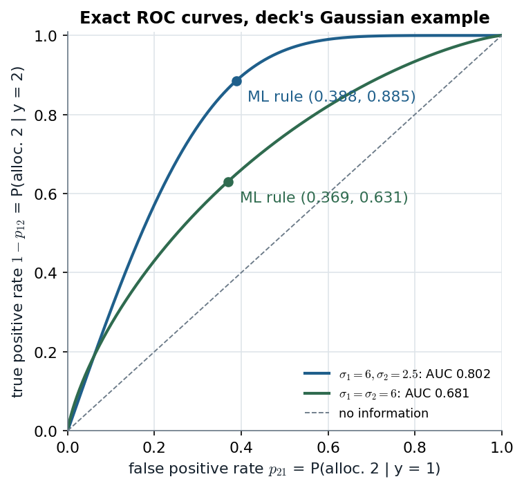

# Discriminant part, slides 40–65 · The Bayes rule, the Gaussian cut-offs, and what unequal costs do to them

> **Claim.** Discriminant analysis models $p(x\mid y=k)$ and turns it into $P(y=k\mid x)$ with
> Bayes' theorem; the **Bayes rule** allocates to the class with the largest $\pi_kp(x\mid y=k)$
> and no rule has a smaller probability of error. With two classes everything runs through
> $h(x)=\log p_1(x)-\log p_2(x)$: allocate to 1 iff $h(x)>\log\{\pi_2c_{12}/(\pi_1c_{21})\}$.
> **Equal Gaussian variances make $h$ linear** (one cut-off at the midpoint, LDA, Mahalanobis);
> **unequal variances make it quadratic** — in the deck's example class 1 wins *both* tails, with
> cut-offs 1.680 and 10.001 and a total error of 0.251 against 0.369 for the equal-variance case.
> Prev: [[L02-04-logistic-regression]] · Next: [[L02-06-gaussian-vs-poisson-regression]] · Map: [[L02-00-map]]

**Notation.**

- $y\in\{1,\dots,\kappa\}$: class label ($\kappa=2$ unless stated); $x\in\mathbb R^p$: predictors.
- $\pi_k=P(y=k)$: prior probability, $\sum_k\pi_k=1$ (here $\pi_k$ is a **prior**, not the Bernoulli mean of note 04).
- $p_k(x)=p(x\mid y=k)$: class-conditional density (or pmf); $\mu_k,\sigma_k^2$ (scalar) or $\mu_k,\Sigma$ / $\Sigma_k$ (vector).
- $R_k$: allocation region of class $k$; $\phi_k(x)=1\{x\in R_k\}$: allocation function.
- $h(x)=\log p_1(x)-\log p_2(x)$: discriminant function (two classes).
- $p_{ij}=\int\phi_i(x)p_j(x)\,dx$: probability of allocating to $i$ an individual from $j$.
- $c_{ij}>0$ ($i\ne j$): cost of allocating to $i$ when the truth is $j$; $c_{kk}=0$.
- $\Phi$: standard normal cdf; $\alpha=\Sigma^{-1}(\mu_1-\mu_2)$, $\bar\mu=(\mu_1+\mu_2)/2$.

---

## 1 · U — two routes to the same posterior (slide 40)

**Logistic regression** (note 04) models $P(y=k\mid x)$ directly. **Discriminant analysis** models
how $x$ is distributed *within* each class and inverts with Bayes' theorem. When the classes are
Gaussian the two give posteriors of the same form (§7.1), so why bother? Slide 40 (and I p. 146):
the logit MLE is **unstable when the classes are well separated** (it may not exist — note 04 §3),
**unstable when $n$ is small**, and clumsy for $\kappa>2$; DA has none of these problems, at the
price of assuming a distribution for $x$.

---

## 2 · C — discriminant rules and the Bayes rule (slides 41–42)

**Discriminant rule (slide 41).** A partition of $\mathbb R^p$ into disjoint regions
$R_1,\dots,R_\kappa$ with $\bigcup_{k}R_k=\mathbb R^p$; allocate $x$ to $k$ iff $x\in R_k$.
(The slide prints $\cap$; a partition needs the union.)

**Bayes' theorem (slide 42; I eq. 4.15, p. 147).**

$$P(y=k\mid x)=\frac{\pi_k\,p_k(x)}{\sum_{j=1}^{\kappa}\pi_j\,p_j(x)}.\tag{1}$$

**Bayes discriminant rule.** Allocate to

$$k^*=\arg\max_{k}P(y=k\mid x)=\arg\max_k\ \pi_k\,p_k(x),\tag{2}$$

the second form because the denominator of (1) is the same for every $k$. Equivalently
$\phi_k(x)=1$ iff $\pi_kp_k(x)=\max_j\pi_jp_j(x)$. **ML discriminant rule:** (2) with
$\pi_1=\dots=\pi_\kappa=1/\kappa$, i.e. $\arg\max_kp_k(x)$.

### 2.1 · C — why (2) minimises the probability of error (AME Teorema 9, p. 135)

Two classes. An error happens when $x\in R_2$ but $y=1$, or $x\in R_1$ but $y=2$:

$$P(\text{error})=\pi_1p_{21}+\pi_2p_{12}=\pi_1\!\int\!\phi_2(x)p_1(x)\,dx+\pi_2\!\int\!\phi_1(x)p_2(x)\,dx .$$

Put both under one integral:

$$P(\text{error})=\int\big[\phi_2(x)\,\pi_1p_1(x)+\phi_1(x)\,\pi_2p_2(x)\big]dx.\tag{3}$$

At each $x$ exactly one of $\phi_1,\phi_2$ is 1, so the integrand is either $\pi_1p_1(x)$ (if we
allocate to 2) or $\pi_2p_2(x)$ (if we allocate to 1). **The integral is smallest when, pointwise,
we pay the smaller of the two** — allocate to 1 iff $\pi_1p_1(x)>\pi_2p_2(x)$, which is (2). AME
writes the same rule as $P(Y=c_1\mid x)\ge1/2$ (p. 135); this is the 0–1-loss risk $R(g)=P(Y\ne g(X))$ of AME eq. 7.1 (p. 134).

---

## 3 · C — two classes: the discriminant function (slide 49)

$$h(x)=\log p(x\mid y=1)-\log p(x\mid y=2).\tag{4}$$

**ML rule:** allocate to 1 if $h(x)>0$, to 2 if $h(x)<0$.

**Bayes rule from (2).** Allocate to 1 iff

$$\pi_1p_1(x)>\pi_2p_2(x)\iff\frac{p_1(x)}{p_2(x)}>\frac{\pi_2}{\pi_1}\iff h(x)>\log\frac{\pi_2}{\pi_1},\tag{5}$$

dividing by $\pi_1p_2(x)>0$, then taking logs (log is increasing).

**The posterior is a logistic function of $h$.** Divide numerator and denominator of (1) (with $k=1$) by $\pi_1p_1(x)$:

$$P(y=1\mid x)=\frac{1}{1+\dfrac{\pi_2p_2(x)}{\pi_1p_1(x)}}=\frac{1}{1+\exp\{-h(x)-\log(\pi_1/\pi_2)\}}=g\big(h(x)+\log\tfrac{\pi_1}{\pi_2}\big),\tag{6}$$

with $g$ the logistic function of note 04. Rule (5) is $P(y=1\mid x)>1/2$ written on the $h$ scale.

---

## 4 · C — worked: the 0-1 predictor and the multinomial (slides 43–44)

**Bernoulli (slide 43).** $x\mid y=1\sim\text{Bernoulli}(1/2)$, $x\mid y=2\sim\text{Bernoulli}(3/4)$. By (4):

$$h(0)=\log\frac{1/2}{1/4}=\log2=0.693>0\ \Rightarrow\ \text{class 1},\qquad h(1)=\log\frac{1/2}{3/4}=\log\tfrac23=-0.405<0\ \Rightarrow\ \text{class 2}.$$

**ML misallocation probabilities:** $p_{21}=P(x=1\mid y=1)=1/2$, $p_{12}=P(x=0\mid y=2)=1/4$; with
equal priors $P(\text{error})=\tfrac12(\tfrac12+\tfrac14)=3/8$.

**Priors move the rule (5).** $x=0$ goes to 1 iff $\log2>\log(\pi_2/\pi_1)\iff\pi_2/\pi_1<2\iff\pi_1>1/3$;
$x=1$ goes to 1 iff $\log\frac23>\log(\pi_2/\pi_1)\iff\pi_1>3/5$. Hence

| prior $\pi_1$ | Bayes rule |
|---|---|
| $<1/3$ | everything to class 2 |
| $1/3$ to $3/5$ | the ML rule ($x=0\to1$, $x=1\to2$) |
| $>3/5$ | everything to class 1 |

**Multinomial (slide 44).** $x\mid y=1\sim\text{Mult}(n;\alpha_1,\dots,\alpha_\kappa)$, $x\mid y=2\sim\text{Mult}(n;\beta_1,\dots,\beta_\kappa)$.
The factor $n!/(x_1!\cdots x_\kappa!)$ is common and cancels in (4):

$$h(x)=\sum_{k=1}^\kappa x_k\log\alpha_k-\sum_{k=1}^\kappa x_k\log\beta_k=\sum_{k=1}^\kappa x_k\log\frac{\alpha_k}{\beta_k},$$

so the ML rule allocates to class 1 iff $\sum_kx_k\log(\alpha_k/\beta_k)>0$. **Slide 44 prints "$<0$" —
a sign slip**: check with $\kappa=2$, $n=1$, $\alpha=(1/2,1/2)$, $\beta=(1/4,3/4)$, which is the
Bernoulli example: $x=(1,0)$ gives $\log2>0$ and must go to class 1.

---

## 5 · C — univariate Gaussians: linear or quadratic $h$ (slides 45–47)

$x\mid y=k\sim N(\mu_k,\sigma_k^2)$, so $\log p_k(x)=-\log\sigma_k-\tfrac12\log2\pi-\dfrac{(x-\mu_k)^2}{2\sigma_k^2}$. Substitute into (4); the $\log2\pi$ cancels:

$$h(x)=\log\frac{\sigma_2}{\sigma_1}-\frac12\Big[\Big(\frac{x-\mu_1}{\sigma_1}\Big)^2-\Big(\frac{x-\mu_2}{\sigma_2}\Big)^2\Big].\tag{7}$$

**ML rule $h>0$.** Move the log term and multiply by $-2$ (flip):

$$\Big(\frac{x-\mu_1}{\sigma_1}\Big)^2-\Big(\frac{x-\mu_2}{\sigma_2}\Big)^2<2\log\frac{\sigma_2}{\sigma_1}.$$

Expand both squares and collect powers of $x$ — this is slide 45's display:

$$x^2\Big(\frac1{\sigma_1^2}-\frac1{\sigma_2^2}\Big)-2x\Big(\frac{\mu_1}{\sigma_1^2}-\frac{\mu_2}{\sigma_2^2}\Big)+\Big(\frac{\mu_1^2}{\sigma_1^2}-\frac{\mu_2^2}{\sigma_2^2}\Big)<2\log\frac{\sigma_2}{\sigma_1}.\tag{8}$$

### 5.1 · Equal variances: the midpoint (slide 45, last lines; I eqs. 4.18–4.19, p. 148)

With $\sigma_1=\sigma_2=\sigma$ the $x^2$ term and the log vanish in (8):

$$-\frac{2x(\mu_1-\mu_2)}{\sigma^2}+\frac{\mu_1^2-\mu_2^2}{\sigma^2}<0\iff(\mu_1-\mu_2)(\mu_1+\mu_2-2x)<0 .$$

With $\mu_1<\mu_2$ the first factor is negative, so the second must be positive:

$$x<\frac{\mu_1+\mu_2}{2}\qquad\Big(\text{equivalently } |x-\mu_2|>|x-\mu_1|\Big),\tag{9}$$

and (7) becomes **linear**: $h(x)=\dfrac{\mu_1-\mu_2}{\sigma^2}\Big(x-\dfrac{\mu_1+\mu_2}{2}\Big)$.

### 5.2 · Worked — the deck's example, $\mu_1=1,\ \mu_2=5,\ \sigma_1=6,\ \sigma_2=2.5$ (slide 46)

Write (7) as $h(x)=ax^2+bx+c$:

| coefficient | expression | value |
|---|---|---|
| $a$ | $-\tfrac12(1/36-1/6.25)=-\tfrac12(0.027778-0.16)$ | 0.066111 |
| $b$ | $\mu_1/\sigma_1^2-\mu_2/\sigma_2^2=1/36-5/6.25=0.027778-0.8$ | −0.772222 |
| $c$ | $-\tfrac12(1/36-25/6.25)+\log(2.5/6)=1.986111-0.875469$ | 1.110642 |

**Roots of $h(x)=0$:**

$$x=\frac{0.772222\pm\sqrt{0.772222^2-4(0.066111)(1.110642)}}{2(0.066111)}=\frac{0.772222\pm\sqrt{0.596327-0.293703}}{0.132222}=\frac{0.772222\pm0.550113}{0.132222},$$

$$x_L=\frac{0.222109}{0.132222}=\mathbf{1.680},\qquad x_U=\frac{1.322335}{0.132222}=\mathbf{10.001}.$$

Because $a>0$, $h$ is a U: $h<0$ (class 2) **between** the roots, $h>0$ (class 1) **outside**:

$$R_1=(-\infty,1.680)\cup(10.001,\infty),\qquad R_2=(1.680,\ 10.001).$$

Checks against slide 46's right panel: $h(-20)=43.0$, $h(20)=12.1$, minimum $h=-1.144$ at
$x=-b/(2a)=5.840$.

> **A large $x$, say 12 — seven units above $\mu_2=5$ — is allocated to class 1, whose mean is 1.**
> Class 1's larger $\sigma$ gives it fatter tails, so far from both means it is the likelier source.
> That is what "quadratic" buys and what a single midpoint cut-off cannot do.

**Equal variances, $\sigma_1=\sigma_2=6$ (slide 47).** By (9) the cut-off is $(1+5)/2=3$ and
$h(x)=\frac{1-5}{36}(x-3)=-\frac{x-3}{9}$: $h(-20)=23/9=2.556$, $h(20)=-17/9=-1.889$, the slide's line.

*Left: with equal priors class 2 owns only the band where its tall, narrow density is on top. Right: (7) for both cases; the dashed line is the cost-adjusted threshold of §10. Source: slides 45–47, eqs. (7)–(9).*

On the left the two curves cross twice, and the shaded band is exactly $R_2$; outside it the wide
class-1 density is higher. On the right the parabola dips below zero only between 1.680 and 10.001,
and below the dashed line $\log\frac12$ only on a narrower band — lowering the threshold shrinks $R_2$.
The green line crosses zero once, at 3.

> **Interactive companion.** [The Two-Gaussian Classifier](companions/companion-gaussian-discriminant.html) — move the class means, SDs, prior and cost ratio; watch the allocation regions, the posterior threshold and the total misclassification probability. Set $\sigma_1=\sigma_2$ to see the two cut-offs collapse to the midpoint.

---

## 6 · C — probabilities of misallocation (slide 50) via $\Phi$

$p_{ij}=\int\phi_i(x)p_j(x)dx$ is the probability that the region of class $i$ catches an
individual from $j$. For Gaussians, standardize and use $\Phi$.

**Equal variances ($\sigma=6$, cut-off 3).**

$$p_{21}=P(x>3\mid y=1)=1-\Phi\Big(\frac{3-1}{6}\Big)=1-\Phi(0.3333)=1-0.6306=0.3694,$$
$$p_{12}=P(x<3\mid y=2)=\Phi\Big(\frac{3-5}{6}\Big)=\Phi(-0.3333)=0.3694 .$$

Total with equal priors: $\tfrac12(0.3694+0.3694)=\mathbf{0.3694}$.

**Unequal variances (cut-offs 1.680, 10.001).**

$$p_{21}=P(1.680<x<10.001\mid y=1)=\Phi\Big(\frac{10.001-1}{6}\Big)-\Phi\Big(\frac{1.680-1}{6}\Big)=\Phi(1.5001)-\Phi(0.1133)=0.93321-0.54510=0.3881,$$

$$p_{12}=\Phi\Big(\frac{1.680-5}{2.5}\Big)+1-\Phi\Big(\frac{10.001-5}{2.5}\Big)=\Phi(-1.3281)+1-\Phi(2.0003)=0.09208+0.02273=0.1148 .$$

Total with equal priors: $\tfrac12(0.3881+0.1148)=\mathbf{0.2515}$.

> **The ML rule is not symmetric in its errors:** it misallocates 39% of class 1 but only 11% of the
> tight class 2. Equal *total* treatment of errors (0–1 loss) is a choice; §10 changes it.

---

## 7 · C — $p$ predictors, common covariance: LDA and the Mahalanobis distance (slide 48)

$x\mid y=k\sim N_p(\mu_k,\Sigma)$, $\Sigma$ positive definite, so

$$\log p_k(x)=-\tfrac p2\log2\pi-\tfrac12\log|\Sigma|-\tfrac12(x-\mu_k)'\Sigma^{-1}(x-\mu_k).$$

The first two terms do not depend on $k$, so the **ML rule** is

$$k^*=\arg\min_k\,(x-\mu_k)'\Sigma^{-1}(x-\mu_k),\tag{10}$$

the class with the smallest **squared Mahalanobis distance**.

**Two classes: $h$ is linear.** From (4),

$$h(x)=-\tfrac12\big[(x-\mu_1)'\Sigma^{-1}(x-\mu_1)-(x-\mu_2)'\Sigma^{-1}(x-\mu_2)\big].$$

Expand each quadratic form, using $\mu_k'\Sigma^{-1}x=x'\Sigma^{-1}\mu_k$ ($\Sigma^{-1}$ symmetric):

$$(x-\mu_k)'\Sigma^{-1}(x-\mu_k)=x'\Sigma^{-1}x-2\mu_k'\Sigma^{-1}x+\mu_k'\Sigma^{-1}\mu_k .$$

Substitute both: $x'\Sigma^{-1}x$ cancels,

$$h(x)=(\mu_1-\mu_2)'\Sigma^{-1}x-\tfrac12\big(\mu_1'\Sigma^{-1}\mu_1-\mu_2'\Sigma^{-1}\mu_2\big).$$

The bracket factors as $(\mu_1-\mu_2)'\Sigma^{-1}(\mu_1+\mu_2)$ (the cross terms $\mu_1'\Sigma^{-1}\mu_2=\mu_2'\Sigma^{-1}\mu_1$ cancel), so

$$h(x)=(\mu_1-\mu_2)'\Sigma^{-1}\Big(x-\frac{\mu_1+\mu_2}2\Big)=\alpha'(x-\bar\mu),\qquad\alpha=\Sigma^{-1}(\mu_1-\mu_2),\ \bar\mu=\tfrac{\mu_1+\mu_2}2.\tag{11}$$

ML: allocate to 1 iff $\alpha'(x-\bar\mu)>0$ (slide 48); Bayes: iff $\alpha'(x-\bar\mu)>\log(\pi_2/\pi_1)$.
The boundary is a hyperplane. I writes the same rule as the largest
$\delta_k(x)=x'\Sigma^{-1}\mu_k-\frac12\mu_k'\Sigma^{-1}\mu_k+\log\pi_k$ (eq. 4.24, p. 151); $p=1$ is eq. 4.18 (p. 148).
In practice $\mu_k$, $\Sigma$, $\pi_k$ are replaced by class means, the pooled covariance and $n_k/n$
(I eqs. 4.20–4.21, p. 149; AME §8.1.4.1, p. 148) — a **plug-in** Bayes rule.

### 7.1 · C — LDA's posterior is a logistic regression

Substitute (11) into (6):

$$P(y=1\mid x)=g\big(\alpha'(x-\bar\mu)+\log\tfrac{\pi_1}{\pi_2}\big)=g(\gamma_0+\alpha'x),\qquad\gamma_0=\log\tfrac{\pi_1}{\pi_2}-\alpha'\bar\mu .$$

Log-odds linear in $x$ — the logit model (I eq. 4.32, p. 162; "identical to the linear form of
LDA", p. 163). **Same functional form, different estimator:** LDA plugs in Gaussian MLEs of
$\mu_k,\Sigma$; logistic regression maximizes the conditional likelihood of $y$ given $x$ and does
not need $x$ to be Gaussian.

### 7.2 · Worked — iris on the two sepal measurements (slides 53–56)

Slide 54 prints the class means and ML covariances ($n_k=50$ each):

| | setosa ($k=1$) | versicolor ($k=2$) | virginica ($k=3$) |
|---|---|---|---|
| mean (length, width) | (5.006, 3.428) | (5.936, 2.770) | (6.588, 2.974) |
| var length, cov, var width | 0.122, 0.097, 0.141 | 0.261, 0.083, 0.096 | 0.396, 0.092, 0.102 |

**Pooled covariance** (equal $n_k$: the average of the three):

$$\hat\Sigma=\begin{pmatrix}0.25967&0.09067\\0.09067&0.11300\end{pmatrix},\quad|\hat\Sigma|=0.25967(0.113)-0.09067^2=0.021122,\quad\hat\Sigma^{-1}=\begin{pmatrix}5.3499&-4.2925\\-4.2925&12.2937\end{pmatrix}.$$

**Flower 51** (versicolor, $x=(7.0,3.2)$), distance to virginica: $d=x-\mu_3=(0.412,0.226)$,

$$d'\hat\Sigma^{-1}d=5.3499(0.412)^2+2(-4.2925)(0.412)(0.226)+12.2937(0.226)^2=0.9081-0.7994+0.6279=0.7367 .$$

All three printed flowers (slide 54), squared distances from (10):

| flower (true species) | $x$ | to setosa | to versicolor | to virginica | ML allocation |
|---|---|---|---|---|---|
| 1 (setosa) | (5.1, 3.5) | **0.053** | 15.530 | 21.966 | setosa ✓ |
| 51 (versicolor) | (7.0, 3.2) | 25.814 | 4.402 | **0.737** | virginica ✗ |
| 101 (virginica) | (6.3, 3.3) | 10.581 | **2.506** | 2.556 | versicolor ✗ (near tie) |

Setosa vs versicolor in the form (11): $\hat\alpha=\hat\Sigma^{-1}(\mu_1-\mu_2)=\hat\Sigma^{-1}(-0.930,0.658)'=(-7.800,12.081)'$,
$\bar\mu=(5.471,3.099)$; flower 1: $\hat\alpha'(x-\bar\mu)=-7.800(-0.371)+12.081(0.401)=2.894+4.844=7.738>0$ → setosa.

> **Sepals separate setosa and confuse the other two** — two of the three printed flowers land
> in the wrong class, in line with the partition plots' "app. error rate: 0.2" for both LDA and QDA
> (slides 56–57). (R's `lda` divides the pooled covariance by $n-\kappa$; rescaling $\Sigma$ scales
> every distance by the same factor, so the equal-prior allocation is unchanged.)

---

## 8 · C — QDA: class-specific covariances (slide 48, last bullet; I §4.4.3, pp. 156–158)

With $x\mid y=k\sim N_p(\mu_k,\Sigma_k)$ the $\log|\Sigma_k|$ and $x'\Sigma_k^{-1}x$ terms no longer cancel:

$$h(x)=\frac12\log\frac{|\Sigma_2|}{|\Sigma_1|}-\frac12\big[(x-\mu_1)'\Sigma_1^{-1}(x-\mu_1)-(x-\mu_2)'\Sigma_2^{-1}(x-\mu_2)\big],\tag{12}$$

quadratic in $x$ through $-\frac12x'(\Sigma_1^{-1}-\Sigma_2^{-1})x$ (I eq. 4.28, p. 156). §5.2 is the
$p=1$ case. **Bias–variance:** LDA estimates $\kappa p$ means and one covariance, $p(p+1)/2$
parameters; QDA estimates $\kappa p(p+1)/2$ covariance parameters (I p. 157) — more flexible,
noisier with small $n$.

**Worked — the admission data (slides 58–65; Ledolter).** 85 applicants, three classes; the priors
printed by `lda` are the class shares $31/85=0.3647$, $26/85=0.3059$, $28/85=0.3294$. For an
applicant with GPA 3.21 and GMAT 497:

| | admit | border | notadmit | allocation |
|---|---|---|---|---|
| LDA posterior (slide 61) | 0.5180 | 0.4816 | 0.0004 | admit (near tie) |
| QDA posterior (slide 62) | 0.9227 | 0.0769 | 0.0005 | admit |

Partition plots: apparent error 0.082 (LDA, slide 64) vs 0.035 (QDA, slide 65). **Both are
training (resubstitution) errors**, optimistic by construction; the honest comparison is a CV
estimate ([[L02-03-cross-validation-motorcycle]]). The "coefficients of linear discriminants"
LD1/LD2 on slide 61 are Fisher's canonical directions, not $\alpha$ of (11) — named only. *(Data
loaded from a URL, not on disk: these numbers are quoted, not recomputed.)*

---

## 9 · C — admissibility (slides 50, 52)

Rule $d$ is **as good as** $d'$ if $p_{kk}\ge p'_{kk}$ for every $k$, **better** if at least one
inequality is strict, **admissible** if no rule is better.

- **Theorem** (slides 50, 52): all Bayes rules, the ML rule included, are admissible.
- **Theorem:** under priors $\pi_k$, no rule has a larger posterior probability of correct allocation
  (smaller Bayes risk) than the Bayes rule for those priors — §2.1 is its proof for two classes.

**Worked on the Bernoulli example (§4).** The four possible rules:

| rule ($x=0\to$, $x=1\to$) | $p_{11}$ | $p_{22}$ | status |
|---|---|---|---|
| (1, 2) — ML | 1/2 | 3/4 | admissible (Bayes for $1/3<\pi_1<3/5$) |
| (2, 2) | 0 | 1 | admissible (Bayes for $\pi_1<1/3$) |
| (1, 1) | 1 | 0 | admissible (Bayes for $\pi_1>3/5$) |
| (2, 1) — reversed | 1/2 | 1/4 | **inadmissible**: ML has the same $p_{11}$ and a larger $p_{22}$ |

> **Admissible is a weak property** — "all to class 2" is admissible. It only rules out rules that
> are beaten everywhere; choosing among admissible rules needs priors and costs.

---

## 10 · C — decision theory and unequal costs (slides 51–52)

**Loss** $K(i,j)=c_{ij}$ for allocating to $i$ when the truth is $j$, $K(j,j)=0$. **Risk** of rule $d$ for class $k$ and **Bayes risk** (slide 51):

$$R(d,k)=\sum_{j=1}^\kappa c_{jk}\,p_{jk},\qquad r(d,\pi)=\sum_{k=1}^\kappa\pi_kR(d,k).\tag{13}$$

**Two classes.** Only $c_{21}$ (truth 1 sent to 2) and $c_{12}$ (truth 2 sent to 1) survive:

$$r(d,\pi)=\pi_1c_{21}p_{21}+\pi_2c_{12}p_{12}=\int\big[\phi_2(x)\,\pi_1c_{21}p_1(x)+\phi_1(x)\,\pi_2c_{12}p_2(x)\big]dx,$$

the same structure as (3) with each term weighted by its cost. Minimise pointwise: allocate to 1 iff

$$\pi_1c_{21}p_1(x)>\pi_2c_{12}p_2(x)\iff h(x)>\log\frac{\pi_2\,c_{12}}{\pi_1\,c_{21}}.\tag{14}$$

**On the posterior scale.** Divide $\pi_1c_{21}p_1>\pi_2c_{12}p_2$ by $\sum_j\pi_jp_j(x)$ and use (1):

$$c_{21}P(y=1\mid x)>c_{12}\big[1-P(y=1\mid x)\big]\iff P(y=1\mid x)>\frac{c_{12}}{c_{12}+c_{21}}.\tag{15}$$

This is AME's cut-off $l_1/(l_0+l_1)$ (p. 170), with $l_1=c_{12}$ the cost of a false "1" and
$l_0=c_{21}$ the cost of a missed "1". Equal costs give back $1/2$ and (5).

**Worked 1 — the deck's Gaussians, missing class 1 twice as costly** ($c_{21}/c_{12}=2$, equal
priors; the ratio is illustrative, the densities are slide 46's). Threshold (14):
$\log(1/2)=-0.693$. Solve $h(x)=-0.693$ with the coefficients of §5.2 ($c\to1.110642+0.693147=1.803789$):
roots **3.228** and **8.453** — $R_2$ shrinks from $(1.680,10.001)$ to $(3.228,8.453)$.

| rule | $p_{21}$ | $p_{12}$ | $P(\text{error})$ | expected cost $\tfrac12(2p_{21})+\tfrac12p_{12}$ |
|---|---|---|---|---|
| ML (threshold 0) | 0.3881 | 0.1148 | **0.2515** | $0.3881+0.0574=0.4455$ |
| cost rule (threshold $\log\frac12$) | 0.2481 | 0.3228 | 0.2855 | $0.2481+0.1614=\mathbf{0.4095}$ |

> **The cost rule makes more errors and costs less** — it trades cheap errors for expensive ones.
> Push the ratio past $e^{1.144}=3.14$ (the depth of $h$'s minimum) and the threshold sits below
> $\min h$: $R_2$ is empty and everything is allocated to class 1.

**Worked 2 — I's `default` threshold (eqs. 4.26–4.27, pp. 153–154).** Lowering the cut-off on
$P(\text{default}\mid x)$ from 0.5 to 0.2 is (15) with $c_{12}/(c_{12}+c_{21})=0.2$, i.e.
$0.8c_{12}=0.2c_{21}$, **a missed defaulter costing 4 times a false alarm**. I's LDA tables:

| cut-off | missed defaulters | false alarms | error rate | cost at $c_{21}=4,c_{12}=1$ |
|---|---|---|---|---|
| 0.5 (Table 4.4, p. 152) | 252 of 333 (75.7%) | 23 | 2.75% | $4(252)+23=1031$ |
| 0.2 (Table 4.5, p. 154) | 138 of 333 (41.4%) | 235 | 3.73% | $4(138)+235=\mathbf{787}$ |

Slide 52's polio/flu sentence is the same idea: misdiagnosing polio as flu is the costly error,
so the threshold for "polio" is lowered. For the spam filter of note 04 §9 the costly error is the
false positive, so the spam cut-off should rise above 1/2.

---

## 11 · C — the ROC curve (AME §9.1, pp. 169–170; I pp. 154–155)

Sweeping the threshold in (14) from $-\infty$ to $\infty$ traces every attainable pair
(false-positive rate, true-positive rate); the **ROC curve** plots them, and the area under it
(AUC) summarises all thresholds at once (I reports AUC 0.95 for LDA on `default`, p. 155). AME
insists the curve be drawn on validation or test data (p. 170).

*Class 2 is "positive": FPR $=p_{21}$, TPR $=1-p_{12}$, each point a threshold $k$ in "allocate to 2 iff $h(x)<k$". Exact, from (7) and $\Phi$; no data.*

Both curves start at (0,0) (nothing allocated to 2) and end at (1,1) (everything). The
unequal-variance curve lies above the equal-variance one almost everywhere: the different spreads
are extra information the quadratic rule exploits. The dots are the ML rules of §6; moving along a
curve is moving the cost ratio of §10.

**G — the equal-variance AUC in closed form.** With the score $x$ itself, AUC $=P(x_{(2)}>x_{(1)})$
for independent draws from the two classes; $x_{(2)}-x_{(1)}\sim N(5-1,\,36+36)$, so
AUC $=\Phi(4/\sqrt{72})=\Phi(0.4714)=0.681$. The unequal-variance AUC (0.802) is computed numerically.

---

## Links

- Neighbours: [[L02-04-logistic-regression]] (the discriminative route; plug-in cut-offs, confusion matrix) · [[L02-06-gaussian-vs-poisson-regression]].
- Unit: [[L02-00-map]] · [[L02-01-prediction-error-bias-variance]] (bias–variance, here LDA vs QDA) · [[L02-02-linear-log-linear-regression]] · [[L02-03-cross-validation-motorcycle]] (estimate test error, not apparent error) · [[L02-07-formulas]] · [[L02-08-pitfalls]] · [[L02-09-python]] (LDA/QDA by hand with asserts).
- Class 1: [[../L01/L01-01-likelihood-sampling-rules|L01 §1]] (Bernoulli likelihoods behind §4) · [[../L01/L01-06-gaussian-linear-regression|L01 §6]] (Gaussian log-density algebra).
- Companion: [The Two-Gaussian Classifier](companions/companion-gaussian-discriminant.html).
- Later: priors and posterior probabilities as a full method — Classes 3+4 (`rules/07_bayes.md`).
- Rules pack: [[../../rules/06_classificacao_validacao|rules/06]] (confusion matrix, ROC/AUC).
- **Practice** (statements in the books): I 4.12 (p. 196), I 4.13 (p. 196), I 4.14 (p. 197) — LDA/QDA on data; also I 4.2 and 4.3 (p. 193) — the LDA and QDA derivations of §5 and §8.
