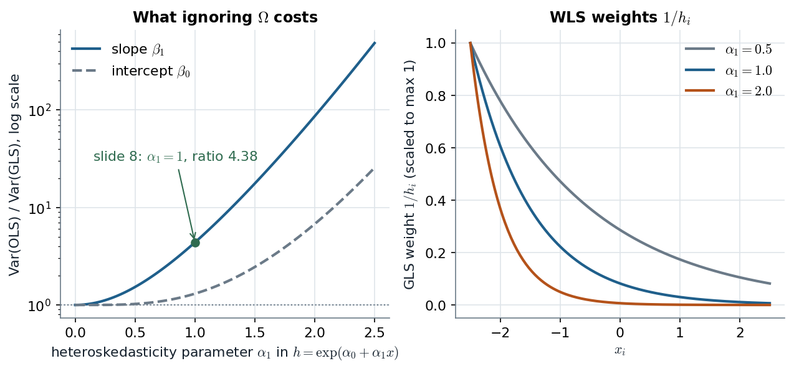

# GLM3 slides 3–15 · Known Ω is OLS after a rotation; unknown Ω costs one Metropolis step

> **Claim.** With $y=X\beta+\epsilon$, $\epsilon\sim N(0,\sigma^2\Omega)$, any matrix $P$ with
> $P\Omega P'=I_n$ turns the model into a standard regression of $Py$ on $PX$. So **GLS is OLS on
> rotated data**, and the Bayesian full conditionals are the familiar normal / inverse-gamma pair
> with $X'X$ replaced by $X'\Omega^{-1}X$. A diagonal $\Omega$ is the heteroskedastic case:
> GLS = **weighted least squares** with weights $1/\omega_i$. When $\omega_i=h(z_i,\alpha)$ is
> unknown, $\alpha$ has no conjugate conditional and is drawn by **Metropolis–Hastings**; the
> frequentist twin is **feasible GLS**, whose first step (regress $\log\hat e_i^2$ on $z_i$) is
> exactly the slides' starting value.
> Prev: — · Next: [[L07-02-student-t-errors]] · Map: [[L07-00-map]]

**Notation.**

- $y$ ($n\times1$), $X$ ($n\times k$, full column rank), $\beta$ ($k\times1$); $\epsilon=y-X\beta$.
- $\sigma^2>0$: scale; $\Omega$ ($n\times n$, symmetric positive definite): the error correlation/variance pattern, $\omega_{ij}$ its entries.
- $P$: any $n\times n$ matrix with $P\Omega P'=I_n$ (e.g. $P=L^{-1}$, $\Omega=LL'$ Cholesky).
- Prior: $\beta\sim N(\beta_0,V_0)$, $\sigma^2\sim IG(\nu_0/2,\nu_0s_0^2/2)$ (slide 4).
- $h(z_i,\alpha)>0$: variance function, $z_i$ ($p\times1$) its covariates, $\alpha$ its parameters (slide 7).
- W's notation: $\mathrm{Var}(u\mid x)=\sigma^2h(x)$, $h_i=h(x_i)$ (8.21).

---

## 1 · U — why the error covariance matters

OLS stays unbiased when $\mathrm{Var}(\epsilon)=\sigma^2\Omega$ (unbiasedness never used the
variance), but two things break: the usual variance formula $\sigma^2(X'X)^{-1}$ is wrong, and OLS
is no longer the most precise linear unbiased estimator. Observations with large variance
(the noisy ones) carry less information about $\beta$ and should count less; correlated
observations repeat part of each other's information and should not be counted twice. GLS does
both, by first transforming the data into something that has spherical errors.

## 2 · C — the known-Ω case (slides 3–5)

**Model (slide 3).**

$$y=X\beta+\epsilon,\qquad \epsilon\sim N(0,\sigma^2\Omega).\tag{1}$$

**The rotation (slide 4).** Take $P$ with $P\Omega P'=I_n$ and multiply (1) by $P$:

$$Py=PX\beta+P\epsilon.\tag{2}$$

The new error has mean 0 and variance

$$\mathrm{Var}(P\epsilon)=P\,\mathrm{Var}(\epsilon)\,P'=P(\sigma^2\Omega)P'=\sigma^2(P\Omega P')=\sigma^2I_n.\tag{3}$$

Writing $y^*=Py$, $X^*=PX$, $\epsilon^*=P\epsilon$, (2)–(3) say $y^*=X^*\beta+\epsilon^*$,
$\epsilon^*\sim N(0,\sigma^2I_n)$: **given Ω, a standard linear regression** (slide 4).

**GLS is OLS on (2).** OLS on the starred data is $(X^{*\prime}X^*)^{-1}X^{*\prime}y^*$. Substitute $X^*=PX$, $y^*=Py$:

$$\hat\beta_{GLS}=(X'P'PX)^{-1}X'P'Py.\tag{4}$$

From $P\Omega P'=I$: $\Omega=P^{-1}(P')^{-1}$, so $\Omega^{-1}=P'P$. Substitute into (4):

$$\hat\beta_{GLS}=(X'\Omega^{-1}X)^{-1}X'\Omega^{-1}y,\qquad \mathrm{Var}(\hat\beta_{GLS})=\sigma^2(X'\Omega^{-1}X)^{-1}.\tag{5}$$

$P$ itself never matters, only $P'P=\Omega^{-1}$. (Checked numerically: `L07_python_checks.py` §1,
OLS on $(Py,PX)$ equals (5) to machine precision.)

**Full conditionals (slide 5).** The likelihood of (1) is

$$p(y\mid\beta,\sigma^2)\propto(\sigma^2)^{-n/2}\exp\Big\{-\frac{1}{2\sigma^2}(y-X\beta)'\Omega^{-1}(y-X\beta)\Big\}.\tag{6}$$

*σ² given β.* Multiply (6) by the $IG(\nu_0/2,\nu_0s_0^2/2)$ kernel $(\sigma^2)^{-\nu_0/2-1}\exp\{-\nu_0s_0^2/(2\sigma^2)\}$ and collect powers and exponents:

$$p(\sigma^2\mid\beta,y)\propto(\sigma^2)^{-(\nu_0+n)/2-1}\exp\Big\{-\frac{\nu_0s_0^2+(y-X\beta)'\Omega^{-1}(y-X\beta)}{2\sigma^2}\Big\},$$

$$\sigma^2\mid\beta,\Omega,y\sim IG(\nu_1/2,\nu_1s_1^2/2),\quad \nu_1=\nu_0+n,\quad \nu_1s_1^2=\nu_0s_0^2+(y-X\beta)'\Omega^{-1}(y-X\beta).\tag{7}$$

*β given σ².* Keep the terms of (6) × prior that involve β:

$$-\tfrac12\big[\sigma^{-2}(y-X\beta)'\Omega^{-1}(y-X\beta)+(\beta-\beta_0)'V_0^{-1}(\beta-\beta_0)\big].$$

Expand and keep the quadratic and linear terms in β:

$$-\tfrac12\big[\beta'(V_0^{-1}+\sigma^{-2}X'\Omega^{-1}X)\beta-2\beta'(V_0^{-1}\beta_0+\sigma^{-2}X'\Omega^{-1}y)\big]+\text{const}.$$

Completing the square gives

$$\beta\mid\sigma^2,\Omega,y\sim N(\beta_1,V_1),\quad V_1^{-1}=V_0^{-1}+\sigma^{-2}X'\Omega^{-1}X,\quad V_1^{-1}\beta_1=V_0^{-1}\beta_0+\sigma^{-2}X'\Omega^{-1}y.\tag{8}$$

> **(8) is a precision-weighted average of the prior mean and the GLS estimate (5).** With
> $V_0^{-1}\to0$, $\beta_1=\hat\beta_{GLS}$ and $V_1=\sigma^2(X'\Omega^{-1}X)^{-1}$; with $\Omega=I$ it is
> G's (8.2) (p. 111). Alternating (7) and (8) is G's Algorithm 8.1 (p. 112) with Ω in place.

## 3 · C — Ω diagonal: weighted least squares (slide 6; W §8.4a)

With $\Omega=\mathrm{diag}(\omega_1,\dots,\omega_n)$ (slide 6), $P=\mathrm{diag}(\omega_i^{-1/2})$ and (2) divides row $i$ by $\sqrt{\omega_i}$ — W's transformed equation (8.25)–(8.26), p. 255, with $h_i=\omega_i$:

$$\frac{y_i}{\sqrt{h_i}}=\beta_0\frac{1}{\sqrt{h_i}}+\beta_1\frac{x_{i1}}{\sqrt{h_i}}+\dots+\beta_k\frac{x_{ik}}{\sqrt{h_i}}+\frac{u_i}{\sqrt{h_i}}.\tag{9}$$

The **constant is divided too** — (9) has no intercept column of ones. OLS on (9) minimises

$$\sum_{i=1}^n\frac{(y_i-x_i'\beta)^2}{h_i}\qquad\text{(W 8.27, p. 256)},\tag{10}$$

the residuals weighted by $1/h_i$, the variables by $1/\sqrt{h_i}$. (10) is (5) written out, since $X'\Omega^{-1}X=\sum_ix_ix_i'/h_i$.

**Worked: W Example 8.6 (Table 8.1, p. 257).** Net total financial wealth (`nettfa`, \$1000s) on
income (`inc`, \$1000s), single people ($n=2{,}017$), WLS under $\mathrm{Var}(u\mid inc)=\sigma^2inc$
(so $h_i=inc_i$, weight $1/inc_i$):

| | intercept | inc | $R^2$ |
|---|---|---|---|
| OLS (robust SE) | −10.57 (2.53) | 0.821 (0.104) | 0.0827 |
| WLS, weights $1/inc$ | −9.58 (1.65) | 0.787 (0.063) | 0.0709 |

All eight numbers are reproduced from the `401KSUBS` data in `L07_python_checks.py` §1. The WLS
standard error of the income slope is $0.063/0.104=0.61$ of the OLS one — "almost 40% smaller"
(W p. 257), **provided** the variance model is right. The $R^2$ of WLS is lower and **not
comparable**: it measures fit of the weighted problem (W p. 256).

**Case I vs Case II (slide 6).** The slides split diagonal Ω into $\omega_i=h(z_i,\alpha)$
(Case I, a deterministic function of covariates — this note) and $\omega_i$ random with an
inverse-gamma law (Case II — the Student-t model, [[L07-02-student-t-errors]]).

## 4 · C — Case I: ω_i = h(z_i, α), and why α needs Metropolis–Hastings (slides 7–8)

**Variance functions (slide 7).** $h(z_i,\alpha)=(\alpha_1z_{i1}+\dots+\alpha_pz_{ip})^2$ or, more
commonly, $h(z_i,\alpha)=\exp\{\alpha_1z_{i1}+\dots+\alpha_pz_{ip}\}$ — W's (8.30), p. 259, is the same
exponential form.

**The conditional of α.** Given β and σ², with $e_i=y_i-x_i'\beta$, (6) becomes

$$p(\alpha\mid y,\beta,\sigma^2)\propto p(\alpha)\prod_{i=1}^nh(z_i,\alpha)^{-1/2}\exp\Big\{-\frac{e_i^2}{2\sigma^2h(z_i,\alpha)}\Big\}.\tag{11}$$

For $h=\exp(z_i'\alpha)$, substitute and take logs:

$$\log p(\alpha\mid\cdot)=\log p(\alpha)-\tfrac12\sum_iz_i'\alpha-\frac{1}{2\sigma^2}\sum_ie_i^2e^{-z_i'\alpha}+\text{const}.\tag{12}$$

α appears linearly and inside an exponential: no normal prior makes (12) a known family, so the
sampler alternates (7), (8) with $\Omega=\mathrm{diag}\{h(z_i,\alpha)\}$, and a **random-walk MH step**
for α: propose $\alpha^\dagger=\alpha+\delta$, $\delta\sim N(0,c^2I)$, accept with probability
$\min\{1,\exp[\log p(\alpha^\dagger\mid\cdot)-\log p(\alpha\mid\cdot)]\}$ (the RW proposal is
symmetric, so it cancels).

**Identification (slide 8).** With an intercept in $z$, $\sigma^2h(z,\alpha)=\sigma^2e^{\alpha_0}e^{\alpha_1x}$:
$\sigma^2$ and $e^{\alpha_0}$ enter only through their product, so the slide **fixes $\sigma^2=1$**.

**The slide-8 design.** $n=100$, $h=\exp\{\alpha_0+\alpha_1x_i\}$, $x_i\sim N(0,1)$, $\alpha=(1,1)$,
priors $\beta\sim N(0,100I_2)$, $\alpha\sim N(0,100I_2)$; start at $\hat\beta_{ols}$ and at α from the
regression of $\log(y_i-x_i'\hat\beta_{ols})^2$ on $x_i$; burn-in 1000, keep every 20th draw to $M=1000$.

> **Slip on slide 8.** It prints $\beta=(2.0,4.0)$, but its own scatter (slide 9: $y$ between 4
> and 16, slope well under 1), its OLS start $\hat\beta_{ols}=(9.12,0.62)$ and its chains (centred
> near 9 and 0.7, slide 10) are not consistent with that β. The true β of the run cannot be
> recovered from the deck; the α part ($\alpha=(1,1)$, chains near 1) is consistent.

**Re-run here** with the printed $\beta=(2,4)$, $\alpha=(1,1)$ (`L07_python_checks.py` §1, seeded,
12,000 iterations, 2,000 burn-in, RW step 0.15): MH acceptance 0.55; posterior means
$\beta=(2.20,3.97)$, $\alpha=(0.93,1.12)$.

### 4.1 · Feasible GLS is the slides' starting value (W §8.4b, pp. 259–260)

W's FGLS: (i) OLS residuals $\hat u_i$; (ii) regress $\log\hat u_i^2$ on the $x$'s (8.32); (iii)
$\hat h_i=\exp(\hat g_i)$ from the fitted values (8.33); (iv) WLS with weights $1/\hat h_i$. Step (ii)
is footnote 1 of slide 8. Why the log regression works: under (8.30)

$$u^2=\sigma^2\exp(\delta_0+\delta_1x_1+\dots)\,v,\quad E(v\mid x)=1\ \Rightarrow\ \log u^2=\alpha_0+\delta_1x_1+\dots+e\qquad(8.31),$$

so the **slopes** are estimated consistently; the intercept absorbs $\log\sigma^2+E\log v$ (for
normal errors $v\sim\chi^2_1$ and $E\log\chi^2_1=-1.27$), which does not matter because a constant
factor in $h$ cancels from WLS.

**What OLS loses.** For a fixed design and $h=\exp(\alpha_1x)$:
$\mathrm{Var}(\hat\beta_{OLS})=\sigma^2(X'X)^{-1}X'\Omega X(X'X)^{-1}$ versus (5).

*Exact variance ratio, 100 normal-quantile design points standing in for $x_i\sim N(0,1)$ (slide 8); (5) vs the OLS sandwich.*

At $\alpha_1=0$ the ratio is 1 (OLS is GLS); at the slide's $\alpha_1=1$ the OLS slope variance is
**4.38 times** the GLS variance, and the curve climbs steeply after that because $e^{\alpha_1x}$
makes a few large-$x$ points carry almost all the noise. The right panel shows why: GLS gives those
points weights near zero, OLS gives them weight one.

> **Robust standard errors fix the inference, not the efficiency.** OLS with HC standard errors
> (W §8.2) is valid whatever Ω is; GLS/WLS is *better* only if the variance model is right (W §8.4c,
> p. 261). Example 8.6's WLS SE is 40% smaller *under* $h=inc$.

## 5 · C — the US airline cost example (slides 11–15)

Greene's data: 6 airlines × 15 years (1970–1984), 90 observations. Mean: log cost on log output,
log fuel price and load factor; variance: $h=\exp(\alpha_1+\alpha_2\,LF)$. Starting values (slide
12): OLS $-10.7112+1.1113\,\log Q-0.5049\,\log PF+2.0197\,LF$ and $\log\hat e^2=-6.3723+1.7032\,LF$.
Priors $N(0,10^4I)$ for β and α; RW-MH with variances (0.5, 0.5); $(M_0,\text{lag},M)=(1000,100,1000)$
(slide 13). Posterior (slide 14):

| | $E(\theta\mid y)$ | sd | 2.5% | 50% | 97.5% |
|---|---|---|---|---|---|
| $\beta_1$ intercept | −10.733 | 0.211 | −11.146 | −10.730 | −10.317 |
| $\beta_2$ log output | 1.117 | 0.016 | 1.086 | 1.117 | 1.148 |
| $\beta_3$ log fuel price | −0.504 | 0.023 | −0.549 | −0.503 | −0.460 |
| $\beta_4$ load factor | 1.895 | 0.374 | 1.178 | 1.887 | 2.626 |
| $\alpha_1$ | −3.968 | 0.157 | −4.256 | −3.964 | −3.667 |
| $\alpha_2$ | 7.085 | 3.293 | 0.572 | 7.077 | 13.731 |

**Reading.** $e^{\alpha_1}=e^{-3.968}=0.0189$ is the variance scale at $LF=0$ (slide 15's histogram
of $e^{\alpha_1}$ is centred near 0.02). Load factor ranges over about 0.4–0.7 (slide 12); a 0.1
rise multiplies the error variance by $e^{0.1\times7.085}=e^{0.7085}=2.03$. The 95% interval of
$\alpha_2$ excludes 0, so heteroskedasticity in LF is supported, but it is wide (0.57 to 13.7): the
variance function is far less precisely learned than the mean. The β's barely move from OLS, as
expected — heteroskedasticity changes precision, not location.

## Links

- Unit: [[L07-00-map]] · next [[L07-02-student-t-errors]] (Case II) · [[L07-03-ar1-errors]] (non-diagonal Ω) · [[L07-07-formulas]] · [[L07-08-pitfalls]] · [[L07-09-python]] §1.
- Class 1: [[../L01/L01-06-gaussian-linear-regression|L01 §6]] (OLS = MLE under spherical errors — the special case Ω = I).
- Class 2: [[../L02/L02-03-cross-validation-motorcycle|L02 §3]] (the mcycle noise is heteroskedastic: the pairs-bootstrap band vs the formula band).
- Later: SUR (GLM3 slides 31–32) is GLS with $\Omega=I_n\otimes\Sigma$; it returns in Class 9 and is used here only for the multinomial probit ([[L07-06-probit-ordered-multinomial]] §6).
- Rules pack: [[../../rules/03_painel_did|rules/03]] (the unit's panel/hierarchical topic).
- **Practice** (statements in the books): W 12.C2 (p. 397) and 12.C10 (p. 399) are the AR(1) analogues ([[L07-03-ar1-errors]]); G 8.5 (p. 132) is the Case II sampler of the next note. Case I has no assigned exercise: re-derive (11)–(12) for $h=(z_i'\alpha)^2$ as a self-check.
