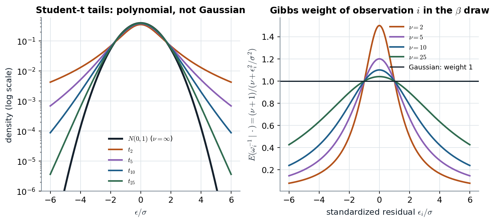

# GLM3 slides 16–21 · The Student-t is a normal with a random variance, and that makes it Gibbs-friendly

> **Claim.** If $\epsilon_i\mid\omega_i\sim N(0,\sigma^2\omega_i)$ and $\omega_i\sim IG(\nu/2,\nu/2)$, then
> marginally $\epsilon_i\sim t_\nu(0,\sigma^2)$ — the t is a **scale mixture of normals**. Keeping the
> $\omega_i$ in the sampler turns a non-conjugate t regression into the heteroskedastic regression
> of [[L07-01-general-covariance-gls]] with **conjugate** inverse-gamma $\omega_i$: each observation
> gets the weight $E(\omega_i^{-1}\mid\cdot)=(\nu+1)/(\nu+\epsilon_i^2/\sigma^2)$, which is below 1
> exactly when $|\epsilon_i|>\sigma$ — **outliers are downweighted automatically**. The degrees of
> freedom ν get an exponential prior and a Metropolis step.
> Prev: [[L07-01-general-covariance-gls]] · Next: [[L07-03-ar1-errors]] · Map: [[L07-00-map]]

**Notation.**

- $\omega_i>0$: observation-specific variance multiplier (slides 16–18); $\lambda_i=\omega_i^{-1}$ its precision (G writes $\lambda_i$, eq. 8.4).
- $\nu>0$: degrees of freedom; $\nu^0$: prior mean of ν (slide 17); $\sigma^2$: scale (not the variance).
- $IG(a,b)$: density $\frac{b^a}{\Gamma(a)}w^{-a-1}e^{-b/w}$; $G(a,b)$: density $\frac{b^a}{\Gamma(a)}\lambda^{a-1}e^{-b\lambda}$ (rate $b$). $\omega\sim IG(a,b)\iff\omega^{-1}\sim G(a,b)$.
- $t_\nu(0,\sigma^2)$: density $\propto(1+e^2/(\nu\sigma^2))^{-(\nu+1)/2}$; variance $\sigma^2\nu/(\nu-2)$ for $\nu>2$.

---

## 1 · U — fat tails as "some observations are noisier"

A Gaussian likelihood treats a residual of 5σ as nearly impossible ($\phi(5)/\phi(0)=e^{-12.5}$), so
OLS bends the line toward it. A t likelihood says such residuals happen. The mixture reading gives
the mechanism: every observation draws its own variance $\sigma^2\omega_i$; a few draw large ones.
After seeing the data, an observation with a huge residual is inferred to have had a large
$\omega_i$, and counts little in the β update. G §4.5 (p. 51) motivates the prior on $\omega_i$ (his
$\lambda_i$) by **exchangeability**: each $\lambda_i$ belongs to observation $i$, but nothing tells us
in advance which observations are the noisy ones, so they are drawn iid from one distribution.

## 2 · C — the scale-mixture identity (slide 16; G p. 52)

Joint density of $(\epsilon,\omega)$ given $\sigma^2$, from $N(0,\sigma^2\omega)$ times $IG(\nu/2,\nu/2)$:

$$f(\epsilon,\omega\mid\sigma^2)=\frac{1}{\sqrt{2\pi\sigma^2\omega}}e^{-\epsilon^2/(2\sigma^2\omega)}\cdot\frac{(\nu/2)^{\nu/2}}{\Gamma(\nu/2)}\omega^{-\nu/2-1}e^{-\nu/(2\omega)}.\tag{1}$$

Collect the powers of ω and the exponents:

$$f(\epsilon,\omega\mid\sigma^2)\propto\omega^{-(\nu+1)/2-1}\exp\Big\{-\frac{1}{\omega}\cdot\frac{\nu+\epsilon^2/\sigma^2}{2}\Big\}.\tag{2}$$

As a function of ω, (2) is an $IG\big(\frac{\nu+1}{2},\frac{\nu+\epsilon^2/\sigma^2}{2}\big)$ kernel. Its integral over ω is
$\Gamma(a)/b^a$ with $a=(\nu+1)/2$, $b=(\nu+\epsilon^2/\sigma^2)/2$:

$$f(\epsilon\mid\sigma^2)=\int_0^\infty f(\epsilon,\omega\mid\sigma^2)\,d\omega\propto\Big(\frac{\nu+\epsilon^2/\sigma^2}{2}\Big)^{-(\nu+1)/2}\propto\Big(1+\frac{\epsilon^2}{\nu\sigma^2}\Big)^{-(\nu+1)/2},\tag{3}$$

the $t_\nu(0,\sigma^2)$ kernel. ∎ (Checked by quadrature at 20 $(\nu,\epsilon)$ pairs, `L07_python_checks.py` §2.)

> **Conditionally heteroskedastic, marginally homoskedastic** (G p. 52): $\mathrm{Var}(\epsilon_i\mid\omega_i)=\sigma^2\omega_i$
> differs across $i$, but every $\epsilon_i$ has the same marginal $t_\nu(0,\sigma^2)$.

**Slip on slide 6.** It writes Case II as "$\omega_i^{-1}\sim IG(\nu/2,\nu/2)$"; slides 16 and 18 (and
G's $\lambda_i\sim G(\nu/2,\nu/2)$) use $\omega_i\sim IG$, i.e. $\omega_i^{-1}\sim G(\nu/2,\nu/2)$ — a **gamma**, not an
inverse gamma. With $\omega_i^{-1}\sim IG$ the marginal would not be a t.

*Left: (3) against the normal, log scale. Right: the conditional mean (5) of $\omega_i^{-1}$ — the weight observation $i$ carries in the next β draw.*

On the log scale the normal is a parabola and the t's are much flatter: at $|e|=6$ the $t_5$
density is $6.9\times10^{-4}$ against the normal's $6.1\times10^{-9}$, about 110,000 times larger. On the right, every curve passes
through 1 at $|e/\sigma|=1$ ($(\nu+1)/(\nu+1)$), exceeds 1 inside, and decays like $\nu/e^2$ outside: a 6σ
residual gets weight $3/38=0.079$ at ν = 2 and $26/61=0.43$ at ν = 25. Larger ν flattens the curve
toward the Gaussian constant weight.

## 3 · C — full conditionals (slides 18; G p. 115)

Model: $y_i=x_i'\beta+\epsilon_i$, $\epsilon_i\mid\omega_i\sim N(0,\sigma^2\omega_i)$, $\omega_i\sim IG(\nu/2,\nu/2)$; priors as in
[[L07-01-general-covariance-gls]] (β normal, σ² inverse gamma), plus a prior on ν.

**$\omega_i$.** Given everything else, only factor $i$ of the likelihood and the prior of $\omega_i$
involve it; with $\epsilon_i=y_i-x_i'\beta$ this is (2):

$$\omega_i\mid y,\beta,\sigma^2,\nu\sim IG\Big(\frac{\nu+1}{2},\frac{\nu+\epsilon_i^2/\sigma^2}{2}\Big),\quad\text{equivalently}\quad \lambda_i\sim G\Big(\frac{\nu+1}{2},\frac{\nu+\epsilon_i^2/\sigma^2}{2}\Big).\tag{4}$$

The gamma mean (shape/rate) gives the weight:

$$E(\omega_i^{-1}\mid\cdot)=\frac{(\nu+1)/2}{(\nu+\epsilon_i^2/\sigma^2)/2}=\frac{\nu+1}{\nu+\epsilon_i^2/\sigma^2}.\tag{5}$$

**β and σ².** Given $\Omega=\mathrm{diag}(\omega_i)$ the model is Case I's: (7)–(8) of note 01 with that Ω,
i.e. $V_1^{-1}=V_0^{-1}+\sigma^{-2}\sum_ix_ix_i'/\omega_i$, $V_1^{-1}\beta_1=V_0^{-1}\beta_0+\sigma^{-2}\sum_ix_iy_i/\omega_i$, and
$\nu_1s_1^2=\nu_0s_0^2+\sum_i\epsilon_i^2/\omega_i$ (G's $\delta_1=\delta_0+(y-X\beta)'\Lambda(y-X\beta)$, p. 115).

**ν.** Only the $\omega_i$ priors and $p(\nu)$ involve ν. Multiply the $n$ IG densities:

$$\prod_{i=1}^n\frac{(\nu/2)^{\nu/2}}{\Gamma(\nu/2)}\omega_i^{-\nu/2-1}e^{-\nu/(2\omega_i)}=\Big[\frac{(\nu/2)^{\nu/2}}{\Gamma(\nu/2)}\Big]^n\exp\Big\{-\frac{\nu}{2}\sum_i\big(\ln\omega_i+\omega_i^{-1}\big)\Big\}\prod_i\omega_i^{-1}.$$

With the exponential prior $p(\nu)\propto e^{-\nu/\nu^0}$ (§4), dropping $\prod_i\omega_i^{-1}$ (free of ν):

$$p(\nu\mid\omega)\propto\Big[\frac{(\nu/2)^{\nu/2}}{\Gamma(\nu/2)}\Big]^n\exp\Big\{-\Big[\frac{1}{\nu^0}+\frac12\sum_{i=1}^n\big(\ln\omega_i+\omega_i^{-1}\big)\Big]\nu\Big\},\quad\nu>0,\tag{6}$$

exactly slide 18. (6) is no standard family (ν sits inside a Gamma function): **ν needs an MH
step**. G (§8.1.2) avoids it by fixing ν (= 5 in his example); G §4.6 (p. 53) is the hierarchical
version, a prior on ν.

## 4 · C — the prior of ν, and Geweke's warning (slide 17)

$\nu\sim G(1,1/\nu^0)\equiv\mathrm{Exp}$ with mean $\nu^0$, so $E(\nu)=\sqrt{V(\nu)}=\nu^0$. With $\nu^0=25$:

$$P(\nu\le10)=1-e^{-10/25}=1-0.6703=0.3297,\qquad P(\nu\ge40)=e^{-40/25}=0.2019.$$

One third of the prior mass on fat tails, one fifth on "practically normal" (the t is close to the
normal in its centre once ν ≳ 30, G p. 53): this is what "substantial prior on both" means on slide 17.

**Geweke (1993), slide 17:** with $p(\beta)\propto1$, $E(\beta\mid y)$ does not exist unless
$P\{\nu\in(0,2]\}=0$, and $V(\beta\mid y)$ unless $P\{\nu\in(0,4]\}=0$. The t's own moments exist only
for $\nu>1$ (mean) and $\nu>2$ (variance); under a flat β prior the posterior inherits that tail
problem. **Medians and quantiles still exist** — report them, or use a proper prior on β.

## 5 · C — the simulated example (slides 19–21) and a re-run

**Design (slide 19).** $n=100$, $\nu=10$, $\sigma^2=1$, $\beta=(0.5,1.0,2.0)$; priors $\beta_0=0$, $V_0=10I_3$,
$\nu_0=5$, $s_0^2=1$, $\nu^0=25$; start at OLS, $\nu=10$, $\omega_i=1$; RW proposal
$q(\nu\mid\nu^{(j-1)})=N(\nu^{(j-1)},0.25^2)$; burn-in 10,000, every 100th draw to $M=1000$.

**What the slides show (20–21).** β and σ² chains mix well and cover the true values; **the ν chain
does not** — its ACF is still about 0.5 at lag 30 even after thinning by 100, and its histogram
spreads over 5–60 around the true 10. ν is weakly identified by 100 observations: only the few
large residuals speak about the tails.

**Re-run** (`L07_python_checks.py` §2; same design, one observation shifted by +15 to create an
outlier; 3,000 burn-in + 20,000 draws, no thinning):

| | intercept | $\beta_1$ | $\beta_2$ |
|---|---|---|---|
| true | 0.5 | 1.0 | 2.0 |
| OLS | 0.54 | 1.07 | 2.03 |
| t-posterior mean | 0.43 | 0.87 | 1.93 |

Posterior mean of ν: **3.8** (the outlier drags the tails fatter than the true 10); MH acceptance
0.83 (a 0.25 step is small for ν); posterior mean weight of the outlier **0.018** against a median
weight of 1.06. Dropping the outlier moves the OLS intercept by more than twice what it moves
the t posterior (asserted). That is the robustness: the t fit **ignores the outlier by itself**,
without anyone deleting it.

## 6 · C — Greenberg's Vella–Verbeek comparison (G §8.1.1–8.1.2, pp. 112–116)

Union-membership coefficient $\beta_U$ in a log-wage regression:

| errors | $E(\beta_U\mid y)$ | sd | 95% interval | $E(\sigma^2\mid y)$ | log₁₀ marginal likelihood |
|---|---|---|---|---|---|
| Gaussian | 0.129 | 0.036 | (0.059, 0.198) | 0.165 | −152.78 |
| Student-t, ν = 5 | 0.128 | 0.033 | (0.062, 0.192) | 0.105 | −147.95 |

The coefficient hardly moves; **σ² does, and should**: under $t_5$ the error variance is
$\sigma^2\cdot5/3=0.105\times1.667=0.175$, close to the Gaussian 0.165 — the two models describe about the
same spread with different scale parameters. The log₁₀ Bayes factor is $-147.95-(-152.78)=4.83$ in
favour of t errors ("strong evidence", G p. 116). The t sampler's inefficiency factor is higher
(1.274 vs 1.074) because the $\lambda_i$ add autocorrelation.

## Links

- Unit: [[L07-00-map]] · [[L07-01-general-covariance-gls]] (Case I, the conditionals reused in §3) · [[L07-05-tobit]] and [[L07-06-probit-ordered-multinomial]] (t versions of the latent-data models: G 8.6, 8.7) · [[L07-07-formulas]] · [[L07-08-pitfalls]] · [[L07-09-python]] §2.
- Class 1: [[../L01/L01-04-first-bayesian-poisson|L01 §4]] (conjugate updating, the gamma–Poisson pattern that (4) repeats).
- Later: the same mixture gives Student-t stochastic volatility in Class 8 ([[../L08/L08-00-map|L08]]).
- **Practice** (statements in the books): G 8.3 (p. 132, t errors with five degrees of freedom and a marginal-likelihood comparison); G 8.5 (p. 132, the sampler of §3); G 4.6 (p. 59, iid ⇒ exchangeable, the assumption behind §1); G 9.3 (p. 151, t errors in the panel model of [[L07-04-hierarchical-linear-models]]).
