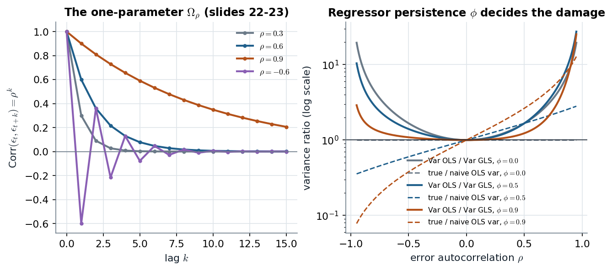

# GLM3 slides 22–30 · One parameter ρ fills the whole n × n Ω, and GLS is quasi-differencing

> **Claim.** AR(1) errors $\epsilon_t=\rho\epsilon_{t-1}+u_t$ give $\mathrm{Corr}(\epsilon_t,\epsilon_{t+k})=\rho^k$: a full
> $n\times n$ covariance pinned down by **one** parameter. $\Omega_\rho^{-1}$ is **tridiagonal**, so GLS is OLS
> on **quasi-differenced** data $y_t-\rho y_{t-1}$ (Prais–Winsten keeps the first row, rescaled;
> Cochrane–Orcutt drops it). In the Gibbs sampler β and σ² keep the note-01 conditionals with
> $\Omega_\rho$; ρ is drawn either by MH on its exact conditional or — after "a small sin", conditioning on
> the first error — **exactly** from a truncated normal, by the inverse-CDF formula of slide 26.
> How much OLS loses, and how wrong its standard errors are, depends on **ρ times the persistence of
> the regressor**.
> Prev: [[L07-02-student-t-errors]] · Next: [[L07-04-hierarchical-linear-models]] · Map: [[L07-00-map]]

**Notation.**

- $y_t=x_t'\beta+\epsilon_t$, $t=1,\dots,n$; $\epsilon_t=\rho\epsilon_{t-1}+u_t$, $u_t\sim N(0,\sigma^2)$ iid, $|\rho|<1$ (slide 22). W writes $u_t=\rho u_{t-1}+e_t$ (12.26), $\sigma_e^2$ for our σ².
- $\Omega_\rho$: the $n\times n$ matrix with entries $\rho^{|i-j|}/(1-\rho^2)$, so $\mathrm{Var}(\epsilon)=\sigma^2\Omega_\rho$ (slide 23).
- $\tilde y_t=y_t-\rho y_{t-1}$, $\tilde x_t=x_t-\rho x_{t-1}$: quasi-differences (W 12.29).
- $\rho_0,V_\rho$: prior mean and variance of ρ, truncated to $[-1,1]$ (slide 24).
- §3 only: $x_t$ a stationary AR(1) with coefficient φ and variance $\sigma_x^2$.

---

## 1 · C — the covariance of AR(1) errors (slide 22)

Take variances in $\epsilon_t=\rho\epsilon_{t-1}+u_t$, with $u_t$ independent of $\epsilon_{t-1}$ and stationarity $\mathrm{Var}(\epsilon_t)=\mathrm{Var}(\epsilon_{t-1})=\gamma_0$:

$$\gamma_0=\rho^2\gamma_0+\sigma^2\ \Rightarrow\ \gamma_0=\frac{\sigma^2}{1-\rho^2}\qquad(\text{W 12.27}).\tag{1}$$

Substitute the recursion $k$ times: $\epsilon_{t+k}=\rho^k\epsilon_t+\sum_{j=0}^{k-1}\rho^ju_{t+k-j}$; the sum is
independent of $\epsilon_t$, so

$$\mathrm{Cov}(\epsilon_t,\epsilon_{t+k})=\rho^k\gamma_0=\rho^k\frac{\sigma^2}{1-\rho^2},\qquad E(\epsilon_t)=0.\tag{2}$$

Stacking (2) gives $\epsilon\mid\sigma^2,\rho\sim N(0,\sigma^2\Omega_\rho)$ with $(\Omega_\rho)_{ij}=\rho^{|i-j|}/(1-\rho^2)$ (slide 23), and
$y\mid X,\beta,\sigma^2,\rho\sim N(X\beta,\sigma^2\Omega_\rho)$: model (1) of [[L07-01-general-covariance-gls]] with a
one-parameter Ω. The full conditionals of β and σ² are (7)–(8) of that note with $\Omega=\Omega_\rho$ (slide 23).

*Left: (2) for four ρ. Right: the large-sample ratios (10) and (11), exact expressions; solid = OLS/GLS variance, dashed = true/naive OLS variance.*

The left panel is the whole Ω: geometric decay, alternating in sign for $\rho<0$. The right panel is
§3: with an iid regressor ($\phi=0$) the naive OLS variance is right (dashed line flat at 1) yet OLS
still loses to GLS; with a persistent regressor ($\phi=0.9$) and positive ρ the naive formula
understates the variance (by 9.5 times at $\rho=0.9$) — standard errors too small by $\sqrt{9.53}=3.1$.

## 2 · C — GLS by quasi-differencing (W §12.3a, pp. 382–383)

**$\Omega_\rho^{-1}$ is tridiagonal.** Claim:

$$\Omega_\rho^{-1}=\begin{pmatrix}1&-\rho&&&\\-\rho&1+\rho^2&-\rho&&\\&\ddots&\ddots&\ddots&\\&&-\rho&1+\rho^2&-\rho\\&&&-\rho&1\end{pmatrix}.\tag{3}$$

It factors as $\Omega_\rho^{-1}=P'P$ with the **Prais–Winsten matrix**

$$P=\begin{pmatrix}\sqrt{1-\rho^2}&0&\cdots&0\\-\rho&1&&\\&\ddots&\ddots&\\0&&-\rho&1\end{pmatrix}.\tag{4}$$

Check (4)⇒(3): column $j$ of $P$ has $1$ (or $\sqrt{1-\rho^2}$ for $j=1$) on the diagonal and $-\rho$ just
below. So $(P'P)_{jj}=1+\rho^2$ for $1<j<n$, $(P'P)_{11}=(1-\rho^2)+\rho^2=1$, $(P'P)_{nn}=1$, $(P'P)_{j,j+1}=-\rho$. ∎
(Both identities asserted in `L07_python_checks.py` §3.)

**$P$ applied to the model.** Row 1 of $Py$: $\sqrt{1-\rho^2}\,y_1$; row $t\ge2$: $y_t-\rho y_{t-1}$. So

$$\sqrt{1-\rho^2}\,y_1=\sqrt{1-\rho^2}\,x_1'\beta+\sqrt{1-\rho^2}\,\epsilon_1\qquad(\text{W 12.31}),\tag{5}$$
$$y_t-\rho y_{t-1}=(x_t-\rho x_{t-1})'\beta+u_t,\quad t\ge2\qquad(\text{W 12.28, 12.32}).\tag{6}$$

The errors are now white: $u_t=\epsilon_t-\rho\epsilon_{t-1}$ for $t\ge2$, and by (1) $\mathrm{Var}(\sqrt{1-\rho^2}\epsilon_1)=(1-\rho^2)\sigma^2/(1-\rho^2)=\sigma^2$.
OLS on (5)–(6) is the BLUE (W p. 383). With an intercept, the constant column becomes
$\sqrt{1-\rho^2}$ in row 1 and $1-\rho$ in rows $t\ge2$ (W 12.33).

**Feasible GLS (W §12.3b, p. 383).** (i) OLS residuals $\hat u_t$; (ii) $\hat\rho$ from regressing $\hat u_t$ on
$\hat u_{t-1}$ (W 12.14); (iii) OLS on (5)–(6) with $\hat\rho$. **Prais–Winsten** keeps (5),
**Cochrane–Orcutt** drops it; both are usually iterated to convergence of $\hat\rho$. Asymptotically
the same; in a small sample the first row can matter.

**Worked: W Example 12.4 (Table 12.1, p. 384), BARIUM, $n=131$.** Log Chinese barium imports on
log chemical production, log gasoline production, log exchange rate and three antidumping dummies.
Reproduced exactly from the data (`L07_python_checks.py` §3; iterated PW converges in 11 steps):

| | OLS | Prais–Winsten |
|---|---|---|
| log(chempi) | 3.12 (0.48) | 2.94 (0.63) |
| afdec6 | −0.565 (0.286) | −0.577 (0.342) |
| intercept | −17.80 (21.05) | −37.08 (22.78) |
| $\hat\rho$ | — | 0.293 |

Every PW standard error is larger: OLS ignores the positive serial correlation and understates
sampling variation (W p. 384), and $t_{afdec6}$ falls to $-0.577/0.342=-1.69$. Iterated
Cochrane–Orcutt gives $\hat\rho=0.293$ and 2.95 for log(chempi) — close, as expected with 131 points.

**T §2.9 (pp. 90–93), the same issue in finance.** Regressing the 3-year on the 1-year Treasury rate
in levels gives $r_{3t}=0.832+0.930r_{1t}+e_t$ with $R^2=96.5\%$ (2.44) but unit-root-like residuals; in
changes, $c_{3t}=0.792c_{1t}+e_t$ (2.45) still has serially correlated residuals, which T models
jointly as MA(1) errors (2.46). "One of the most commonly misused econometric models because the
serial dependence in $e_t$ is often overlooked" (T p. 90).

## 3 · C/G — how much OLS loses, in closed form

Single demeaned regressor, $x_t$ AR(1)(φ) with variance $\sigma_x^2$, independent of the errors. OLS:
$\hat\beta-\beta=\sum_tx_t\epsilon_t/\sum_tx_t^2$, with $\sum_tx_t^2\approx n\sigma_x^2$. The numerator's variance:

$$\mathrm{Var}\Big(\sum_tx_t\epsilon_t\Big)=\sum_s\sum_tE(x_sx_t)E(\epsilon_s\epsilon_t)=\sum_s\sum_t\sigma_x^2\phi^{|s-t|}\gamma_0\rho^{|s-t|}.\tag{7}$$

For large $n$, $\sum_s\sum_t(\rho\phi)^{|s-t|}\approx n\big[1+2\sum_{k\ge1}(\rho\phi)^k\big]=n\frac{1+\rho\phi}{1-\rho\phi}$. Substitute into (7) and divide by $(n\sigma_x^2)^2$:

$$\mathrm{Var}(\hat\beta_{OLS})\approx\frac{\gamma_0}{n\sigma_x^2}\cdot\frac{1+\rho\phi}{1-\rho\phi}.\tag{8}$$

The **naive** formula $\hat\gamma_0/\sum x_t^2\approx\gamma_0/(n\sigma_x^2)$ drops the last factor. **GLS** is OLS on (6):
$\tilde x_t=x_t-\rho x_{t-1}$ has variance $\sigma_x^2(1+\rho^2-2\rho\phi)$ and the error $u_t$ has variance
$\sigma^2=\gamma_0(1-\rho^2)$ by (1), so

$$\mathrm{Var}(\hat\beta_{GLS})\approx\frac{\gamma_0(1-\rho^2)}{n\sigma_x^2(1+\rho^2-2\rho\phi)}.\tag{9}$$

Dividing (8) by the naive formula, and (8) by (9):

$$\frac{\text{true Var}_{OLS}}{\text{naive Var}_{OLS}}=\frac{1+\rho\phi}{1-\rho\phi},\tag{10}$$
$$\frac{\mathrm{Var}_{OLS}}{\mathrm{Var}_{GLS}}=\frac{1+\rho\phi}{1-\rho\phi}\cdot\frac{1+\rho^2-2\rho\phi}{1-\rho^2}.\tag{11}$$

Numbers at $\rho=0.9$: with $\phi=0.9$, (10) $=1.81/0.19=9.53$; with $\phi=0$, (10) $=1$ but (11)
$=(1+0.81)/(1-0.81)=9.53$ (asserted in `make_figures.py`). **Reading:** the bias of the usual SE comes
from the *product* ρφ (both series persistent in the same direction, the typical macro case); the efficiency loss exists even when the SE is right.

## 4 · C — the conditional of ρ (slides 24–26)

**Exact (slide 24).** With prior $\rho\sim N_{[-1,1]}(\rho_0,V_\rho)$ and $\epsilon=y-X\beta$:

$$p(\rho\mid\epsilon,\sigma^2)\propto|\Omega_\rho|^{-1/2}\exp\Big\{-\frac{1}{2\sigma^2}\epsilon'\Omega_\rho^{-1}\epsilon\Big\}\exp\Big\{-\frac{(\rho-\rho_0)^2}{2V_\rho}\Big\}1(|\rho|<1).\tag{12}$$

**Slip on slide 24:** its exponent reads $-0.5\,\epsilon'\Omega_\rho^{-1}\epsilon$ without $\sigma^{-2}$; the factor is needed since
$\mathrm{Var}(\epsilon)=\sigma^2\Omega_\rho$ (and the prior term is written $\rho^2-2\rho\rho_0$, the same up to a constant). Because $|\Omega_\rho|=(1-\rho^2)^{-1}$ and (3)
is quadratic in ρ except for its corners, (12) is not a standard density: **MH step**.

**"A small sin" (slide 25).** Treat $\epsilon_1$ as given (drop its factor). Then the likelihood is that of
the regression $\epsilon_t=\rho\epsilon_{t-1}+u_t$, $t=2,\dots,n$. With $\tilde\epsilon=(\epsilon_1,\dots,\epsilon_{n-1})'$ and $\epsilon=(\epsilon_2,\dots,\epsilon_n)'$,
the exponent in ρ is

$$-\frac{1}{2}\Big[\frac{(\epsilon-\rho\tilde\epsilon)'(\epsilon-\rho\tilde\epsilon)}{\sigma^2}+\frac{(\rho-\rho_0)^2}{V_\rho}\Big]=-\frac12\Big[\rho^2\Big(\frac{\tilde\epsilon'\tilde\epsilon}{\sigma^2}+\frac{1}{V_\rho}\Big)-2\rho\Big(\frac{\tilde\epsilon'\epsilon}{\sigma^2}+\frac{\rho_0}{V_\rho}\Big)\Big]+c,$$

a normal kernel restricted to $[-1,1]$:

$$\rho\mid y,X,\beta,\sigma^2\sim N_{[-1,1]}(\rho_1,\bar V_\rho),\quad\bar V_\rho=(V_\rho^{-1}+\sigma^{-2}\tilde\epsilon'\tilde\epsilon)^{-1},\quad\rho_1=\bar V_\rho(V_\rho^{-1}\rho_0+\sigma^{-2}\tilde\epsilon'\epsilon).\tag{13}$$

The "sin" costs one observation's information out of $n$ — W's Cochrane–Orcutt choice, now in a
Bayesian sampler.

**Drawing from $N_{[a,b]}(\mu,\sigma^2)$ (slide 26).** For $y\in[a,b]$ the CDF is

$$u=P(Y\le y)=\frac{\Phi\big(\frac{y-\mu}{\sigma}\big)-A}{B-A},\qquad A=\Phi\Big(\frac{a-\mu}{\sigma}\Big),\ B=\Phi\Big(\frac{b-\mu}{\sigma}\Big).\tag{14}$$

Solve (14) for $y$:

$$y=\mu+\sigma\,\Phi^{-1}\big(uB+(1-u)A\big),\qquad u\sim U(0,1).\tag{15}$$

(15) is exact (the inverse-CDF method); `L07_python_checks.py` §3 confirms it equals scipy's
`truncnorm.ppf` on 999 quantiles. One practical caveat: if $[a,b]$ lies deep in the upper tail, $A$
and $B$ both round to 1; reflect ($y\mapsto-y$) and work in the lower tail — the `rtruncnorm` helper
does this, and it is the sampler reused by the Tobit and probit notes.

## 5 · C — the simulated example (slides 27–30) and a re-run

**Design (slide 27).** $n=200$, $\rho=0.9$, $\sigma^2=1$, $\beta=(2.0,4.0)$ on two regressors; priors $\beta_0=0$,
$V_0=100I_2$, $\nu_0=5$, $s_0^2=1$, $\rho_0=0.9$, $V_\rho=100$; start at GLS $\hat\beta=(1.94,3.93)$,
$\hat\sigma^2=1.12$, $\hat\rho=0.94$; burn-in 1000, keep 2000 draws. Slides 29–30's chains for $\beta_1,\beta_2,\sigma^2$ mix
quickly; ρ's posterior sits in 0.85–1.00.

**Re-run** (`L07_python_checks.py` §3: β and σ² from the exact Ω conditionals via (3), ρ from (13)
by (15); 1,000 burn-in + 5,000 draws): posterior means $\beta=(1.97,4.06)$, $\sigma^2=1.03$, $\rho=0.871$.
No MH needed anywhere — the small sin buys an exact Gibbs step.

## Links

- Unit: [[L07-00-map]] · [[L07-01-general-covariance-gls]] (the general-Ω conditionals) · [[L07-05-tobit]] (the truncated-normal draw (15) again) · [[L07-07-formulas]] · [[L07-08-pitfalls]] · [[L07-09-python]] §3.
- Class 1: [[../L01/L01-07-ar-var-review|L01 §7]] (AR(1): stationarity $|\phi|<1$, the equilibrium variance (1), OLS = conditional MLE — the same "drop the first observation" choice as (13)).
- Class 8: [[../L08/L08-00-map|L08]] (ARMA errors and model building in their own right).
- **Practice** (statements in the books): W 12.C2 (p. 397, WAGEPRC, testing and correcting for AR(1) errors); W 12.C10 (p. 399, PHILLIPS, Prais–Winsten / Cochrane–Orcutt).
