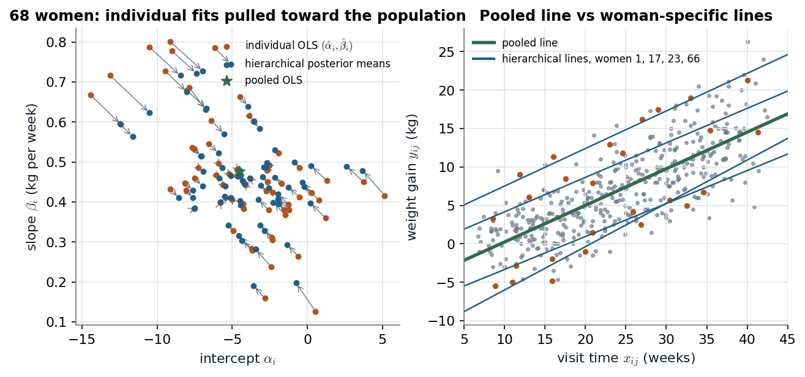

# HLM slides 3–23 · Partial pooling: every unit's estimate is a precision-weighted compromise with the population

> **Claim.** With $N$ units observed $T$ times there are three models: **pooled** (one line for all),
> **individual effects** (one intercept per unit) and **random coefficients** (one line per unit). Giving
> the unit parameters a common prior whose mean and variance are themselves estimated — the
> **hierarchical prior** — makes each unit's posterior mean a weighted average of its own estimate
> and the population mean, with weight $TV_\alpha/(TV_\alpha+\sigma^2)$ on its own data. Units with little or
> noisy data borrow strength from the others; the data decide how much through the between-unit
> variance ($V_\alpha$, or τ in the eight schools). Every conditional is normal, inverse gamma or Wishart:
> **a pure Gibbs sampler**.
> Prev: [[L07-03-ar1-errors]] · Next: [[L07-05-tobit]] · Map: [[L07-00-map]]

**Notation** (slide 3).

- $i=1,\dots,N$ units, $t=1,\dots,T$ occasions; $y_{it}$ response, $x_{it}$ ($k\times1$) regressors.
- $y_i=(y_{i1},\dots,y_{iT})'$, $X_i$ ($T\times k$) with rows $x_{it}'$; $X_i=(1_T,\tilde X_i)$ splits the constant from the other regressors $\tilde X_i$; $y$, $X$ stack the units.
- $\beta=(\alpha,\tilde\beta)$ common coefficients; $\alpha_i$ unit intercepts; $\beta_i=(\alpha_i,\tilde\beta_i)$ unit coefficient vectors.
- First-level prior parameters $\mu_\alpha,V_\alpha$ (intercepts) or $\beta_0,V_0$ (coefficient vectors); second-level (hyper)priors $\mu_\alpha\sim N(\mu_0,V_\mu)$, $V_\alpha\sim IG(\eta_0/2,\eta_0\sigma_0^2/2)$, $\beta_0\sim N(\beta_{00},V_\beta)$, $V_0^{-1}\sim W(\nu_0,V_{00}^{-1})$.
- Eight schools: $y_i$ estimated effect, $\sigma_i$ its standard error, $\theta_i$ true effect, $\mu,\tau$ population mean and sd (slide 23).

---

## 1 · U — pool, separate, or compromise

Pooling all 427 weight-gain measurements of 68 pregnant women into one regression ignores that
some women gain systematically more; fitting 68 separate lines uses 5 to 7 points per line and
produces wild intercepts (from −14.4 to 5.2). The hierarchical model says the 68 lines are draws
from a population of lines: each woman's line is estimated from her data **and** from what the other
67 say about the population. G §4.6 (p. 52) gives the formal shape: data $f(y\mid\theta)$, prior
$\pi(\theta\mid\theta_0)$, hyperprior $\pi(\theta_0\mid\theta_{00})$ — and notes that $\theta_0$ "is not identified" by itself
(the likelihood does not depend on it) but is introduced "to facilitate computations or modeling".

## 2 · C — three models (slides 4–6)

$$\text{Pooled:}\qquad y_i\sim N(X_i\beta,\sigma^2I_T),\quad\beta=(\alpha,\tilde\beta).\tag{1}$$
$$\text{Individual effects:}\qquad y_i\sim N(1_T\alpha_i+\tilde X_i\tilde\beta,\sigma^2I_T).\tag{2}$$
$$\text{Random coefficients:}\qquad y_i\sim N(X_i\beta_i,\sigma^2I_T),\quad\beta_i=(\alpha_i,\tilde\beta_i).\tag{3}$$

(1) has $k$ mean parameters, (2) has $N+k-1$, (3) has $Nk$. Slides 5–6 draw them as graphs: in the
hierarchical versions an arrow runs from a population node ($\alpha^*$, or $(\beta,V_\beta)$) into every unit's
coefficient.

**Pooled conditionals (slides 7–8).** Stacking, $y\sim N(X\beta,\sigma^2I_{TN})$ and the conditionals are note 01's
(7)–(8) with $\Omega=I$ and $n=TN$:
$V_1^{-1}=V_0^{-1}+\sigma^{-2}X'X$, $V_1^{-1}\beta_1=V_0^{-1}\beta_0+\sigma^{-2}X'y$, $\nu_1=\nu_0+TN$,
$\nu_1s_1^2=\nu_0s_0^2+(y-X\beta)'(y-X\beta)$.

**Individual effects, non-hierarchical prior (slides 9–10).** Stack (2) with
$\beta^*=(\alpha_1,\dots,\alpha_N,\tilde\beta')'$ and the dummy design

$$X^*=\begin{pmatrix}1_T&0&\cdots&0&\tilde X_1\\0&1_T&\cdots&0&\tilde X_2\\\vdots&&\ddots&&\vdots\\0&0&\cdots&1_T&\tilde X_N\end{pmatrix};\tag{4}$$

then it is again the pooled algebra with $X^*$, $\beta^*\sim N(\beta_0^*,V_0^*)$. **Slip on slide 9:** the last
block row of $X^*$ ends in $\tilde X_1$; it is $\tilde X_N$. With a vague $V_0^*$ this is the frequentist
**fixed-effects / dummy-variable regression** (W §14.1a, p. 438): each $\alpha_i$ is learned only from unit $i$.

## 3 · C — individual effects with a hierarchical prior (slides 11–13)

First level: $\alpha_i\sim N(\mu_\alpha,V_\alpha)$ iid, $\tilde\beta\sim N(\beta_0,V_\beta)$, $\sigma^2\sim IG(\nu_0/2,\nu_0s_0^2/2)$; second level:
$\mu_\alpha\sim N(\mu_0,V_\mu)$, $V_\alpha\sim IG(\eta_0/2,\eta_0\sigma_0^2/2)$ (slide 11 prints the $V_\alpha$ hyperparameters as
$\nu_0,\sigma_0^2$; slide 13's update uses $\eta_0,\eta_1$ — the letters, not the algebra, differ).

**$\alpha_i$ given the rest.** Write $r_i=y_i-\tilde X_i\tilde\beta$, so $r_i=1_T\alpha_i+\epsilon_i$. The terms in $\alpha_i$:

$$-\frac12\Big[\frac{(r_i-1_T\alpha_i)'(r_i-1_T\alpha_i)}{\sigma^2}+\frac{(\alpha_i-\mu_\alpha)^2}{V_\alpha}\Big]=-\frac12\Big[\alpha_i^2\Big(\frac{T}{\sigma^2}+\frac{1}{V_\alpha}\Big)-2\alpha_i\Big(\frac{1_T'r_i}{\sigma^2}+\frac{\mu_\alpha}{V_\alpha}\Big)\Big]+c,$$

so (slide 12)

$$\alpha_i\mid\tilde\beta,\sigma^2,\mu_\alpha,V_\alpha\sim N(\tilde\mu_{i\alpha},\tilde V_\alpha),\quad\tilde V_\alpha^{-1}=V_\alpha^{-1}+\sigma^{-2}T,\quad\tilde V_\alpha^{-1}\tilde\mu_{i\alpha}=V_\alpha^{-1}\mu_\alpha+\sigma^{-2}1_T'(y_i-\tilde X_i\tilde\beta).\tag{5}$$

**The partial-pooling weight.** Divide the mean in (5) by the precision, with $\bar r_i=1_T'r_i/T$:

$$\tilde\mu_{i\alpha}=\frac{(T/\sigma^2)\,\bar r_i+(1/V_\alpha)\,\mu_\alpha}{T/\sigma^2+1/V_\alpha}=w\,\bar r_i+(1-w)\,\mu_\alpha,\qquad w=\frac{TV_\alpha}{TV_\alpha+\sigma^2}.\tag{6}$$

> **(6) is the whole idea.** $w\to1$ (no pooling, the fixed-effects estimate $\bar r_i$) when $T\to\infty$ or
> $V_\alpha\to\infty$; $w\to0$ (complete pooling, everyone gets $\mu_\alpha$) when $V_\alpha\to0$ or σ² is huge. Because
> $V_\alpha$ is *estimated*, the data choose the degree of pooling.

**$\tilde\beta$ given the intercepts (slide 12).** $y_i-1_T\alpha_i=\tilde X_i\tilde\beta+\epsilon_i$ for all $i$, a pooled regression:
$\tilde V_\beta^{-1}=V_\beta^{-1}+\sigma^{-2}\sum_i\tilde X_i'\tilde X_i$, $\tilde V_\beta^{-1}\beta_1=V_\beta^{-1}\beta_0+\sigma^{-2}\sum_i\tilde X_i'(y_i-1_T\alpha_i)$.
**σ²** (slide 13): $\nu_1=\nu_0+TN$, $\nu_1s_1^2=\nu_0s_0^2+\sum_i(y_i-1_T\alpha_i-\tilde X_i\tilde\beta)'(\cdots)$.

**$\mu_\alpha$ given the intercepts.** The $\alpha_i$ are $N$ iid draws from $N(\mu_\alpha,V_\alpha)$ — a normal-mean problem:

$$-\frac12\Big[\frac{\sum_i(\alpha_i-\mu_\alpha)^2}{V_\alpha}+\frac{(\mu_\alpha-\mu_0)^2}{V_\mu}\Big]\ \Rightarrow\ \tilde V_\mu^{-1}=V_\mu^{-1}+V_\alpha^{-1}N,\quad\tilde V_\mu^{-1}\mu_1=V_\mu^{-1}\mu_0+V_\alpha^{-1}\sum_{i=1}^N\alpha_i.\tag{7}$$

**Slip on slide 13:** it prints $\sigma^{-2}N$ and $\sigma^{-2}\sum_i\alpha_i$. The $\alpha_i$ scatter around $\mu_\alpha$ with variance $V_\alpha$,
not σ² — the precision is $V_\alpha^{-1}$, as (7) and the site's own code (`V = diag(1/diag(iA0+I*iSig))`, `iSig` = the
inverse prior variances of the unit coefficients) both say.

**$V_\alpha$** (slide 13): $V_\alpha\mid\alpha,\mu_\alpha\sim IG(\eta_1/2,\eta_1\sigma_1^2/2)$, $\eta_1=\eta_0+N$, $\eta_1\sigma_1^2=\eta_0\sigma_0^2+\sum_i(\alpha_i-\mu_\alpha)^2$ —
again the conjugate variance update, with the $N$ intercepts as the "data".

## 4 · C — random coefficients (slides 14–16)

First level $\beta_i\sim N(\beta_0,V_0)$ iid, $\sigma^2\sim IG(\eta_0/2,\eta_0s_0^2/2)$; second level $\beta_0\sim N(\beta_{00},V_\beta)$,
$V_0^{-1}\sim W(\nu_0,V_{00}^{-1})$. Completing squares exactly as in (5) and (7), now with vectors:

$$\beta_i\mid\sigma^2,\beta_0,V_0\sim N(\beta_{1i},V_{1i}),\quad V_{1i}^{-1}=V_0^{-1}+\sigma^{-2}X_i'X_i,\quad V_{1i}^{-1}\beta_{1i}=V_0^{-1}\beta_0+\sigma^{-2}X_i'y_i;\tag{8}$$
$$\beta_0\mid\beta_{1:N},V_0\sim N(\beta_{01},\tilde V_\beta),\quad\tilde V_\beta^{-1}=V_\beta^{-1}+NV_0^{-1},\quad\tilde V_\beta^{-1}\beta_{01}=V_\beta^{-1}\beta_{00}+V_0^{-1}\sum_i\beta_i;\tag{9}$$
$$V_0^{-1}\mid\beta_0,\beta_{1:N}\sim W(\nu_0+N,V_{11}^{-1}),\quad V_{11}^{-1}\ \text{with}\ V_{11}=V_{00}+\sum_i(\beta_i-\beta_0)(\beta_i-\beta_0)'.\tag{10}$$

(σ²: $\eta_1=\eta_0+TN$, $\eta_1s_1^2=\eta_0s_0^2+\sum_i(y_i-X_i\beta_i)'(y_i-X_i\beta_i)$.) **Two slips:** slide 15 prints
$V_0\beta_0^{-1}$ for $V_0^{-1}\beta_0$ in (8), and slide 16 prints $NV_0$ for $NV_0^{-1}$ in (9). (10) is the matrix version of
the variance update: the scatter of the unit vectors around $\beta_0$ updates the Wishart scale. (8) is (6) in
matrix form: $\beta_{1i}$ is a matrix-weighted average of unit $i$'s OLS $(X_i'X_i)^{-1}X_i'y_i$ and $\beta_0$.

G §9.3 writes the same model as $y_i=X_i\beta+W_ib_i+u_i$, $b_i\mid D\sim N(0,D)$ (9.11, p. 146): "fixed effects" β
and "random effects" $b_i$ in the **statistics** sense (p. 145). His sampler (Algorithm 9.3, p. 148) draws β
with the $b_i$ integrated out, $\mathrm{Cov}(y_i)=W_iDW_i'+h_u^{-1}I_T$ (9.15), because β and the $b_i$ are correlated
a posteriori — one-block sampling mixes better.

## 5 · C — eight schools, computed exactly (slide 23)

**Model.** $y_i\mid\theta_i\sim N(\theta_i,\sigma_i^2)$, $\theta_i\sim N(\mu_\theta,\sigma_\theta^2)$, $\mu_\theta\sim N(0,10^6)$, $\sigma_\theta\sim U(0,100)$, $i=1,\dots,8$,
with the $\sigma_i$ known. Below $\mu=\mu_\theta$, $\tau=\sigma_\theta$.

| School | A | B | C | D | E | F | G | H |
|---|---|---|---|---|---|---|---|---|
| $y_i$ | 28.39 | 7.94 | −2.75 | 6.82 | −0.64 | 0.63 | 18.01 | 12.16 |
| $\sigma_i$ | 14.9 | 10.2 | 16.3 | 11.0 | 9.4 | 11.4 | 10.4 | 17.6 |

The slides fit it in WinBUGS (slides 24–26). It needs no MCMC: given τ everything is normal.

**Step 1, integrate the θ's.** $y_i=\theta_i+e_i$ with $\theta_i\sim N(\mu,\tau^2)$ independent of $e_i\sim N(0,\sigma_i^2)$:

$$y_i\mid\mu,\tau\sim N(\mu,\sigma_i^2+\tau^2),\ \text{independent over}\ i.\tag{11}$$

**Step 2, μ given τ.** (11) is a normal-mean problem with weights $w_i=1/(\sigma_i^2+\tau^2)$; with the $N(0,v_0)$ prior,

$$\mu\mid y,\tau\sim N(\hat\mu,V_\mu),\quad V_\mu^{-1}=v_0^{-1}+\sum_iw_i,\quad\hat\mu=V_\mu\sum_iw_iy_i.\tag{12}$$

**Step 3, θ_i given μ, τ.** Normal prior $N(\mu,\tau^2)$, one normal observation $y_i$ with variance $\sigma_i^2$:

$$E(\theta_i\mid y,\mu,\tau)=\frac{y_i/\sigma_i^2+\mu/\tau^2}{1/\sigma_i^2+1/\tau^2}=(1-B_i)y_i+B_i\mu,\quad B_i=\frac{\sigma_i^2}{\sigma_i^2+\tau^2},\quad\mathrm{Var}=(1-B_i)\sigma_i^2.\tag{13}$$

Averaging (13) over (12):

$$E(\theta_i\mid y,\tau)=(1-B_i)y_i+B_i\hat\mu,\qquad\mathrm{Var}(\theta_i\mid y,\tau)=(1-B_i)\sigma_i^2+B_i^2V_\mu.\tag{14}$$

**Step 4, τ.** Integrating μ from (11) gives $y\mid\tau\sim N_8(0,\mathrm{diag}(\sigma_i^2+\tau^2)+v_01_81_8')$, so

$$p(\tau\mid y)\propto1\{0<\tau<100\}\;N_8\big(y\mid0,\ \mathrm{diag}(\sigma_i^2+\tau^2)+v_011'\big),\tag{15}$$

a one-dimensional density, normalized on a grid.

**Numbers** (`L07_python_checks.py` §4; `make_figures.py`).

- Complete pooling ($\tau=0$): every $E(\theta_i\mid y)$ equals $\hat\mu=\sum y_i/\sigma_i^2\big/\sum1/\sigma_i^2=$ **7.87**, sd $(\sum1/\sigma_i^2)^{-1/2}=$ **4.17**.
- $p(\tau\mid y)$: mode at **0**, median **5.23**, mean **6.59**, 95% interval **[0.24, 20.87]**.
- School A at $\tau=5.2$ (the companion's default): $\hat\mu=8.027$, $B_A=14.9^2/(14.9^2+5.2^2)=222.01/249.05=0.8914$,
  $E(\theta_A\mid y,\tau)=0.1086\times28.39+0.8914\times8.027=3.083+7.155=$ **10.24**.
- Fully Bayes, τ integrated out: $E(\theta_A\mid y)=$ **11.64** (from 28.39); school C (−2.75) goes **up** to 6.35.

*(14) for all eight schools against τ, and (15); exact, the grid is the only approximation.*

At the posterior median the paths are still bunched within about 6 to 10: the data say the
schools differ little relative to their standard errors (all $\sigma_i\ge9.4$ against a spread of $y_i$ of
about 31). A's raw 28.39 survives only if τ is large, and the right panel puts little mass there.
Shrinkage is toward $\hat\mu$, not toward zero — C and E move **up**.

> **Interactive companion.** [The Partial-Pooling Dial](companions/companion-partial-pooling.html) — move
> τ, the prior bound $A$, a data-precision multiplier κ and the highlighted school; watch (14) along all
> eight paths, $B_i$, $\hat\mu$, the fully Bayes mean and $p(\tau\mid y)$ (10.24 for school A at the default).

## 6 · C — pregnant women: pooled, individual, hierarchical (site code)

**Data** (`hierarchicalmodel.html`): weight gains $y_{ij}$ (kg) of $I=68$ women at 5–7 visits, visit times
$x_{ij}$ in weeks; $n=427$.

**Pooled** ($y_{ij}=\alpha+\beta x_{ij}+\epsilon_{ij}$; the site's `lm` printout, reproduced to every digit):

$$\hat y=-4.52639+0.47633\,x,\qquad\text{SE }(0.48680),(0.01897),\quad\hat\sigma=3.612,\quad R^2=0.5974.$$

**Individual OLS** (one line per woman): intercepts from −14.432 to 5.157 (mean −4.412, median −4.260),
slopes from 0.126 to 0.801 (mean 0.470, median 0.450); residual sd mean 1.013 against the pooled
3.612 — **most of the pooled noise is between-woman heterogeneity**, not visit-to-visit noise.

**Hierarchical** (site section 4): $y_{ij}\mid\alpha_i,\beta_i\sim N(\alpha_i+\beta_ix_{ij},\sigma_y^2)$,
$(\alpha_i,\beta_i)'\sim N((\alpha,\beta)',\mathrm{diag}(\sigma_\alpha^2,\sigma_\beta^2))$, $(\alpha,\beta)\sim N(0_2,1000I_2)$, all three variances
$IG(0.001,0.001)$: model (3) with a diagonal $V_0$, so (10) becomes two scalar IG updates. The sampler,
ported line by line (`make_figures.gibbs_hlm`, 1,000 burn-in + 2,000 draws, seeded), gives posterior means

| $\alpha$ | $\beta$ | $\sigma_y$ | $\sigma_\alpha$ | $\sigma_\beta$ |
|---|---|---|---|---|
| −4.363 | 0.4687 | 1.119 | 3.210 | 0.1253 |

(the site prints no table — only plots — so these are this run's numbers).

*Left: each arrow is one woman's partial pooling (8). Right: the pooled line vs four hierarchical lines (women 1, 17, 23, 66).*

The arrows point inward, longest for the most extreme individual fits — those rest on 5–7 points
and are pulled most. The cloud keeps its strong negative tilt: intercept and slope are correlated
because visits start at week 7–15, far from $x=0$, so the intercept is an extrapolation. On the right,
the hierarchical lines are far apart (the $\sigma_\alpha=3.2$ kg spread is real) but each is anchored on its
own points.

**The site's "$p(y_{new}\mid x_{new},\text{data})$" is the posterior of the mean line.** Its code plots quantiles of
`draws2[,i,1]+draws2[,i,2]*X[i,7]`, i.e. of $\alpha_i+\beta_ix$, without adding $N(0,\sigma_y^2)$ noise. For woman 1 at her
unobserved 7th visit ($x=40.143$) this run gives median 17.68, 95% band [15.68, 19.86]; a predictive band for
a new measurement would be wider by roughly $\pm1.96\times1.12$.

**The weight in (6) with these numbers** (random-intercept reading, $T=6$): $w=6\sigma_\alpha^2/(6\sigma_\alpha^2+\sigma_y^2)=
6(10.30)/(61.83+1.25)=0.980$ — with this much between-woman spread, each woman's own data dominate her
intercept.

## 7 · U — the airline intercepts (slides 20–21)

Slide 20 reports separate regressions for the 6 airlines (dependent variable output; covariates total
cost, fuel price, load factor) and the pooled one: intercepts 8.56, 9.54, 8.00, 8.57, 10.65, 10.91 (SEs
0.28–0.73) vs pooled 8.08 (0.33). Slide 21 compares, firm by firm, the individual intercept, the
individual-effects posterior with a non-hierarchical prior and with the hierarchical prior: the two
Bayesian versions sit close together around 8.6–9.0 for every firm, while the individual OLS
intercepts spread from 8.0 to 10.9 with wide intervals — with $T=15$ and only $N=6$ firms, the
estimated between-firm variance is small and the hierarchical prior pulls hard.

## 8 · C/G — the frequentist neighbours

**Random-intercept model, MS §6.4 (pp. 215–218).** Calves weighed 8 times (weeks 12–26):
$y_{ij}=\alpha+\beta(x_j-12)+e_{ij}$ (6.27) vs $y_{ij}=\alpha+\beta(x_j-12)+a_i+e_{ij}$ (6.28), $a_i$ with mean 0 and variance
$\sigma_a^2$, independent of $e_{ij}$. Under (6.28)

$$\mathrm{Var}(y_{ij})=\sigma_a^2+\sigma^2,\qquad\mathrm{Cov}(y_{ij},y_{ik})=\sigma_a^2\ (j\ne k),\qquad\mathrm{Corr}=\frac{\sigma_a^2}{\sigma_a^2+\sigma^2},\tag{16}$$

the equicorrelation that MS's draftsman's plot (correlations 0.84–0.99) shows. Point estimates are the
same under both ($\hat\alpha=69.9$, $\hat\beta=4.7$) but the standard errors differ: 5.6 vs 7.8 for α, 0.1 vs 0.4 for β
(smaller under the mixed model). Model (2) with the hierarchical prior *is* (6.28) with $a_i=\alpha_i-\mu_\alpha$.

**Random effects in W §14.2 (pp. 441–442).** The RE estimator is OLS on quasi-demeaned data
$y_{it}-\theta\bar y_i$ with

$$\theta=1-\Big[\frac{\sigma_u^2}{\sigma_u^2+T\sigma_a^2}\Big]^{1/2}\qquad(\text{W 14.10}).\tag{17}$$

$\theta=0$ is pooled OLS, $\theta=1$ fixed effects — the same pooled ↔ separate axis as (6). With the
pregnancy numbers ($\sigma_u=\sigma_y=1.119$, $\sigma_a=\sigma_\alpha=3.210$, $T=6$), $\theta=0.859$ against $w=0.980$: related, not equal
(θ is a square-root version, applied to data rather than to estimates). Consistency of RE requires the
unit effect to be uncorrelated with the regressors (W 14.8) — **the same assumption the
exchangeable prior makes**; G p. 148 relaxes it by letting $E(b_i)$ depend on covariates. FE vs RE and
the Hausman test are not on this site's schedule (`Map/class-plan.md`, "Syllabus items not on the site
schedule").

**G's panel example (Table 9.5, p. 149).** Vella–Verbeek wages, 8 years, intercept and experience as
random effects: union coefficient 0.090 (95% 0.006–0.179), smaller than the 0.129 of the single-year
regression; mean experience effect 0.058 (0.038–0.078) — about 6% per year.

**Named only:** the dugong nonlinear growth curve and the WinBUGS/R2WinBUGS code (slides 22–33) — a
software demonstration, outside the course's Python toolchain.

## Links

- Unit: [[L07-00-map]] · [[L07-01-general-covariance-gls]] (the conjugate conditionals reused at every level) · [[L07-06-probit-ordered-multinomial]] (G 9.2: the binary panel version) · [[L07-07-formulas]] · [[L07-08-pitfalls]] · [[L07-09-python]] §4.
- Class 1: [[../L01/L01-04-first-bayesian-poisson|L01 §4]] (shrinkage of a posterior mean toward the prior mean — (13) is the same formula).
- Classes 5+6: [[../L05/L05-00-map|L05]] (DiD and panel thinking; the FE side of §8).
- Rules pack: [[../../rules/03_painel_did|rules/03]] (panel data, hierarchical models, FE/RE).
- **Practice** (statements in the books): G 4.6 (p. 59); G 9.2 (p. 151, binary panel data); G 9.3 (p. 151, Student-t errors in (9.11)); W 14.C5 (p. 454, RE vs FE in a wage equation).
