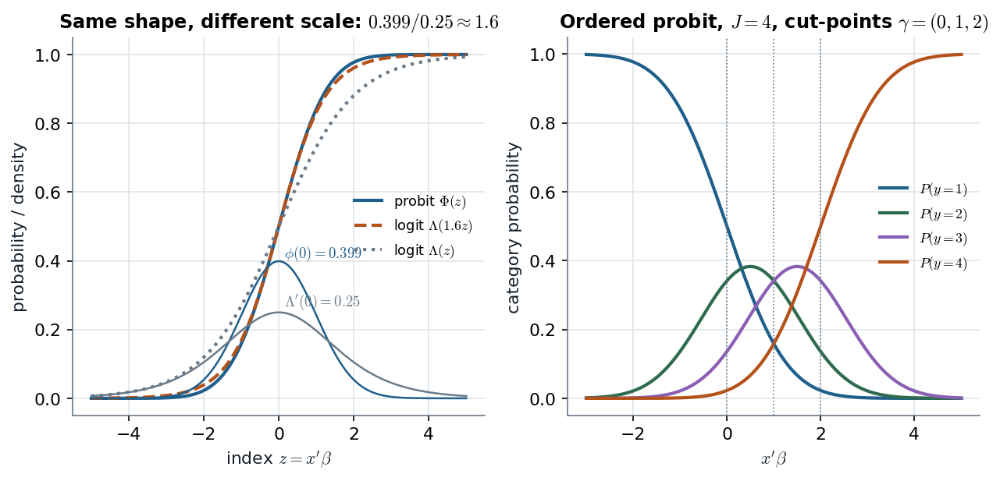

# LDV slides 11–15 · Probit, ordered probit, multinomial probit: one latent normal regression, three ways of cutting it

> **Claim.** Each model is a normal regression on a latent $y^*$ observed only through a **cut**: its sign
> (binary probit), the interval between cut-points it falls in (ordered probit), or which latent utility is
> largest (multinomial probit). Only the cut is seen, so the **scale is not identified** (σ = 1, or
> $\Sigma_{11}=1$). The Albert–Chib trick makes all three Gibbs samplers: draw $y^*$ from a **truncated normal**
> consistent with the observed category, then β by a normal regression on $y^*$; cut-points get
> **uniform** conditionals; the multinomial version is a SUR in utility differences with a truncated
> multivariate normal. Coefficients are not effects: the effect on $P(y=1)$ is $\phi(x'\beta)\beta_j\le0.4\beta_j$.
> Prev: [[L07-05-tobit]] · Next: [[L07-07-formulas]] · Map: [[L07-00-map]]

**Notation.**

- $y_i^*=x_i'\beta+u_i$, $u_i\sim N(0,1)$: latent index; binary $y_i=1(y_i^*>0)$ (G 8.8–8.9; W 17.6).
- Ordered: $y_i\in\{1,\dots,J\}$, $y_i=j\iff\gamma_{j-1}<y_i^*\le\gamma_j$, cut-points $-\infty=\gamma_0<\gamma_1<\dots<\gamma_J=\infty$ (slide 11).
- Multinomial: alternatives $0,1,\dots,J$; $U_{ij}$ utility; $y_{ij}^*=U_{ij}-U_{i0}=x_{ij}'\beta_j+\epsilon_{ij}$, $y_i^*=(y_{i1}^*,\dots,y_{iJ}^*)'$, $\epsilon_i\sim N_J(0,\Omega)$ (slides 13–14).
- $\Lambda(z)=e^z/(1+e^z)$ logistic cdf.

---

## 1 · C — the binary probit and why σ = 1 (G §8.2.2, pp. 122–124)

From the latent form,

$$P(y_i=1)=P(x_i'\beta+u_i>0)=P(u_i>-x_i'\beta)=1-\Phi(-x_i'\beta)=\Phi(x_i'\beta)\qquad(\text{G 8.7; W 17.2, 17.4}).\tag{1}$$

If instead $u_i\sim N(0,\sigma^2)$, $P(y_i=1)=\Phi(x_i'\beta/\sigma)$: only $\beta/\sigma$ enters, so $(\beta,\sigma)$ and $(c\beta,c\sigma)$ give the same
likelihood for every $c>0$ — "only the sign of $y_i^*$ determines the observed $y_i$" (G p. 124). Set σ = 1.
The probit is a GLM with link Φ (G p. 123), a cdf because it must map $\mathbb R$ into $(0,1)$.

**Partial effects** (W 17.7; G p. 124):

$$\frac{\partial P(y_i=1\mid x_i)}{\partial x_{ik}}=\phi(x_i'\beta)\,\beta_k,\qquad\max=\phi(0)\beta_k=\frac{\beta_k}{\sqrt{2\pi}}=0.3989\,\beta_k.\tag{2}$$

For the logit, $\Lambda'=\Lambda(1-\Lambda)$ peaks at $1/4$ (G p. 127). Equating the maximum effects, $0.4\beta_k^{p}=\beta_k^{l}/4$, so

$$\beta^{logit}\approx1.6\,\beta^{probit}\qquad(\text{G p. 128}).\tag{3}$$

*Left: (1) against the logit, and the rule (3). Right: the ordered probit (8) with $\gamma=(0,1,2)$.*

$\Phi(z)$ and $\Lambda(1.6z)$ are almost indistinguishable over the whole range; $\Lambda(z)$ is visibly flatter —
the coefficients differ by a scale, the fitted probabilities do not. On the right, as $x'\beta$ grows the mass
moves from category 1 to 4; the middle categories rise then fall, so **a positive β need not raise
$P(y=2)$**.

## 2 · C — Albert–Chib data augmentation (G Algorithm 8.3, p. 125)

Likelihood contribution given the latent value: $p(y_i\mid y_i^*)=1(y_i=0)1(y_i^*\le0)+1(y_i=1)1(y_i^*>0)$. With
$\beta\sim N(\beta_0,B_0)$,

$$\pi(\beta,y^*\mid y)\propto\prod_i\big[1(y_i=0)1(y_i^*\le0)+1(y_i=1)1(y_i^*>0)\big]\,N_n(y^*\mid X\beta,I)\,N_K(\beta\mid\beta_0,B_0).\tag{4}$$

Conditionals from (4):

$$y_i^*\mid\beta,y_i\sim\begin{cases}TN_{(-\infty,0]}(x_i'\beta,1)&y_i=0\\TN_{(0,\infty)}(x_i'\beta,1)&y_i=1\end{cases},\qquad\beta\mid y^*\sim N_K(\bar\beta,B_1),\ B_1=(X'X+B_0^{-1})^{-1},\ \bar\beta=B_1(X'y^*+B_0^{-1}\beta_0).\tag{5}$$

$B_1$ never changes because σ² = 1 (G p. 125). (5) is the Tobit sampler of [[L07-05-tobit]] with every
observation latent and σ fixed.

**Prior elicitation in probabilities (G pp. 125–126, computer ownership, $n=500$).** "A household with
zero wage and no college degree owns a computer with probability 0.10": $\beta_{01}=\Phi^{-1}(0.10)=-1.2816$;
"very likely below 0.3": $\Phi^{-1}(0.3)=-0.5244$, so $\sqrt{B_{0,11}}=(-0.5244+1.2816)/1.96=0.3863$, $B_{0,11}=0.1492$.
Wage \$2,000/week with probability 0.8: $-1.2816+2\beta_{02}=\Phi^{-1}(0.8)=0.8416\Rightarrow\beta_{02}=1.0616$; at least 0.6:
$\Phi^{-1}(0.6)=0.2533\Rightarrow\beta_2=0.767$, $B_{0,22}=[(1.0616-0.767)/1.96]^2=0.0225$. College raises 0.1 to 0.4:
$\beta_{03}=\Phi^{-1}(0.4)+1.2816=1.0283$. Posterior (Table 8.2, p. 126): $\beta_1=-0.705$ (0.074), wage 0.879 (0.106),
college 0.524 (0.154). The logit version (pp. 128–129) needs MH — a normal prior is not conditionally
conjugate for (1) with Λ — and gives college 0.786 with $P(\beta_3>0\mid y)=0.88$ only.

**Worked: W Example 17.1 (Table 17.1, p. 533), labour-force participation, MROZ ($n=753$).**
Reproduced exactly (`L07_python_checks.py` §6):

| | nwifeinc | educ | exper | exper² | age | kidslt6 | kidsge6 | const | log-lik |
|---|---|---|---|---|---|---|---|---|---|
| probit | −0.012 | 0.131 | 0.123 | −0.0019 | −0.053 | −0.868 | 0.036 | 0.270 | −401.30 |
| logit | −0.021 | 0.221 | 0.206 | −0.0032 | −0.088 | −1.443 | 0.060 | 0.425 | −401.77 |

Scale factors at the means: $\phi(\bar x'\hat\beta)=0.391$ (probit), $\Lambda'(\bar x'\hat\beta)=0.243$ (logit), ratio **1.61** — rule
(3) (W p. 534). Averaged over the sample: 0.301 and 0.179, so the probit APE of educ is
$0.301\times0.131=0.039$, the LPM's 0.038. 73.4% correctly predicted, pseudo-$R^2$ 0.221. The Albert–Chib sampler
(5) with a flat prior returns posterior means within 0.3 SE of every MLE (educ 0.132 vs 0.131).

## 3 · C — the ordered probit (slides 11–12)

**Probabilities.** From the cut rule,

$$P(y_i=j\mid x_i)=P(\gamma_{j-1}<x_i'\beta+u_i\le\gamma_j)=\Phi(\gamma_j-x_i'\beta)-\Phi(\gamma_{j-1}-x_i'\beta),\quad j=1,\dots,J.\tag{6}$$

**Identification.** Adding $c$ to the intercept and to every $\gamma_j$ leaves (6) unchanged: fix $\gamma_1=0$ when $x$
has an intercept (slide 11: "in probit models $y_i\in\{1,2\}$ and $\gamma_1=0$" — the binary probit is $J=2$). The
scale is fixed by $\mathrm{Var}(u)=1$.

**Conditionals (slide 12)**, flat priors on β and on the ordered γ's:

$$y_i^*\mid\beta,\gamma,y_i=j\sim TN_{(\gamma_{j-1},\gamma_j]}(x_i'\beta,1),\qquad\beta\mid y^*\sim N\big((X'X)^{-1}X'y^*,(X'X)^{-1}\big).\tag{7}$$

**Cut-point $\gamma_j$** given everything else: the joint density of $(y^*,\gamma)$ contains $\gamma_j$ only through the
indicators $1(\gamma_{j-1}<y_i^*\le\gamma_j)$ for $y_i=j$ and $1(\gamma_j<y_i^*\le\gamma_{j+1})$ for $y_i=j+1$, and the ordering. They hold
iff $\gamma_j\ge\max\{y_i^*:y_i=j\}$, $\gamma_j<\min\{y_i^*:y_i=j+1\}$, $\gamma_{j-1}<\gamma_j<\gamma_{j+1}$. A flat density restricted to an
interval is uniform:

$$\gamma_j\mid\gamma_{(-j)},\beta,y^*\sim U(\underline\gamma_{j},\overline\gamma_{j}),\quad\underline\gamma_j=\max\{\max\{y_i^*:y_i=j\},\gamma_{j-1}\},\quad\overline\gamma_j=\min\{\min\{y_i^*:y_i=j+1\},\gamma_{j+1}\}.\tag{8}$$

(The slide writes the bounds as $\bar\gamma_{j-1},\bar\gamma_{j+1}$.)

**Re-run** (`L07_python_checks.py` §6; $n=500$, $x'\beta=0.5+1.0x$, $\gamma=(0,1,2)$, $J=4$; 2,000 burn-in + 8,000 draws):
posterior means $\beta=(0.50,0.89)$, $\gamma_2=1.10$, $\gamma_3=2.08$. **The cut-point chain has lag-1
autocorrelation 0.99.** With many observations the interval in (8) is squeezed between neighbouring
latent values, so each γ moves very little per sweep (Cowles 1996 proposed an MH fix). This is the
price of the elegant uniform draw: check the trace of γ, not just of β.

## 4 · C — the multinomial probit as a SUR (slides 13–15)

**Choice rule (slide 13).** Individual $i$ picks the alternative with the largest utility. Differencing
from alternative 0, $y_{ij}^*=U_{ij}-U_{i0}=x_{ij}'\beta_j+\epsilon_{ij}$, and the econometrician sees

$$y_i=0\iff\max_jy_{ij}^*<0;\qquad y_i=j\iff y_{ij}^*=\max(y_i^*)\ge0.\tag{9}$$

**Stacking (slide 14).** $y_i^*=X_i\beta+\epsilon_i$ with $X_i=\mathrm{blockdiag}(x_{i1}',\dots,x_{iJ}')$, $\beta=(\beta_1',\dots,\beta_J')'$,
$\epsilon_i\sim N_J(0,\Omega)$; over individuals $y^*=X\beta+\epsilon$ with $\mathrm{Var}(\epsilon)=I_N\otimes\Omega$: a seemingly
unrelated regression (GLM3 slides 31–32), latent.

**Conditionals (slide 15).** β normal (the SUR GLS form: $V_1^{-1}=V_0^{-1}+\sum_iX_i'\Omega^{-1}X_i$,
$V_1^{-1}\beta_1=V_0^{-1}\beta_0+\sum_iX_i'\Omega^{-1}y_i^*$ — GLM3 slide 32); Ω inverse Wishart (scale updated by
$\sum_i(y_i^*-X_i\beta)(y_i^*-X_i\beta)'$); and

$$y_i^*\sim\begin{cases}N(X_i\beta,\Omega)\,1(\max(y_i^*)<0)&y_i=0\\N(X_i\beta,\Omega)\,1(\max(y_i^*)=y_{ij}^*\ge0)&y_i=j\end{cases},\tag{10}$$

a **truncated multivariate normal**, drawn one coordinate at a time from its univariate conditional
(normal, truncated: below 0 if $y_i=0$; above $\max(0,\text{others})$ for the chosen $j$; below the chosen
coordinate otherwise) — the same device G uses for the multivariate probit (9.9).

**Identification.** Utilities are defined up to location (hence the differencing) and **scale**:
$(\beta,\Omega)$ and $(c\beta,c^2\Omega)$ imply the same choices, so one variance (say $\Omega_{11}=1$) must be fixed
(Keane 1992; McCulloch & Rossi 1994 sample the unidentified model and normalize afterwards;
McCulloch, Polson & Rossi 2000 impose $\Omega_{11}=1$ in the prior — slide 16's references).

**Re-run** (`L07_python_checks.py` §6; 3 alternatives, $n=800$, alternative-specific intercept and slope, Ω
known with $\Omega_{11}=1$): posterior means $(0.45,1.10,-0.11,-0.71)$ for true $(0.3,1.0,-0.2,-0.8)$. The Ω step
is omitted (marked `ponytail:` in the code, upgrade path stated).

## 5 · C/G — the multivariate probit (G §9.2, pp. 139–144)

$J$ binary decisions by the same individual, $y_{ij}=1(y_{ij}^*>0)$, $u_i\sim N_J(0,\Sigma)$: a SUR whose responses are
all binary. Only signs are seen, so all $J$ variances are fixed at 1 and Σ is a **correlation matrix**
(p. 141); its free correlations get a normal prior truncated to positive-definite matrices and a
tailored MH step (Algorithm 9.2), β and the $y_i^*$ are Gibbs draws. Example (Table 9.4, p. 144):
Rubinfeld's 95 voters, public school (1) and voting for a school tax (2): income raises the
probability of voting yes ($\beta_{22}=1.113$, 95% 0.282–1.997), property taxes lower it ($\beta_{23}=-1.437$),
correlation $\sigma_{12}=0.085$ (−0.302 to 0.455).

## 6 · U — the logit coefficient as an odds ratio (MS §6.5, pp. 218–220)

MS fit $\log\{P(Y=1\mid x)/P(Y=0\mid x)\}=\alpha+\beta x$ (6.29) to 32 IVF patients (good responder vs poor, $x$ =
inhibin B rise): $\hat\alpha=-2.310$ (0.947), $\hat\beta=0.026$ (0.009), residual deviance 24.758 on 30 df. $\hat\beta$ is the
log odds ratio per unit of $x$: $e^{0.026}=1.026$, +2.6% odds per unit, $e^{100\times0.026}=e^{2.6}=13.5$ per 100 units. The
probit counterpart of this reading does not exist — probit coefficients have no odds-ratio meaning, only
the effect (2).

## Links

- Unit: [[L07-00-map]] · [[L07-05-tobit]] (the same augmentation) · [[L07-03-ar1-errors]] (the truncated-normal draw) · [[L07-04-hierarchical-linear-models]] (G 9.2 binary panel) · [[L07-07-formulas]] · [[L07-08-pitfalls]] · [[L07-09-python]] §6.
- Class 2: [[../L02/L02-04-logistic-regression|L02 §4]] (logit likelihood, IRLS, odds ratios — the frequentist side of §2).
- Rules pack: [[../../rules/06_classificacao_validacao|rules/06]].
- **Practice** (statements in the books): G 8.7 (p. 132, probit with Student-t errors); G 9.2 (p. 151); W 17.C2 (p. 561, LOANAPP probit and logit); MS 6.18 (p. 241) and 6.21 (p. 242), logistic regressions read through odds ratios.
