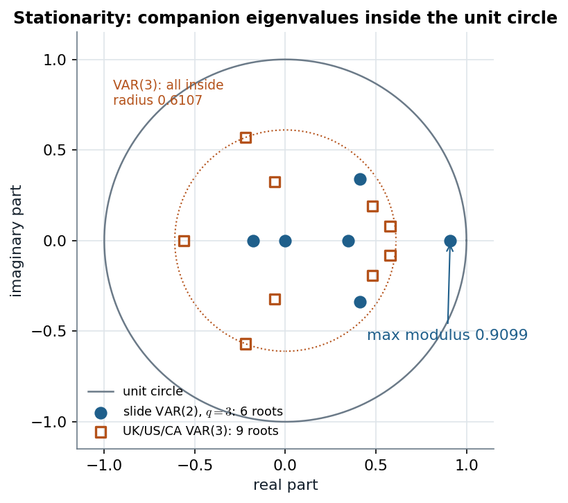

# Slides 3–9 · A VAR(p) is a multivariate regression: OLS is the MLE, the companion matrix decides stationarity, and forecasts are powers of it

> **Claim.** Stack the lags in $x_t$ and a VAR(p) is $y_t=Bx_t+u_t$, a multivariate regression
> with the **same regressors in every equation**. That one fact makes equation-by-equation OLS
> the conditional MLE and the SUR/GLS estimator at once, and gives
> $\widehat{\mathrm{Cov}}(\hat\beta)=\hat\Sigma\otimes(X'X)^{-1}$. Writing the VAR(p) as a VAR(1)
> in $qp$ dimensions (the **companion form**) settles both remaining questions: the process is
> stationary iff every eigenvalue of the companion matrix lies inside the unit circle, and the
> $h$-step forecast is its $h$-th power applied to the current state.

Prev: [[../L01/L01-07-ar-var-review|L01 §9 (VAR(1) review)]] · Next: [[L09-02-vma-irf-fevd]] · Map: [[L09-00-map]]

**Notation.**

| Symbol | Meaning | Range |
|---|---|---|
| $y_t$ | $q\times1$ vector of series at time $t$ (Tsay: $r_t$, dimension $k$) | $t=1,\dots,n$ |
| $B_i$ | $q\times q$ autoregressive matrix at lag $i$ (Tsay: $\Phi_i$) | $i=1,\dots,p$ |
| $B=(B_1,\dots,B_p)$ | $q\times qp$ coefficient matrix | |
| $x_t=(y_{t-1}',\dots,y_{t-p}')'$ | $qp\times1$ stacked lags | |
| $\mu$ / $\phi_0$ | intercept (slide 13 calls it $\mu$; Tsay $\phi_0$) | $\mathbb R^q$ |
| $u_t$ | innovation, i.i.d. $N(0,\Sigma)$ | |
| $\Sigma$ | $q\times q$ innovation covariance, positive definite | |
| $Y,X,U$ | $n\times q$, $n\times qp$, $n\times q$ data matrices with rows $y_t',x_t',u_t'$ | |
| $\beta=\mathrm{vec}(B')$ | $q^2p\times1$: equation 1's coefficients, then equation 2's, … (slide 22) | |
| $A$ | $qp\times qp$ companion matrix | |
| $\Psi_i$ | VMA weights (derived in [[L09-02-vma-irf-fevd]]) | $\Psi_0=I_q$ |

---

## 1 · U — why a VAR

Slide 3 quotes Del Negro and Schorfheide (2011): VARs "appear to be straightforward multivariate
generalizations of univariate autoregressive models. They turn out to be one of the key empirical
tools in modern macroeconomics." Sims (1980) proposed them in place of large structural models
whose exclusion restrictions he called "incredible". The VAR makes **no** exclusion: every
variable depends on every lag of every variable. That buys flexibility and costs parameters — the
tension the whole of Class 9 is about (§8 below, then [[L09-04-bvar-minnesota-ssvs]]).

---

## 2 · C — the model (slide 4; T eq. 8.13, p. 403)

$$y_t=\mu+B_1y_{t-1}+\dots+B_py_{t-p}+u_t,\qquad u_t\overset{iid}{\sim}N(0,\Sigma).\tag{1}$$

The slide writes (1) without $\mu$ ("the (basic) VAR(p)"); the simulated example (slide 13) and
Tsay keep it. **Stationary mean.** If $y_t$ is weakly stationary with $E(y_t)=m$, take
expectations of (1):

$$m=\mu+B_1m+\dots+B_pm$$

$$(I_q-B_1-\dots-B_p)\,m=\mu$$

$$m=(I_q-B_1-\dots-B_p)^{-1}\mu\tag{2}$$

(T p. 403: $\mu=[\Phi(1)]^{-1}\phi_0$), provided $I-\sum B_i$ is invertible.

---

## 3 · C — the multivariate regression form (slides 5–7)

Stack the lags: with $B=(B_1,\dots,B_p)$ and $x_t=(y_{t-1}',\dots,y_{t-p}')'$, (1) without $\mu$ is

$$y_t=Bx_t+u_t,\qquad u_t\sim N(0,\Sigma).\tag{3}$$

(A constant is one more column of $x_t$.) Transpose (3) and stack the $n$ rows:

$$Y=XB'+U,\qquad U\sim N(0,\ I_n,\ \Sigma)\tag{4}$$

— the **matrix normal**: rows of $U$ independent across $t$, each row with covariance $\Sigma$
(slide 6 writes $Y=XB+U$ with $B$ already transposed). Column $i$ of (4) is equation $i$:
$y^{(i)}=X\beta_i+u^{(i)}$, where $\beta_i'$ is row $i$ of $B$ and $y^{(i)}$ the $n$ observations
of series $i$. Stacking the columns, with $\mathrm{vec}(XB')=(I_q\otimes X)\mathrm{vec}(B')$:

$$y=\mathrm{vec}(Y)=(I_q\otimes X)\beta+u,\qquad u\sim N(0,\ \Sigma\otimes I_n)\tag{5}$$

(slide 7). $\Sigma\otimes I_n$ says: errors of **different equations at the same date** are
correlated ($\Sigma_{ij}$), errors at **different dates** are not. That is exactly the
**seemingly unrelated regression** of Greenberg §9.1 (p. 134, eqs. 9.1–9.2: "the covariances
permit nonzero correlations for disturbances with the same second subscript"), with the same
regressor block $x_t'$ in every equation.

---

## 4 · C — OLS is the conditional MLE, and also the SUR/GLS estimator

### 4.1 · The likelihood

Conditioning on the first $p$ observations, (3) gives the log-likelihood

$$\ell(B,\Sigma)=-\frac{nq}{2}\log2\pi-\frac n2\log|\Sigma|-\frac12\sum_{t}(y_t-Bx_t)'\Sigma^{-1}(y_t-Bx_t).\tag{6}$$

A scalar is its own trace, and $\mathrm{tr}(ab')=b'a$, so

$$\sum_t(y_t-Bx_t)'\Sigma^{-1}(y_t-Bx_t)=\mathrm{tr}\Big(\Sigma^{-1}\sum_t(y_t-Bx_t)(y_t-Bx_t)'\Big)=\mathrm{tr}\big(\Sigma^{-1}S(B)\big),\tag{7}$$

with $S(B)=(Y-XB')'(Y-XB')$, a $q\times q$ matrix of residual cross-products.

### 4.2 · Completing the square in $B$

Define the OLS solution $\hat B'=(X'X)^{-1}X'Y$, so that the normal equations hold:

$$X'(Y-X\hat B')=0.\tag{8}$$

Write $Y-XB'=(Y-X\hat B')+X(\hat B-B)'$ and expand $S(B)$:

$$S(B)=(Y-X\hat B')'(Y-X\hat B')+(Y-X\hat B')'X(\hat B-B)'+(\hat B-B)X'(Y-X\hat B')+(\hat B-B)X'X(\hat B-B)'.$$

By (8) the two middle terms are zero:

$$S(B)=S(\hat B)+(\hat B-B)X'X(\hat B-B)'.\tag{9}$$

Substituting (9) into (7):

$$\mathrm{tr}\big(\Sigma^{-1}S(B)\big)=\mathrm{tr}\big(\Sigma^{-1}S(\hat B)\big)+\mathrm{tr}\big(\Sigma^{-1}(\hat B-B)X'X(\hat B-B)'\big).\tag{10}$$

The last trace equals $\mathrm{tr}(C'\Sigma^{-1}C)\ge0$ with $C=(\hat B-B)(X'X)^{1/2}$, and is zero
iff $B=\hat B$. So **for every $\Sigma$**, (6) is maximised in $B$ at $\hat B$:

$$\boxed{\hat B'=(X'X)^{-1}X'Y\quad\Longleftrightarrow\quad\hat\beta_i=(X'X)^{-1}X'y^{(i)},\ i=1,\dots,q}\tag{11}$$

— each equation by its own OLS (T p. 405: "Parameters ... can be estimated by the ordinary
least-squares (OLS) method"; p. 406: "the OLS estimates ... are equivalent to the (conditional)
ML estimates"). Then maximising $-\frac n2\log|\Sigma|-\frac12\mathrm{tr}(\Sigma^{-1}S(\hat B))$
over $\Sigma$ gives $\tilde\Sigma=S(\hat B)/n$ (T eq. 8.19); the bias-adjusted version divides by
$n-qp$ (one constant more if there is an intercept; T eq. 8.17 uses $T-2i-1$ for the univariate
count).

### 4.3 · Why SUR/GLS adds nothing here

GLS on (5) is $\hat\beta_{GLS}=[(I_q\otimes X)'(\Sigma^{-1}\otimes I_n)(I_q\otimes X)]^{-1}(I_q\otimes X)'(\Sigma^{-1}\otimes I_n)y$.
With $(A\otimes B)(C\otimes D)=AC\otimes BD$:

$$(I_q\otimes X)'(\Sigma^{-1}\otimes I_n)(I_q\otimes X)=\Sigma^{-1}\otimes X'X$$

$$(I_q\otimes X)'(\Sigma^{-1}\otimes I_n)\,y=(\Sigma^{-1}\otimes X')\,y$$

$$\hat\beta_{GLS}=(\Sigma\otimes(X'X)^{-1})(\Sigma^{-1}\otimes X')\,y=(I_q\otimes(X'X)^{-1}X')\,y,\tag{12}$$

which is (11) stacked. **$\Sigma$ drops out because every equation has the same regressors.** The
SUR gain of Greenberg §9.1 appears only when the $X_j$ differ — for a VAR, when some coefficients
are restricted to zero (the "refined" VAR of the site page, §6 of [[L09-02-vma-irf-fevd]]). The
sampling covariance follows from (12) and $\mathrm{Cov}(y)=\Sigma\otimes I_n$:

$$\mathrm{Cov}(\hat\beta)=(I_q\otimes(X'X)^{-1}X')(\Sigma\otimes I_n)(I_q\otimes X(X'X)^{-1})=\Sigma\otimes(X'X)^{-1}.\tag{13}$$

### 4.4 · Worked — the site's VAR(3) for UK/US/CA GDP growth (VAR-Example.html §2)

Quarterly growth of real GDP, standardised, 1980Q2–2011Q2 (Tsay 2014, Ex. 2.3), $q=3$, $p=3$,
$x_t$ of dimension 9, no constant (standardised data). The script builds $X=(\text{lag1},\text{lag2},\text{lag3})$,
computes `bhat = solve(t(X)%*%X) %*% t(X)%*%y` — that is (11) — and `Cov = kronecker(Shat, iXtX)`,
which is (13). Printed:

| $\hat B_1$ | UK | US | CA |
|---|---|---|---|
| UK | 0.4308 | 0.0587 | 0.1274 |
| US | 0.4380 | 0.2405 | 0.1747 |
| CA | 0.2938 | 0.4887 | 0.3231 |

and $\hat\Sigma$ with diagonal $(0.5272,\ 0.5851,\ 0.4952)$. MTS's `VAR(rates,3)` (with a constant)
prints $\hat B_1$ row 1 as $(0.430,\ 0.0576,\ 0.128)$: the same coefficients to the third
decimal, since the standardised series have mean zero. Its residual covariance differs
($0.4918$ for UK) because the script divides by a hand-typed $114$ (`Shat = t(A)%*%A/(123-(3+1)*2-1)`)
while MTS reports the ML version: **the divisor changes $\hat\Sigma$ and the standard errors, never
$\hat B$** (by (11), $\hat B$ does not involve $\Sigma$).

Reading row 2 of $\hat B_1$: last quarter's UK growth enters US growth with 0.438 — larger than
US growth's own coefficient 0.2405. **The equations are fitted separately, but they are read
together**: this lead–lag pattern is what the impulse responses of [[L09-02-vma-irf-fevd]] turn
into a picture.

---

## 5 · C — companion form and stationarity (slides 8–9; T eq. 8.15, pp. 404–405)

Stack $Y_t=(y_t',y_{t-1}',\dots,y_{t-p+1}')'$ ($qp\times1$). Then (1) without $\mu$ is the VAR(1)

$$Y_t=AY_{t-1}+U_t,\qquad A=\begin{pmatrix}B_1&B_2&\cdots&B_{p-1}&B_p\\I_q&0&\cdots&0&0\\0&I_q&\cdots&0&0\\\vdots&&\ddots&&\vdots\\0&0&\cdots&I_q&0\end{pmatrix},\qquad U_t=\begin{pmatrix}u_t\\0\\\vdots\\0\end{pmatrix}.\tag{14}$$

The first block row is (1); the others are the identities $y_{t-j}=y_{t-j}$. Everything proved
for a VAR(1) in [[../L01/L01-07-ar-var-review|L01 §9]] now applies to (14): it is stationary iff
**all eigenvalues of $A$ have modulus below one** (slide 9).

**The equivalent root condition** (slide 9: all $z$ with $|I_q-B_1z-\dots-B_pz^p|=0$ lie outside
the unit circle). For $p=2$, $A=\begin{pmatrix}B_1&B_2\\I&0\end{pmatrix}$ and

$$\lambda I_{2q}-A=\begin{pmatrix}\lambda I-B_1&-B_2\\-I&\lambda I\end{pmatrix}.$$

The block-determinant rule $\det\begin{pmatrix}P&Q\\R&S\end{pmatrix}=\det(S)\det(P-QS^{-1}R)$ (for
$\lambda\ne0$) with $P=\lambda I-B_1$, $Q=-B_2$, $R=-I$, $S=\lambda I$ gives

$$\det(\lambda I-A)=\det(\lambda I_q)\,\det\big(\lambda I-B_1-(-B_2)(\lambda I)^{-1}(-I)\big)$$

$$=\lambda^q\det\big(\lambda I-B_1-\lambda^{-1}B_2\big)$$

$$=\lambda^{2q}\det\big(I-B_1\lambda^{-1}-B_2\lambda^{-2}\big).\tag{15}$$

With $z=1/\lambda$, a nonzero eigenvalue $\lambda$ of $A$ is exactly the reciprocal of a root $z$
of $|I-B_1z-B_2z^2|=0$. Hence $|\lambda|<1\iff|z|>1$. (The same Schur step, repeated, gives the
general $p$; T p. 405: "$|I-\Phi B|=|\Phi(B)|$".)

> **Stationarity is a property of the whole system, not of any coefficient.** A diagonal entry
> above one can sit in a stationary VAR (T Ex. 8.3, $\Phi_{22}=1.1$, [[../L01/L01-07-ar-var-review|L01 §9.1]]);
> all entries small can still sum to a unit root.

### 5.1 · Worked — the slide-13 simulated VAR(2)

$$B_1=\begin{pmatrix}0.7&0.1&0\\0&0.4&0.1\\0.9&0&0.8\end{pmatrix},\quad B_2=\begin{pmatrix}-0.2&0&0\\0&0.1&0.1\\0&0&0\end{pmatrix},\quad\Sigma=\begin{pmatrix}0.26&0.03&0\\0.03&0.09&0\\0&0&0.81\end{pmatrix},\quad\mu=\begin{pmatrix}2\\1\\0\end{pmatrix}$$

(slide 13, "based on Lütkepohl's (2007) Problem 2.3"). The $6\times6$ companion matrix (14) has
eigenvalues

$$0.9099,\quad 0.4118\pm0.3382i\ (\text{modulus }0.5329),\quad 0.3456,\quad -0.1792,\quad 0,$$

all inside the unit circle: **stationary**, but with a dominant root of 0.91 (a half-life of
$\ln0.5/\ln0.9099=7.3$ periods). The zero root comes from the zero third row of $B_2$.

$\Phi(1)=I-B_1-B_2=\begin{pmatrix}0.5&-0.1&0\\0&0.5&-0.2\\-0.9&0&0.2\end{pmatrix}$, $|\Phi(1)|=0.032$:
small, because $z=1$ is close to a root. If slide 13's $\mu$ is the intercept (as the constant in
Sims' code), (2) gives the mean. Solve $\Phi(1)m=\mu$ row by row:

- row 3: $-0.9m_1+0.2m_3=0\Rightarrow m_3=4.5m_1$;
- row 2: $0.5m_2-0.2(4.5m_1)=1\Rightarrow m_2=2+1.8m_1$;
- row 1: $0.5m_1-0.1(2+1.8m_1)=2\Rightarrow0.32m_1=2.2\Rightarrow m_1=6.875$;

so $m=(6.875,\ 14.375,\ 30.94)'$. (A seeded 60-period simulation used in
[[L09-04-bvar-minnesota-ssvs]] has sample means $6.81,\ 14.19,\ 30.24$.) **A small $|\Phi(1)|$
magnifies the intercept** into a large mean, the multivariate version of $\mu=\phi_0/(1-\phi_1)$
with $\phi_1$ near one.

### 5.2 · Worked — the UK/US/CA VAR(3)

The $9\times9$ companion matrix of §4.4's $\hat B_1,\hat B_2,\hat B_3$ has moduli
$0.6107\,(\times2),\ 0.5842\,(\times2),\ 0.5620,\ 0.5165\,(\times2),\ 0.3288\,(\times2)$: all
inside, so the fitted VAR(3) is stationary and its impulse responses die out (they are below
$0.005$ by $h=20$, [[L09-02-vma-irf-fevd]] §3).

*Figure — eigenvalues of the companion matrix (14) for the slide-13 VAR(2) and the site's OLS VAR(3); slide 9.*

Both sets lie inside the unit circle. The VAR(2)'s root at 0.91 sits close to the boundary — the
system is persistent — while the GDP VAR(3) has no root above 0.61. Complex pairs mean damped
oscillation in the responses; the VAR(3) has four such pairs.

---

## 6 · C — forecasting (slide 8; T p. 409)

From (14), $Y_{t+h}=A^hY_t+\sum_{i=0}^{h-1}A^iU_{t+h-i}$. Taking $E(\cdot\mid F_t)$ and reading the
first $q$ rows with $J=(I_q,0,\dots,0)$:

$$y_t(h)=E(y_{t+h}\mid F_t)=JA^hY_t\tag{16}$$

(slide 8: $F(A,y_t,h)=A^hy_t$, "a highly nonlinear function of $B_1,\dots,B_p$"). The forecast
error uses $JA^iJ'=\Psi_i$ (the VMA weights, [[L09-02-vma-irf-fevd]] (3)):

$$e_t(h)=y_{t+h}-y_t(h)=\sum_{i=0}^{h-1}\Psi_iu_{t+h-i}\tag{17}$$

and, the $u$'s being uncorrelated across dates,

$$\mathrm{MSE}(h)=\mathrm{Cov}\big(e_t(h)\big)=\Sigma+\Psi_1\Sigma\Psi_1'+\dots+\Psi_{h-1}\Sigma\Psi_{h-1}'\tag{18}$$

(slide 11; for $h=2$, T p. 409: $e_h(2)=a_{h+2}+\Phi_1a_{h+1}$, covariance $\Sigma+\Phi_1\Sigma\Phi_1'$).
Under stationarity, as $h\to\infty$, $y_t(h)\to m$ and $\mathrm{MSE}(h)\to\Gamma_0=\mathrm{Cov}(y_t)$.

**Bayesian forecast** (slide 8). With a posterior for $(B,\Sigma)$:

$$\hat y_t(h)=\int F(A,y_t,h)\,p(B,\Sigma\mid\text{data})\,d(B,\Sigma).\tag{19}$$

Because $F$ is a power of $A$, $E[A^h]\ne(E A)^h$: plugging the posterior mean into (16) is not
the posterior mean forecast. Posterior draws of $B$ pushed through (16) give it, and its bands.

### 6.1 · Worked — Tsay's VAR(1) for IBM and S&P 500 (pp. 414–416)

Fitted: $\phi_0=(1.0614,\ 0.4087)'$, $\Phi=\begin{pmatrix}-0.0320&0.1503\\-0.0223&0.1020\end{pmatrix}$,
residual sds $7.0078,\ 5.5247$. By (2):

$$I-\Phi=\begin{pmatrix}1.0320&-0.1503\\0.0223&0.8980\end{pmatrix},\qquad|I-\Phi|=1.0320(0.8980)-(-0.1503)(0.0223)=0.92674+0.00335=0.93009,$$

$$m_1=\frac{0.8980(1.0614)+0.1503(0.4087)}{0.93009}=\frac{0.95314+0.06143}{0.93009}=1.0908,\qquad m_2=\frac{-0.0223(1.0614)+1.0320(0.4087)}{0.93009}=\frac{-0.02367+0.42178}{0.93009}=0.4280.$$

Tsay's 6-step forecasts are $1.0909$ and $0.4280$: **the forecast has already converged to the
mean**, because the eigenvalues of $\Phi$ are $0.0013$ and $0.0687$. The forecast standard
errors converge to $\sqrt{\mathrm{diag}\,\Gamma_0}$; with $\Gamma_0$ from the vec formula of
[[../L01/L01-07-ar-var-review|L01 (25)]] and the innovation correlation 0.642 (§2 of
[[L09-02-vma-irf-fevd]]), $\sqrt{\mathrm{diag}\,\Gamma_0}=(7.0436,\ 5.5455)$ against Tsay's
printed $7.0436,\ 5.5454$; at $h=2$, (18) gives $(7.0434,\ 5.5454)$ against the printed
$7.0434,\ 5.5453$.

---

## 7 · C — choosing $p$ (T §8.2.4, pp. 405–407)

Fit VAR(0), VAR(1), … by OLS; with $\tilde\Sigma_i$ the ML residual covariance (8.19) of the VAR($i$)
and $T$ the sample size:

$$M(i)=-\Big(T-k-i-\tfrac32\Big)\ln\frac{|\tilde\Sigma_i|}{|\tilde\Sigma_{i-1}|}\ \overset{a}{\sim}\ \chi^2_{k^2}\quad(H_0:\Phi_i=0)\tag{20}$$

$$\mathrm{AIC}(i)=\ln|\tilde\Sigma_i|+\frac{2k^2i}{T},\qquad\mathrm{BIC}(i)=\ln|\tilde\Sigma_i|+\frac{k^2i\ln T}{T},\qquad\mathrm{HQ}(i)=\ln|\tilde\Sigma_i|+\frac{2k^2i\ln\ln T}{T}.\tag{21}$$

Each lag adds $k^2$ coefficients, hence the $k^2$ in every penalty and in the $\chi^2$ degrees of
freedom. BIC's penalty $\ln T$ exceeds AIC's 2 once $T>e^2\approx7.4$, so **BIC never picks a
longer lag than AIC**.

### 7.1 · Worked — `VARorder(rates)` on the GDP data (VAR-Example.html §3.1)

| $p$ | AIC | BIC | HQ | $M(p)$ | p-value |
|---|---|---|---|---|---|
| 0 | −1.6743 | −1.6743 | −1.6743 | — | — |
| 1 | −2.6013 | **−2.3976** | **−2.5185** | 115.13 | 0.0000 |
| 2 | **−2.6825** | −2.2752 | −2.5171 | 23.54 | 0.0051 |
| 3 | −2.6418 | −2.0309 | −2.3936 | 10.49 | 0.3126 |
| 4 | −2.6154 | −1.8008 | −2.2845 | 11.58 | 0.2382 |

"selected order: aic = 2, bic = 1, hq = 1". With $k=3$, $M(p)\sim\chi^2_9$, 5% critical value
16.92: $M(2)=23.54$ rejects $\Phi_2=0$, $M(3)=10.49$ does not, so the sequential test stops at
$p=2$ (with a stray rejection again at $p=8$, $M=24.48$). HQ is a near-tie: $-2.5185$ at $p=1$
vs $-2.5171$ at $p=2$. The lecturer fits $p=3$ anyway, one lag beyond AIC — a choice the
criteria do not support but that costs only 9 coefficients here; [[L09-04-bvar-minnesota-ssvs]]
replaces the lag-length decision by a prior that shrinks long lags toward zero.

---

## 8 · C — the curse of dimensionality (slides 27, 45)

Without intercepts, a VAR(p) has $q^2p$ coefficients plus $q(q+1)/2$ in $\Sigma$:

| VAR(1) (slide 45, Bańbura–Giannone–Reichlin sizes) | $q$ | $q^2+q(q+1)/2$ |
|---|---|---|
| Small | 3 | $9+6=15$ |
| Medium | 20 | $400+210=610$ |
| Large | 131 | $17{,}161+8{,}646=25{,}807$ |

Kadiyala–Karlsson's revisit of Litterman (slide 27): $q=7$, $p=6$, "$7+6(7^2)=301$ parameters"
(intercepts and coefficients, $\Sigma$ excluded) from 133 quarterly observations — **43
coefficients per equation from 133 data points**. OLS is still defined, but its variance (13)
scales with $(X'X)^{-1}$ in a 43-dimensional regression: forecasts are poor. That is the opening
of the Bayesian half of the lecture.

---

## 9 · U — the site's R and its Python twin

`VAR-Example.html` does (11) and (13) by hand, then `MTS::VAR`, `VARorder`, `refVAR`, `FEVdec`.
Python equivalents (used in [[L09-10-python]]): `numpy.linalg.lstsq` for (11), `np.kron` for
(13), `statsmodels.tsa.api.VAR(y).fit(p, trend="n")` for the fit, `.select_order(maxlags)` for
(21) (statsmodels normalises the criteria differently; only the arg-min matters, as T p. 414
says of S-Plus vs SCA), `np.linalg.eigvals` on (14).

---

## Links

- Neighbours: [[L09-02-vma-irf-fevd]] (the $\Psi_i$ of (17)–(18)) · [[L09-04-bvar-minnesota-ssvs]] (the answer to §8).
- Unit: [[L09-00-map]] · [[L09-08-formulas]] · [[L09-09-pitfalls]] · [[L09-10-python]].
- Class 1: [[../L01/L01-07-ar-var-review|L01 §8–§9]] (AR(p) as a regression; VAR(1) mean, $\Gamma_0$ by the vec formula, T Ex. 8.3) · [[../L01/L01-06-gaussian-linear-regression|L01-06]] (OLS algebra).
- Rules: [[../../rules/05_espaco_estados_volatilidade|rules/05]].
- **Practice (number and printed page only):** T 8.1 (p. 462); T 8.2 (pp. 462–463); T 8.3, 8.4, 8.5 (p. 463); G 10.4 (p. 167) for the SUR structure of §3.
