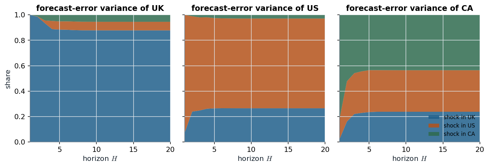

# Slides 10–12 · Impulse responses and variance decompositions: the $\Psi_s$ recursion, the Cholesky factor, and what the ordering decides

> **Claim.** A stationary VAR is a moving average of its innovations, $y_t=\sum_s\Psi_su_{t-s}$,
> with $\Psi_s=B_1\Psi_{s-1}+\dots+B_p\Psi_{s-p}$. **$\Psi_s(i,j)$ is the response of variable $i$,
> $s$ periods later, to a unit innovation in variable $j$** — but innovations are correlated, so
> "holding the others constant" is not an experiment the data contain. A Cholesky factor
> $P$ of $\Sigma$ makes the shocks orthogonal, $\Theta_s=\Psi_sP$, and then the $h$-step forecast-error
> variance splits exactly into shares, one per shock. **Both objects depend on the ordering**
> of the variables, which is an identifying assumption, not a detail ([[L09-03-structural-var]]).

Prev: [[L09-01-var-p-estimation-forecasting]] · Next: [[L09-03-structural-var]] · Map: [[L09-00-map]]

**Notation.** As in [[L09-01-var-p-estimation-forecasting]], plus:

| Symbol | Meaning |
|---|---|
| $\Psi_s$ | $q\times q$ VMA weight / reduced-form impulse response at horizon $s$; $\Psi_0=I_q$ |
| $P$ | lower-triangular Cholesky factor, $PP'=\Sigma$, positive diagonal |
| $L,G$ | unit-lower-triangular $L$ and diagonal $G$ with $\Sigma=LGL'$ (Tsay); $P=LG^{1/2}$ |
| $\varepsilon_t=P^{-1}u_t$ | orthogonalised shocks, $N(0,I_q)$ |
| $\Theta_s=\Psi_sP$ | orthogonalised impulse response (response to a one-standard-deviation shock) |
| $\omega_{ij}(h)$ | share of variable $i$'s $h$-step forecast-error variance due to shock $j$ |

---

## 1 · C — the VMA(∞) representation (slide 10; T eq. 8.21, p. 412)

Write the VAR(p) with the lag operator $L$: $\Phi(L)y_t=u_t$, $\Phi(L)=I-B_1L-\dots-B_pL^p$. If the
companion eigenvalues lie inside the unit circle, $\Phi(L)$ is invertible and

$$y_t=\Phi(L)^{-1}u_t=\Psi(L)u_t=\sum_{i=0}^\infty\Psi_iu_{t-i}.\tag{1}$$

The $\Psi_i$ solve $\Phi(L)\Psi(L)=I$:

$$(I-B_1L-\dots-B_pL^p)(\Psi_0+\Psi_1L+\Psi_2L^2+\dots)=I.\tag{2}$$

Collect the coefficient of $L^s$ on the left and set it equal to the right-hand side's ($I$ for
$s=0$, $0$ for $s\ge1$):

- $L^0$: $\Psi_0=I_q$;
- $L^s$, $s\ge1$: $\Psi_s-B_1\Psi_{s-1}-\dots-B_p\Psi_{s-p}=0$, with $\Psi_{s-i}=0$ when $s-i<0$.

$$\boxed{\Psi_0=I_q,\qquad\Psi_s=B_1\Psi_{s-1}+B_2\Psi_{s-2}+\dots+B_p\Psi_{s-p},\quad s=1,2,\dots}\tag{3}$$

(slide 10). Equivalently $\Psi_s=JA^sJ'$ with the companion matrix $A$ and $J=(I_q,0,\dots,0)$, so
$\Psi_s\to0$ geometrically at the rate of the largest companion eigenvalue. For a VAR(1),
$\Psi_s=B_1^s$.

---

## 2 · C — the impulse-response function (slide 12; T p. 412)

Differentiating (1):

$$\frac{\partial y_{t+s}}{\partial u_t'}=\Psi_s.\tag{4}$$

Slide 12: "the $(i,j)$ element of $\Psi_s$ identifies the consequences of a one-unit increase in the
innovation of variable $j$ at time $t$ for the value of variable $i$ at time $t+s$, holding all other
innovations at all dates constant." Plotted against $s$ it is the **impulse-response function**,
"highly nonlinear on $B_1,\dots,B_p$" (as the forecast was: [[L09-01-var-p-estimation-forecasting]] (16)).

**The problem** (T p. 413): "since the components of $a_t$ are often correlated, the interpretation of
elements in $\Psi_i$ ... is not straightforward." If $\Sigma_{12}\ne0$, a unit $u_{1t}$ comes on
average with $E(u_{2t}\mid u_{1t}=1)=\Sigma_{21}/\Sigma_{11}$, so "holding $u_{2t}$ constant"
describes a shock pattern the data rarely produce.

### 2.1 · Worked — $\Psi_2$ of the UK/US/CA VAR(3)

By (3), $\Psi_1=B_1$ and $\Psi_2=B_1\Psi_1+B_2=B_1^2+B_2$. Entry (UK, UK), with $\hat B_1,\hat B_2$
from [[L09-01-var-p-estimation-forecasting]] §4.4 and VAR-Example.html §2.1:

$$\Psi_2(1,1)=\underbrace{0.4308(0.4308)+0.0587(0.4380)+0.1274(0.2938)}_{(B_1^2)_{11}}+\underbrace{0.0008}_{B_2(1,1)}=0.18559+0.02571+0.03743+0.0008=0.2495.$$

The full matrices:

| | $\Psi_2$: UK | US | CA | $\Psi_3$: UK | US | CA |
|---|---|---|---|---|---|---|
| UK | 0.2495 | 0.0578 | 0.2545 | 0.2754 | 0.3335 | −0.1409 |
| US | 0.1354 | 0.3399 | 0.0597 | 0.1639 | 0.1141 | 0.0078 |
| CA | 0.2690 | 0.3155 | 0.0357 | 0.1506 | 0.1013 | 0.1204 |

**Errata in the site script.** The loop plots `Psi[2:H,i,j]` under the title "Response of `names[j]`
to shock in `names[i]`". By (4), $\Psi_s(i,j)$ is the response of **$i$** to a shock in **$j$**, so
every off-diagonal title is transposed. The script also starts the plot at $s=1$ (`Psi[2:H,,]`),
which hides $\Psi_0=I$.

---

## 3 · C — orthogonalised responses (slide 11; T eq. 8.22, p. 413)

$\Sigma$ is positive definite, so it has a Cholesky factorisation $\Sigma=PP'$ with $P$ lower
triangular and positive diagonal (Tsay's $\Sigma=LGL'$ with $P=LG^{1/2}$). Define

$$\varepsilon_t=P^{-1}u_t\qquad\Longrightarrow\qquad\mathrm{Cov}(\varepsilon_t)=P^{-1}\Sigma(P^{-1})'=P^{-1}PP'(P')^{-1}=I_q.\tag{5}$$

Insert $u_{t-i}=P\varepsilon_{t-i}$ into (1):

$$y_t=\sum_{i=0}^\infty\Psi_iP\,\varepsilon_{t-i}=\sum_{i=0}^\infty\Theta_i\varepsilon_{t-i},\qquad\Theta_i=\Psi_iP.\tag{6}$$

$\Theta_s(i,j)$ is the response of $y_{i,t+s}$ to a **one-standard-deviation** orthogonal shock
$\varepsilon_{jt}$. At impact, $\Theta_0=P$ is lower triangular: **shock 1 moves every variable at
once; shock $q$ moves only variable $q$ at impact.** Tsay (p. 413): "the result depends on the
ordering of the components of $r_t$. In particular, $b_{1t}=a_{1t}$ so that $a_{1t}$ is not
transformed." Slide 11 writes the same with $\varepsilon_t=A^{-1}u_t\sim N(0,D)$, $\Sigma=ADA'$
(unit-lower $A$, diagonal $D$, "via singular value decomposition or Cholesky decomposition").

### 3.1 · Worked — Tsay's VAR(1) for IBM and the S&P 500 (pp. 414–417)

S-Plus `impRes` prints, responses in rows, innovations in columns (IBM first):

$$\Theta_0=\begin{pmatrix}6.9973&0\\3.5432&4.2280\end{pmatrix},\qquad\Theta_1=\begin{pmatrix}0.3088&0.6353\\0.2050&0.4312\end{pmatrix}.$$

**Check $\Theta_1=\Phi\Theta_0$** with $\Phi=\begin{pmatrix}-0.0320&0.1503\\-0.0223&0.1020\end{pmatrix}$ (p. 415):

$$\Theta_1(1,1)=-0.0320(6.9973)+0.1503(3.5432)=-0.22391+0.53254=0.3086$$
$$\Theta_1(1,2)=-0.0320(0)+0.1503(4.2280)=0.6355$$
$$\Theta_1(2,1)=-0.0223(6.9973)+0.1020(3.5432)=-0.15604+0.36141=0.2054$$
$$\Theta_1(2,2)=0.1020(4.2280)=0.4313$$

— the printed values to the rounding of the four-decimal $\Phi$. **The implied $\Sigma=\Theta_0\Theta_0'$:**
$\Sigma_{11}=6.9973^2=48.96$, $\Sigma_{21}=6.9973(3.5432)=24.79$,
$\Sigma_{22}=3.5432^2+4.2280^2=12.554+17.876=30.43$, correlation
$3.5432/\sqrt{30.43}=0.642$ — the "concurrent correlation ... 0.63" of Tsay's VAR(5) (p. 408).
The reading: a one-sd S&P innovation ($4.23$ points, orthogonal to IBM's) raises next month's
IBM return by 0.64 — the "unidirectional dynamic relationship from the monthly S&P 500 index
return to the IBM return" (p. 408) — while the IBM shock moves the S&P **at impact** by 3.54,
only because IBM was ordered first.

### 3.2 · Worked — the UK/US/CA VAR(3)

Cholesky of the script's $\hat\Sigma$ (VAR-Example.html §2.1):

$$P=\begin{pmatrix}0.7261&0&0\\0.2126&0.7348&0\\0.1077&0.2800&0.6365\end{pmatrix},\qquad P_{11}=\sqrt{0.52719}=0.7261,\quad P_{21}=\frac{0.15433}{0.7261}=0.2126,$$

$P_{22}=\sqrt{0.58511-0.2126^2}=\sqrt{0.58511-0.04520}=\sqrt{0.53991}=0.7348$.
Then $\Theta_1=\hat B_1P$; e.g. Canada's response one quarter after a one-sd US shock:

$$\Theta_1(3,2)=0.2938(0)+0.4887(0.7348)+0.3231(0.2800)=0.35910+0.09047=0.4496.$$

*Figure — $\Psi_h$ from (3) (grey, unit innovation) and $\Theta_h=\Psi_hP$ from (6) (blue, one-sd orthogonal shock), OLS VAR(3) of VAR-Example.html §2.1, ordering UK, US, CA.*

Above the diagonal the blue curves start at zero (a later-ordered shock cannot move an earlier
variable at impact); below it they start at $P_{ij}>0$. The largest cross-effects run **from
the US to Canada** (blue peak about 0.45 at $h=1$) and from the UK to the US. Every response is
negligible after ten quarters, as the companion moduli (at most 0.61) imply.

---

## 4 · C — forecast-error variance decomposition (slide 11)

Start from the forecast MSE ([[L09-01-var-p-estimation-forecasting]] (18)) and substitute
$\Sigma=PP'=\sum_jp_jp_j'$, where $p_j$ is column $j$ of $P$:

$$\mathrm{MSE}(h)=\sum_{s=0}^{h-1}\Psi_s\Sigma\Psi_s'=\sum_{s=0}^{h-1}\Psi_s\Big(\sum_{j=1}^qp_jp_j'\Big)\Psi_s'=\sum_{j=1}^q\Big[\sum_{s=0}^{h-1}(\Psi_sp_j)(\Psi_sp_j)'\Big].\tag{7}$$

The bracket is the contribution of orthogonal shock $j$ (slide 11 writes it
$d_j(a_ja_j'+\Psi_1a_ja_j'\Psi_1'+\dots+\Psi_{h-1}a_ja_j'\Psi_{h-1}')$ with $p_j=\sqrt{d_j}\,a_j$).
Its $(i,i)$ element is $\sum_s\Theta_s(i,j)^2$, so the share of variable $i$'s $h$-step
forecast-error variance due to shock $j$ is

$$\boxed{\omega_{ij}(h)=\frac{\sum_{s=0}^{h-1}\Theta_s(i,j)^2}{\sum_{k=1}^q\sum_{s=0}^{h-1}\Theta_s(i,k)^2}},\qquad\sum_j\omega_{ij}(h)=1.\tag{8}$$

At $h=1$, $\Theta_0=P$, so $\omega_{ij}(1)=P_{ij}^2/\Sigma_{ii}$; for $i=2,j=1$:
$P_{21}^2/\Sigma_{22}=(\Sigma_{21}/\sqrt{\Sigma_{11}})^2/\Sigma_{22}=\Sigma_{21}^2/(\Sigma_{11}\Sigma_{22})=\rho_{21}^2$,
the squared innovation correlation. **The first-ordered variable takes all of the shared
variation.**

### 4.1 · Worked — reproducing the site's `FEVdec` table (VAR-Example.html §3.2)

The site first runs `refVAR`, which drops insignificant coefficients (e.g. $\hat B_1(1,2)=0$, the
whole third row of $\hat B_3$ set to zero), so the model now has **different regressors per
equation** and is estimated by GLS — the case where SUR matters ([[L09-01-var-p-estimation-forecasting]] §4.3).
Its residual covariance has $\Sigma_{11}=0.49497$, $\Sigma_{22}=0.55162$, $\Sigma_{21}=0.14385$,
$\Sigma_{33}=0.46841$, $\Sigma_{31}=0.07301$.

$h=1$, by the formula just derived:

$$\omega_{21}(1)=\frac{0.14385^2}{0.49497(0.55162)}=\frac{0.020692}{0.273037}=0.07579,\qquad\omega_{31}(1)=\frac{0.07301^2}{0.49497(0.46841)}=\frac{0.0053307}{0.231850}=0.02299.$$

`FEVdec` prints 0.07578528 and 0.02299206. The first forecast-error sd is
$\sqrt{0.49497}=0.7035$ (printed 0.7035426). Running (3), (6) and (8) on the refined matrices
reproduces the whole table; at $h=20$:

| share of … due to shock in → | UK | US | CA |
|---|---|---|---|
| UK | 0.8774 | 0.0676 | 0.0550 |
| US | 0.2657 | 0.7051 | 0.0292 |
| CA | 0.2379 | 0.3263 | 0.4359 |

(printed values; (8) on the three-decimal refined coefficients gives each to within 0.001).
**Canada's growth is mostly explained by foreign shocks** (56% at 20 quarters), the UK's almost
entirely by its own (88%) — partly because the UK is ordered first.

**Errata in the site script.** It plots `vd.can = OmegaR[2,]` and `vd.us = OmegaR[3,]` and puts
the legend "UK, CAN, US" on the shocks, but the series order is (uk, us, ca) (`cor(rates)`
prints `uk us ca`): row 2 is the **US** and row 3 is **Canada**. The table above uses the
correct labels.

*Figure — FEVD (8) of the refined VAR(3) (VAR-Example.html §3.2), ordering UK, US, CA; asserted against the printed `FEVdec` values at $h=1$ and $h=20$.*

The shares move only in the first four or five quarters and are flat afterwards: once the
responses die out, extra horizons add nothing to either numerator or denominator of (8). At
$h=1$ the panels are triangular — UK 100% own, Canada 82% own — which is the Cholesky
ordering, not a finding.

---

## 5 · U — uncertainty bands, two ways

- **The site's bands** (VAR-Example.html §4.1): draw $\beta^{(r)}=\hat\beta+\mathrm{chol}(\hat\Sigma\otimes(X'X)^{-1})'z$,
  $z\sim N(0,I)$, $r=1,\dots,1000$, recompute (3), report the 2.5/50/97.5% quantiles. This is the
  normal approximation (13) of [[L09-01-var-p-estimation-forecasting]] — equivalently the posterior
  under a flat prior with $\Sigma$ fixed at $\hat\Sigma$.
- **The slides' bands** (slides 14–17): posterior draws of $(\mu,B_1,B_2,\Sigma)$ for the simulated
  VAR(2) ("Posterior summaries based on 1000 draws", Sims' code), each pushed through (3) and (6).
  With 1000 observations the posteriors of $B_1,B_2$ concentrate near the true values of slide 13,
  and the IRF panels (slide 17) show, e.g., the response of $Y_3$ to its own shock starting near
  $\sqrt{0.81}=0.9$.
- **Zivot–Wang example** (slides 18–21): monthly real stock returns, real interest rate, real IP
  growth and inflation, 1947.1–1987.12; posterior means of $B_1,B_2$ on slide 19, IRFs and the
  variance decomposition on slides 20–21 (figures only).

Because the IRF is nonlinear in $B$, the band of $\Psi_s$ is **not** $\Psi_s(\hat B)\pm2$ se's of
anything simple: simulate.

---

## Links

- Neighbours: [[L09-01-var-p-estimation-forecasting]] (MSE (18), companion form) · [[L09-03-structural-var]] (what makes an ordering defensible).
- Unit: [[L09-00-map]] · [[L09-08-formulas]] · [[L09-09-pitfalls]] · [[L09-10-python]].
- Class 1: [[../L01/L01-07-ar-var-review|L01 §9]] (the VAR(1) whose $\Psi_s=\Phi^s$ these generalise).
- Rules: [[../../rules/05_espaco_estados_volatilidade|rules/05]].
- **Interactive companion.** [The Ordering Dial](companions/companion-var-irf-ordering.html) — move the four coefficients and the innovation correlation of a bivariate VAR(1), flip the ordering, watch $\Theta_h$ and the FEVD change.
- **Practice (number and printed page only):** T 8.5 (p. 463); T 8.7(a)–(c) (p. 463: IRFs and forecasts; parts (d)–(e) are cointegration, outside Class 9).
